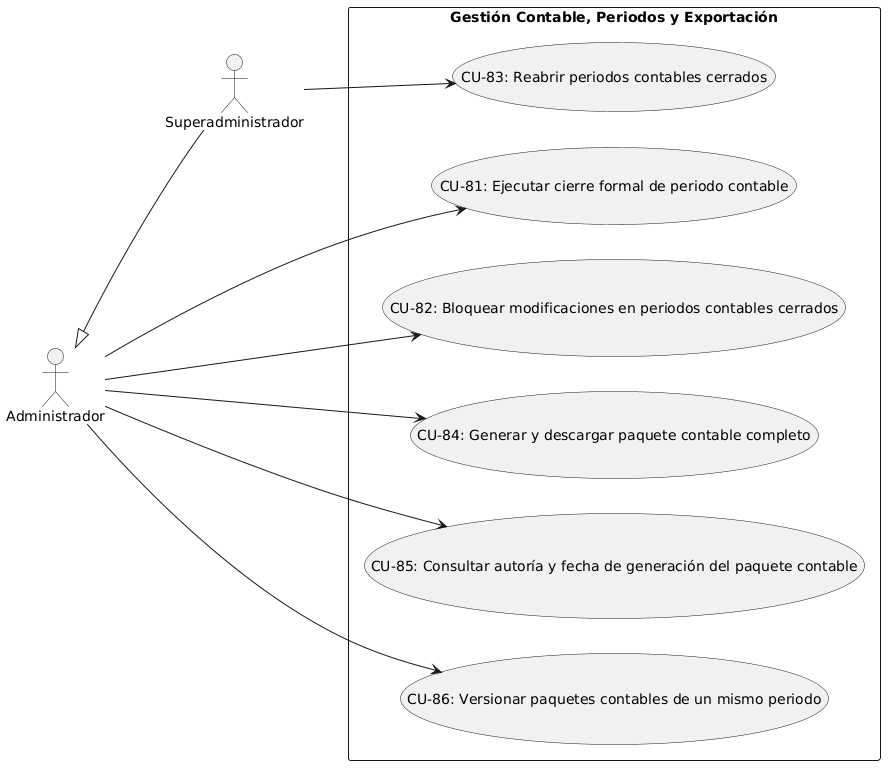
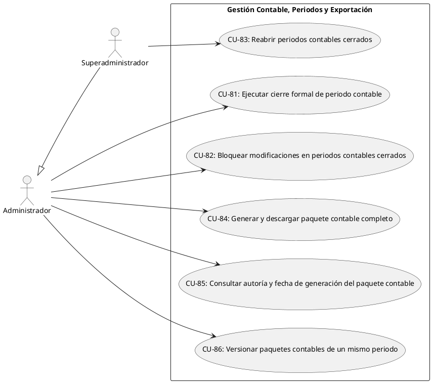
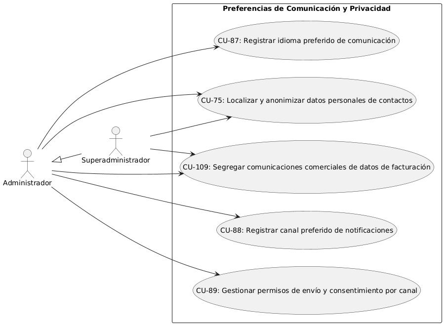
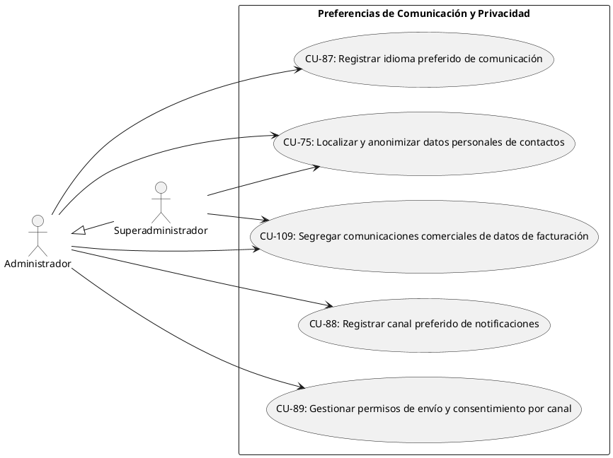
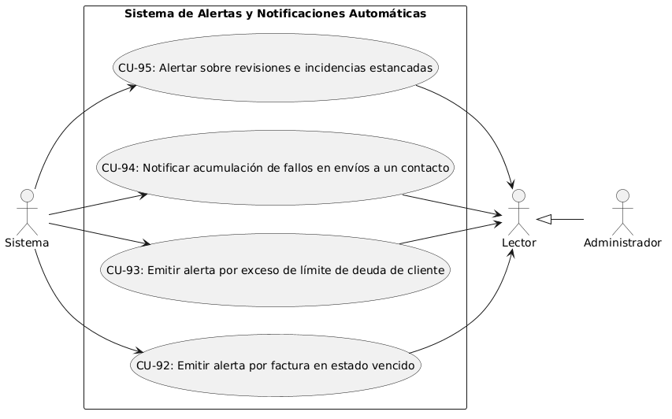
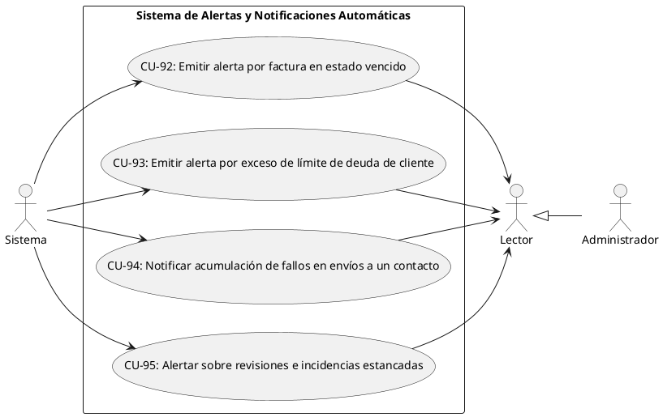
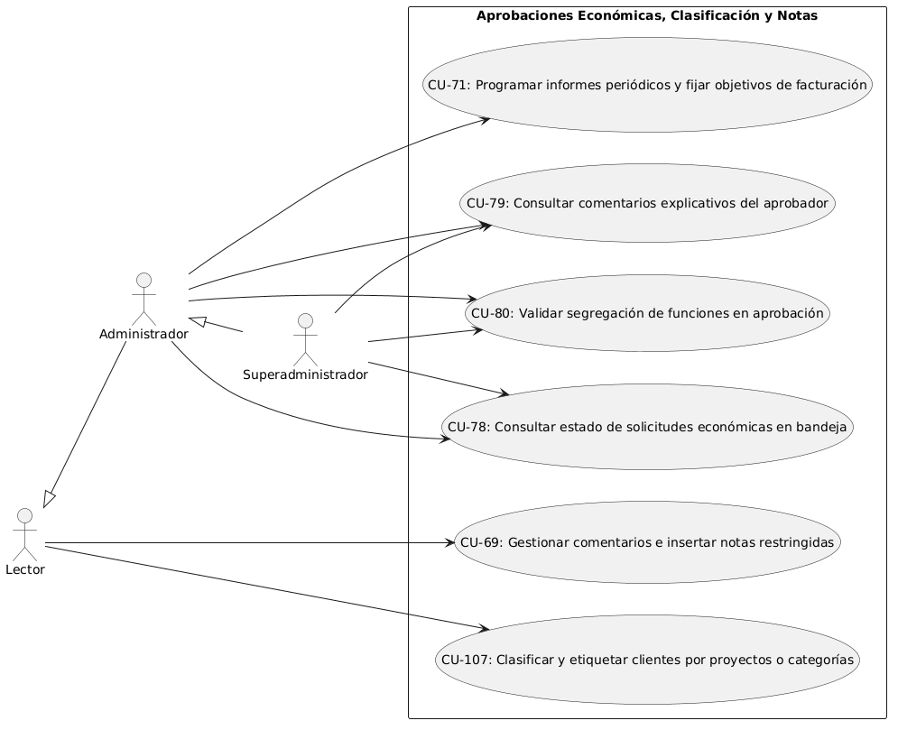
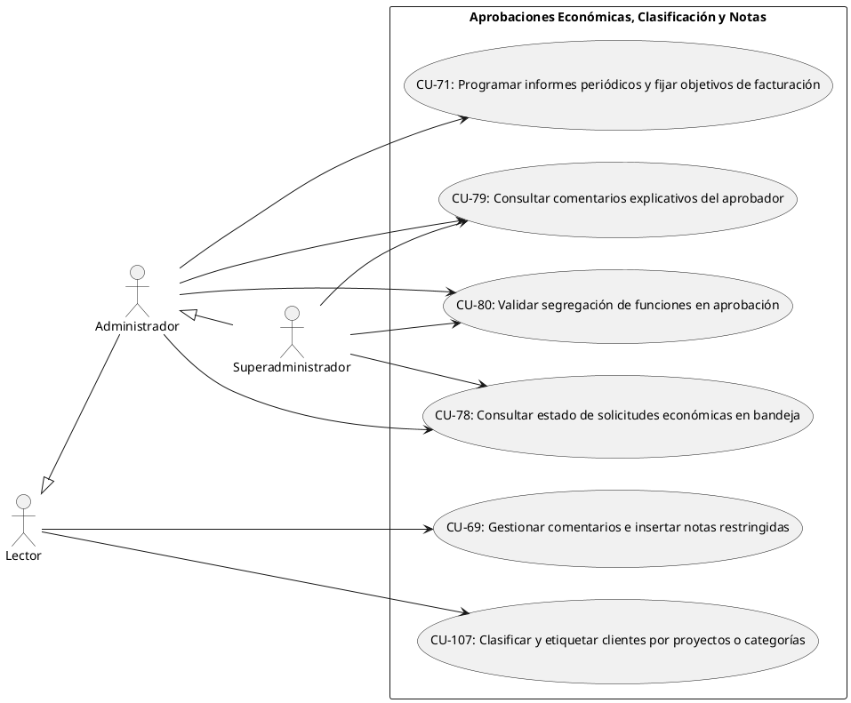
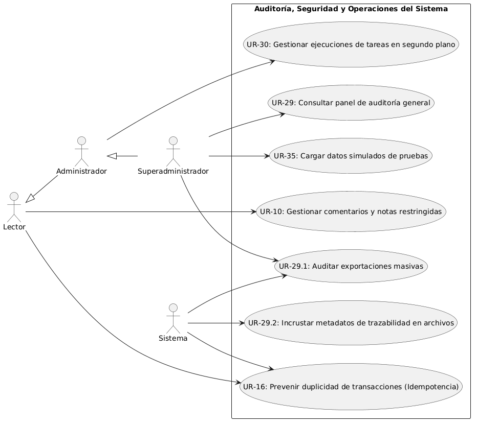
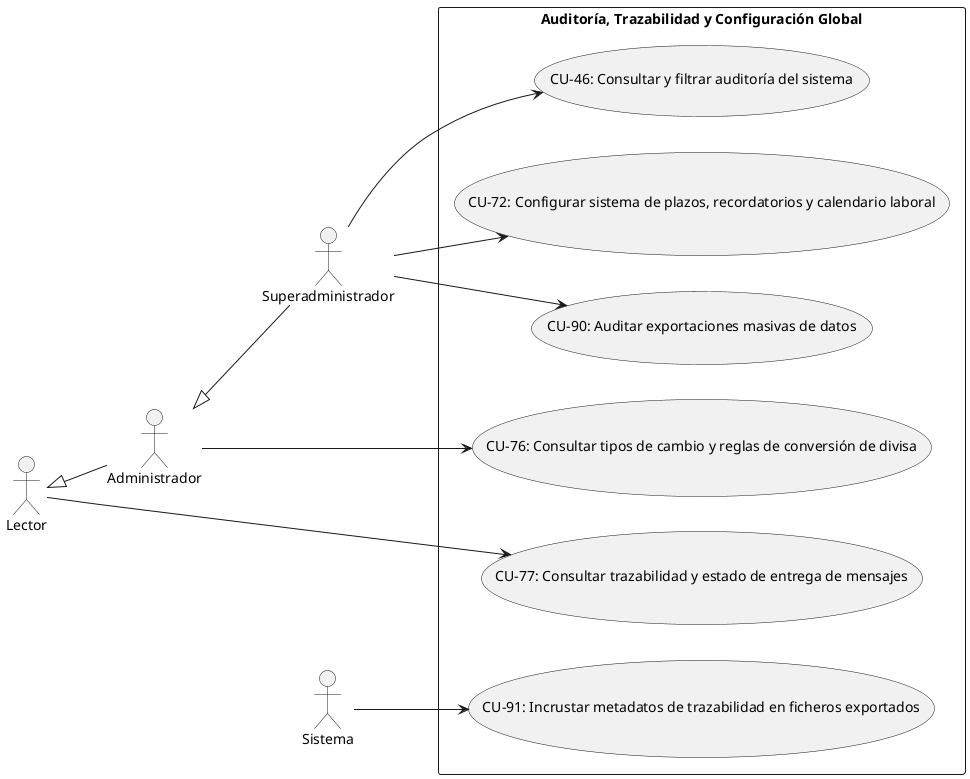

# Casos de Uso Actuales

| CU ID | Caso de Uso | Actores Principales | Requisito de Usuario (UR) | Requisito Funcional (FR) |
| --- | --- | --- | --- | --- |
| CU-46 | Consultar y filtrar auditoría del sistema | Superadministrador | UR-46 | FR-92 |
| CU-69 | Gestionar comentarios e insertar notas restringidas | Lector / Administrador | UR-69 | FR-194 |
| CU-71 | Programar informes periódicos y fijar objetivos de facturación y cobro | Administrador | UR-71 | FR-186 |
| CU-72 | Configurar sistema de plazos, recordatorios y calendario laboral | Superadministrador | UR-72 | FR-187 |
| CU-75 | Localizar y anonimizar datos personales de contactos | Administrador / Superadministrador | UR-75 | FR-207 |
| CU-76 | Consultar tipos de cambio y reglas de conversión de divisa | Administrador | UR-76 | FR-189 |
| CU-77 | Consultar trazabilidad y estado de entrega de mensajes | Lector / Administrador | UR-77 | FR-192 |
| CU-78 | Consultar estado de solicitudes económicas en bandeja de entrada | Administrador / Superadministrador | UR-78 | FR-167 |
| CU-79 | Consultar comentarios explicativos del aprobador | Administrador / Superadministrador | UR-79 | FR-168 |
| CU-80 | Validar segregación de funciones en aprobación de solicitudes | Administrador / Superadministrador | UR-80 | FR-169 |
| CU-81 | Ejecutar cierre formal de periodo contable | Administrador | UR-81 | FR-170 |
| CU-82 | Bloquear modificaciones en periodos contables cerrados | Administrador | UR-82 | FR-171 |
| CU-83 | Reabrir periodos contables cerrados | Superadministrador | UR-83 | FR-172 |
| CU-84 | Generar y descargar paquete contable completo | Administrador | UR-84 | FR-173 |
| CU-85 | Consultar autoría y fecha de generación del paquete contable | Administrador | UR-85 | FR-174 |
| CU-86 | Versionar paquetes contables de un mismo periodo | Administrador | UR-86 | FR-175 |
| CU-87 | Registrar idioma preferido de comunicación | Administrador | UR-87 | FR-176 |
| CU-88 | Registrar canal preferido de notificaciones | Administrador | UR-88 | FR-177 |
| CU-89 | Gestionar permisos de envío y consentimiento por canal | Administrador | UR-89 | FR-178 |
| CU-90 | Auditar exportaciones masivas de datos | Superadministrador | UR-90 | FR-179 |
| CU-91 | Incrustar metadatos de trazabilidad en ficheros exportados | Superadministrador / Sistema | UR-91 | FR-180 |
| CU-92 | Emitir alerta por factura en estado vencido | Lector / Administrador / Sistema | UR-92 | FR-181 |
| CU-93 | Emitir alerta por exceso de límite de deuda de cliente | Lector / Administrador / Sistema | UR-93 | FR-182 |
| CU-94 | Notificar acumulación de fallos en envíos a un contacto | Lector / Administrador / Sistema | UR-94 | FR-183 |
| CU-95 | Alertar sobre revisiones e incidencias estancadas | Lector / Administrador / Sistema | UR-95 | FR-184 |
| CU-107 | Clasificar y etiquetar clientes por proyectos o categorías | Lector / Administrador | UR-107 | FR-185 |
| CU-109 | Segregar comunicaciones comerciales de datos de facturación | Administrador / Superadministrador | UR-109 | FR-193 |

---

## Diagrama 1: Gestión Contable, Periodos y Exportación
- **Foco:** Cierre y reapertura de periodos contables, empaquetado de datos para gestoría, versión y control de modificaciones.
- **Actores:** Administrador, Superadministrador.
- **Casos de Uso incluidos (6):** CU-81, CU-82, CU-83, CU-84, CU-85, CU-86.

---

## Diagrama 2: Preferencias de Comunicación y Privacidad
- **Foco:** Configuración de idiomas/canales de contacto, gestión de consentimientos RGPD, anonimización y segregación comercial.
- **Actores:** Administrador, Superadministrador.
- **Casos de Uso incluidos (5):** CU-75, CU-87, CU-88, CU-89, CU-109.

---

## Diagrama 3: Sistema de Alertas y Notificaciones Automáticas
- **Foco:** Monitoreo y disparo de alertas automáticas por facturas vencidas, exceso de deuda, fallos de comunicación e incidencias pendientes.
- **Actores:** Lector, Administrador, Sistema.
- **Casos de Uso incluidos (4):** CU-92, CU-93, CU-94, CU-95.

---

## Diagrama 4: Aprobaciones Económicas, Clasificación y Notas
- **Foco:** Bandeja de solicitudes económicas, segregación de funciones de aprobación, categorización de clientes e inserción de notas restringidas.
- **Actores:** Lector, Administrador, Superadministrador.
- **Casos de Uso incluidos (6):** CU-69, CU-71, CU-78, CU-79, CU-80, CU-107.

---

## Diagrama 5: Auditoría, Trazabilidad y Configuración Global
- **Foco:** Auditoría inmutable de acciones y exportaciones masivas, incrustación de metadatos, trazabilidad de envíos, cambio de divisas y reglas del sistema.
- **Actores:** Lector, Administrador, Superadministrador, Sistema.
- **Casos de Uso incluidos (6):** CU-46, CU-72, CU-76, CU-77, CU-90, CU-91.

