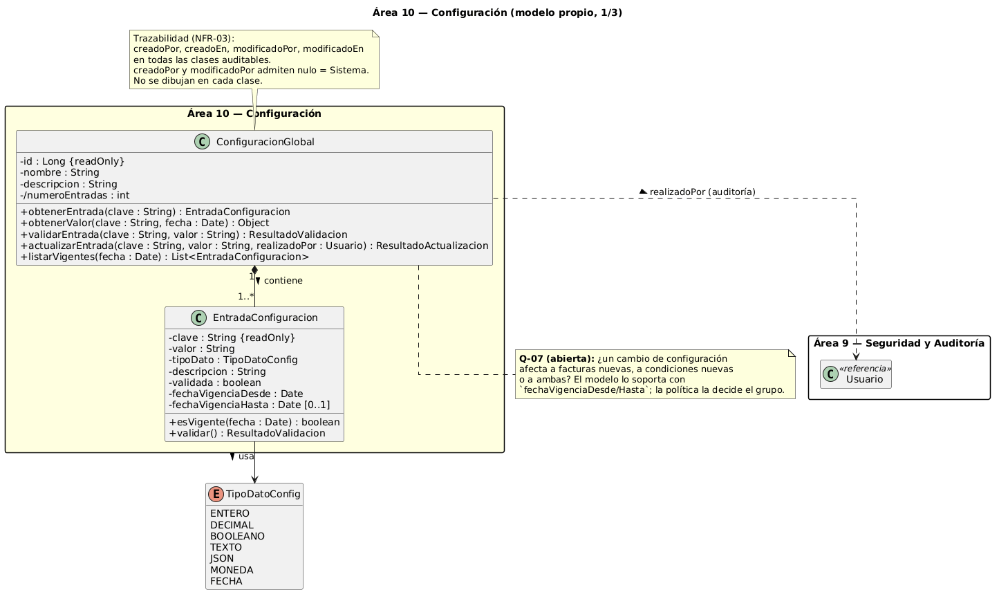
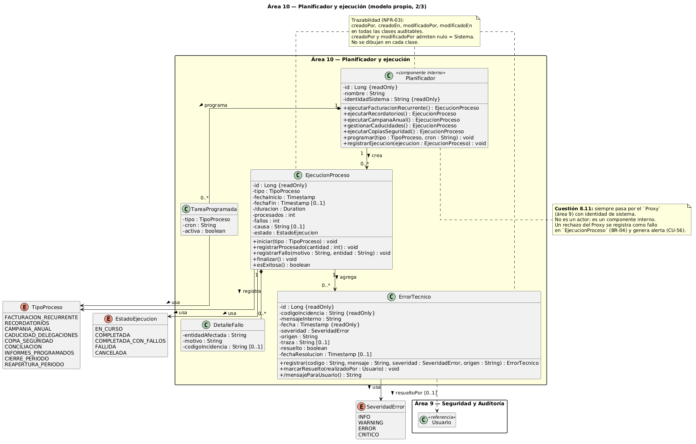
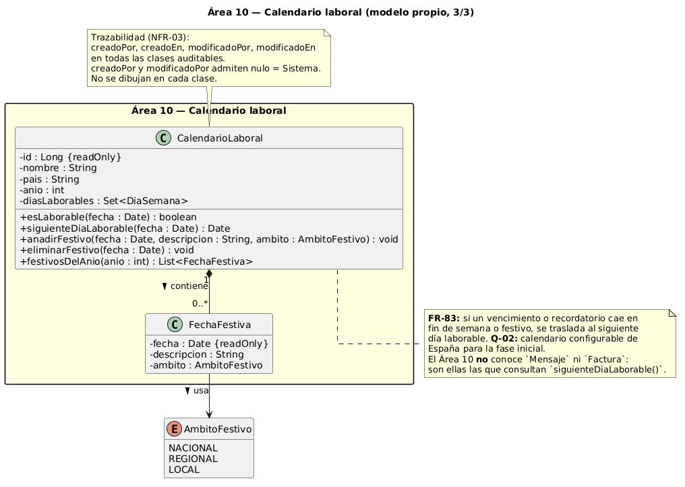
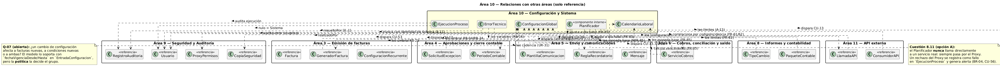
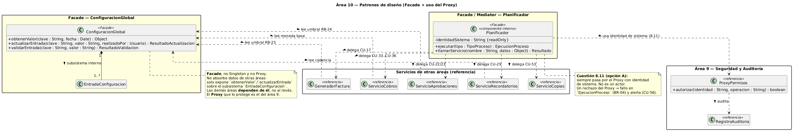
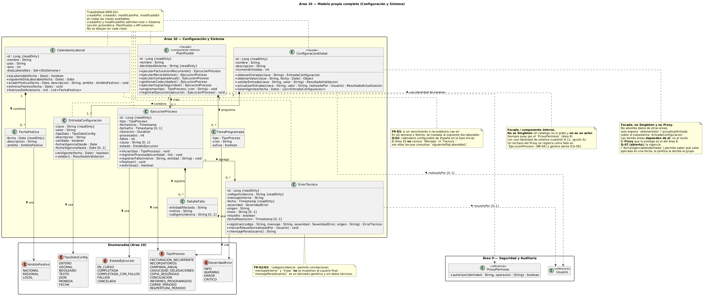

### NOTAS

- No se puede usar singleton porque la clase Configuración no es un objeto sino que será traducido como una tabla en una base de datos.
- NO es Proxy (en el sentido estricto) sustituto de otro objeto que controla el acceso a él (añade lazy loading, control de permisos, logging, etc.)
ConfiguracionGlobal no sustituye a nada: es la fuente de verdad. El Proxy del catálogo es otro (el ProxyPermisos del área 9)
Proxy del área 9 protege el acceso a ConfiguracionGlobal"
ConfiguracionGlobal es lo protegido, no el protector.
- Facade no significa "meter dentro de mi clase los datos de las demás". Significa ofrecer una interfaz simplificada a un conjunto de subsistemas, sin absorberlos.
- Facade aquí = una puerta única y sencilla (obtenerValor, actualizarEntrada) delante de un subsistema (EntradaConfiguracion + persistencia + validación + auditoría). Las otras áreas no ven ese subsistema; solo ven la puerta. No metes sus datos dentro de tu clase.

PLANIFICADOR
- El Planificador llama a los servicios a través del ProxyPermisos con una identidad de sistema que tiene su propio conjunto de permisos (mínimo privilegio).
- La identidad de sistema no es un valor del enumerado Rol Solo la usa el Planificador, desde dentro. Nunca puede llegar por la interfaz ni por la API externa
Se audita igual: sus acciones quedan en RegistroAuditoria como «Sistema» (usuario nulo).
- Un rechazo del Proxy a una tarea del Planificador no puede pasar en silencio: se registra como fallo en EjecucionProceso y genera alerta (BR-04, CU-56).

COSAS CONFIG
con fechaVigenciaDesde / fechaVigenciaHasta en EntradaConfiguracion, y con obtenerValor(clave, fecha) en ConfiguracionGlobal. Eso permite que quien consulte sepa qué valor aplicaba en la fecha de emisión
 La **identidad de sistema no es un `Usuario` ni un valor de `Rol`**:
  es una identidad técnica que solo conoce el ProxyPermisos (área 9).

PENDIENTE
ConfiguracionGlobal: politicasAutomatizacion. Queda pendiente de definir qué contiene exactamente.

### Diagrama 1

### Diagrama 2

### Diagrama 3

--- 
### De Apoyo

