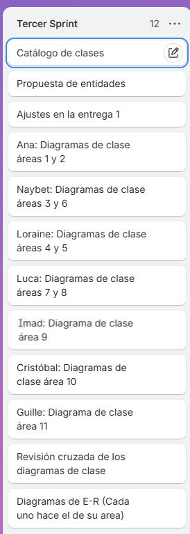
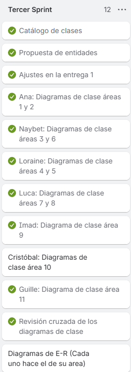
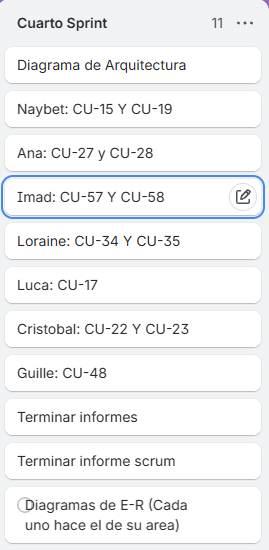
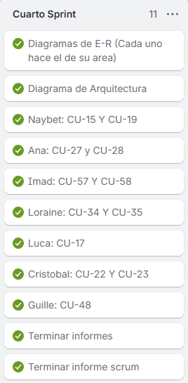

# Informe Scrum · Entrega 2

## Identificación del equipo

| Nombre y apellidos | Rol en esta entrega |
|---|---|
| Abdelnaybet Aomar Hamed | Scrum Master |
| Imad El Founti Chaib | Miembro del equipo |
| Luca Fernández Cordeiro | Miembro del equipo |
| Ana Guerrero Martín | Miembro del equipo |
| Guillermo Herrera Lozano | Miembro del equipo |
| Loraine Meijer Arboleda | Miembro del equipo |
| Cristóbal Jesús Subires Macías | Miembro del equipo |

## Organización del trabajo

La Entrega 2 se ha trabajado en dos sprints, el tercero y el cuarto del proyecto:

- **Sprint 3: diagrama de clases.** Cada miembro diseña las clases de las áreas funcionales que le corresponden. El reparto es el de las 11 áreas de los diagramas de casos de uso de la Entrega 1.
- **Sprint 4: el resto del diseño.** Modelo de datos (E-R y script.sql), diagramas de secuencia y de arquitectura, redacción y corrección de los informes.

Para que las áreas encajen entre sí, se preparó un **catálogo interno de clases** con los nombres, enumerados y relaciones compartidas, y una **propuesta de entidades**. Sobre esa base se fijaron unas **convenciones comunes**: un servicio por área como punto de entrada, lógica entre áreas en un solo sentido, avisos entre áreas como eventos, clases de otras áreas marcadas con `<<referencia área N>>` y DTO para los datos que cruzan áreas.

Herramientas utilizadas: repositorio Git con la estructura de la plantilla del profesor, tablero Trello, PlantUML y VS Code para el diseño de todos los diagramas, PostgreSQL para probar el script del modelo ER, además de Discord y WhatsApp para las dudas del día a día.

## Reuniones del periodo

| Fecha | Inicio | Duración | Participantes | Temas y acuerdos |
|---|---|---|---|---|
| 27/10 | 10:45 | 105 minutos | Todo el grupo | Planificación del sprint 3: reparto de áreas, catálogo de clases y propuesta de entidades y convenciones comunes |
| 11/11 | 10:45 | 105 minutos | Todo el grupo | Revisión cruzada de los diagramas de clase; dependencias entre áreas en un solo sentido; planificación del sprint 4 (E-R, secuencias, arquitectura) |
| 24/11 | 10:45 | 105 minutos | Todos; Imad y Guillermo, en remoto |Revisión de coherencia de todos los diagramas subidos al repositorio, limpieza de erratas y pequeño debate sobre la presentación del día 1/12  |

## Estado del product backlog y Sprint backlog

**Tablero:** https://trello.com/b/kKiiBTri/proyecto-ayda-bebes

### Sprint 3: diagrama de clases

- **Fechas:** del 27/10 al 11/11.
- **Objetivo:** Preparar el diagrama de clases de las 11 áreas, asegurándonos de que fueran coherentes entre ellas, además de aplicar las correcciones pendientes de la Entrega 1.
- **Completado:**
  - catálogo de clases;
  - propuesta de entidades;
  - ajustes de la Entrega 1;
  - diagramas de clase de las áreas 1 a 9 y 11;
  - revisión cruzada de los diagramas de clase.
- **Pasa al sprint 4:**
  - diagramas de clase del área 10;
  - diagramas E-R.

### Sprint 4: datos, secuencias, arquitectura e informes

- **Fechas:** del 11/11 al 27/11.
- **Objetivo:** el modelo físico de datos, los diagramas de secuencia de los casos de uso del núcleo, la arquitectura y los informes de la entrega.
- **Completado**:
  - diagramas de arquitectura;
  - diagramas de clase del área 10;
  - secuencias de CU-15, CU-17, CU-19, CU-22/23, CU-27/28 y CU-48, y de la tarea diaria del planificador;
  - E-R y script de las 11 áreas (64 tablas), construido y probado área por área sobre PostgreSQL.
- **En curso:**
  - el resto de secuencias (CU-34/35 y CU-57/58);
  - informe y este informe Scrum.

## Información de tareas

| Tarea | Responsable | Milestone | Prioridad | Etiqueta | Descripción / estado |
|---|---|---|---|---|---|
| Catálogo de clases y propuesta de entidades | Abdelnaybet | Entrega 2 | Alta | clases | Nombres, enumerados y relaciones comunes a todas las áreas. Completado |
| Ajustes de la Entrega 1 | Abdelnaybet | Entrega 2 | Muy Alta | entrega 1 | Cambios recogidos en `cambios_entrega1.md`. Completado |
| Diagramas de clase, áreas 1 y 2 | Ana | Entrega 2 | Muy Alta | clases | Completado |
| Diagramas de clase, áreas 3 y 6 | Abdelnaybet | Entrega 2 | Muy Alta | clases | Completado |
| Diagramas de clase, áreas 4 y 5 | Loraine | Entrega 2 | Muy Alta | clases | Completado |
| Diagramas de clase, áreas 7 y 8 | Luca | Entrega 2 | Muy Alta | clases | Completado |
| Diagramas de clase, área 9 | Imad | Entrega 2 | Muy Alta | clases | Completado |
| Diagramas de clase, área 10 | Cristóbal | Entrega 2 | Muy Alta | clases | Completado |
| Diagrama de clase, área 11 | Guille | Entrega 2 | Muy Alta | clases | Completado |
| Revisión cruzada de los diagramas de clase | Todos | Entrega 2 | Alta | revisión | Completado |
| Diagramas E-R (cada uno el de su área) | Todos | Entrega 2 | Muy Alta | datos | Completado; script de las 11 áreas probado sobre PostgreSQL. |
| Diagramas de arquitectura | Abdelnaybet | Entrega 2 | Muy Alta | arquitectura | Completado |
| Secuencias CU-15 y CU-19 | Abdelnaybet | Entrega 2 | Alta | secuencias | Completado |
| Secuencias CU-27 y CU-28 | Ana | Entrega 2 | Alta | secuencias | Completado |
| Secuencias CU-57 y CU-58 | Imad | Entrega 2 | Alta | secuencias | En curso |
| Secuencias CU-34 y CU-35 | Loraine | Entrega 2 | Alta | secuencias | En curso |
| Secuencia CU-17 | Luca | Entrega 2 | Alta | secuencias | Completado |
| Secuencias CU-22 y CU-23 | Cristóbal | Entrega 2 | Alta | secuencias | Completado |
| Secuencia CU-48 | Guille | Entrega 2 | Alta | secuencias | Completado |
| Terminar informes | Abdelnaybet | Entrega 2 | Alta | informe | En curso |
| Terminar informe Scrum | Abdelnaybet | Entrega 2 | Alta | informe | En curso |

## Problemas y riesgos

| Sprint | Problema/riesgo | Impacto | Medida aplicada | Estado |
|---|---|---|---|---|
| 3 | Cada área usaba nombres distintos para lo mismo (servicios, DTO, firmas de operaciones) | Diagramas que no encajan entre sí | Catálogo común de clases y revisión de coherencia entre áreas | Resuelto |
| 3 | Dependencias en los dos sentidos entre áreas (1↔2, 2↔3) | Ciclos: un cambio en un área obliga a tocar otra | Regla de lógica en un solo sentido, eventos entre áreas y datos derivados (estado del cliente, rango vigente) | Resuelto |
| 3 | El nombre del rol «Lector» volvía a causar confusión, como en la revisión de la Entrega 1 | Malentendidos sobre los permisos | Se renombra a «Usuario operativo» (`OPERATIVO`) en todos los documentos | Resuelto |
| 4 | Los E-R llegaron con formatos distintos (algunos conceptuales, otros físicos) | Modelo de datos incoherente | Convenciones comunes de traducción y un único script probado sobre PostgreSQL | Resuelto |
| 4 | Revisiones hechas sobre copias antiguas del repositorio | Correcciones repetidas sobre cosas ya resueltas | Subir los cambios al repositorio con más frecuencia y descargar la última versión antes de revisar | Resuelto |
| 4 | Área 10 pendiente de su versión nueva | El planificador debe recoger las tareas programadas de las áreas 2, 3, 6 y 9 | Lista de tareas programadas enviada a Cristóbal; versión nueva del área 10 integrada | Resuelto |
| 4 | Varias secuencias se hicieron siguiendo solo el flujo del caso de uso, sin las clases del diseño | Secuencias que no se corresponden con el diagrama de clases | Revisar cada secuencia contra los diagramas de clase y adaptarla a sus clases y operaciones | En curso |

## Revisión y retrospectiva

 **Logros**
- Hemos conseguido hacer un diagrama de clases con 11 áreas que encajan entre sí y no generan ciclos de dependencia.
- El modelo físico de datos cuenta con 64 tablas y se puede crear completo en PostgreSQL.
- También hemos definido una arquitectura por capas con un único punto desde el que se controlan los permisos.

**Aspectos positivos**
- Tener desde el principio un catálogo común y unas convenciones claras nos ayudó a evitar muchos de los problemas de coherencia que tuvimos en la Entrega 1. Esto era precisamente una de las mejoras que nos habíamos propuesto en la retrospectiva anterior.
- La revisión entre compañeros fue útil para detectar a tiempo algunos descuadres entre las distintas áreas y poder corregirlos antes de avanzar más.

**Mejoras**
- Deberíamos subir los cambios al repositorio con más frecuencia. Así todos podremos trabajar siempre sobre la versión más reciente y revisar los cambios de los demás.
- También creemos que habría sido mejor pasar antes del diagrama de clases al modelo E-R, ya que al construir el modelo de datos aparecieron algunos detalles que no estaban del todo claros en las clases.
- El script se fue construyendo y probando poco a poco, área por área. Durante este proceso aparecieron algunos errores, como restricciones con el mismo nombre, comprobaciones que estaban incompletas o detalles que faltaban en algunas clases. Estos problemas se fueron corrigiendo durante el propio sprint.
- Al repartir una tarea, explicar cómo se relaciona con lo ya hecho. Por ejemplo, que los diagramas de secuencia usan las clases y operaciones del diagrama de clases, y no solo el flujo del caso de uso.

**Acciones siguientes**
- Empezar a preparar la Entrega 3, donde se formalizarán los patrones que vamos a utilizar, entre ellos el patrón Observer para gestionar los eventos entre las diferentes áreas.
- Confirmar con el cliente qué hacer con el importe sobrante de un abono mayor que lo facturado o de un cobro excesivo (Q-12); el diseño asume por ahora que queda como saldo a favor del cliente.