# Entrega 2 · Diseño del sistema

**Asignatura:** Análisis y Diseño de Aplicaciones · Grupo A · 2026–27  
**Equipo:** Bebés 

| Nombre y apellidos |
|---|
| Abdelnaybet Aomar Hamed |
| Imad El Founti Chaib | 
| Luca Fernández Cordeiro | 
| Ana Guerrero Martín | 
| Guillermo Herrera Lozano |
| Loraine Meijer Arboleda |
| Cristóbal Jesús Subires Macías | 

**Fecha:** 27/11/2026

**Repositorio:** https://github.com/naybetaomar/AyDA-ProyectoBebes.git

# 1. Introducción y alcance

Turbine necesita una herramienta interna para gestionar la administración, la facturación y los cobros, independiente de su producto principal, Brain. El sistema debe permitir gestionar miles de clientes, suscripciones, facturas recurrentes y puntuales, cobros, recordatorios y distintos flujos operativos. Además, debe garantizar la trazabilidad de las operaciones y la inmutabilidad de los documentos emitidos, sin llegar a la complejidad propia de un ERP.

Los requisitos y los 59 casos de uso se encuentran en la Entrega 1, actualizada en un PDF independiente.

En este informe se presenta el diseño del sistema propuesto, incluyendo los siguientes apartados:

- **Modelo físico de datos:** se incluye un diagrama E-R para cada área y un script SQL encargado de crear todas las tablas y sus restricciones. El script se ha construido y probado área por área sobre PostgreSQL 16, tanto con inserciones válidas como con casos que las restricciones deben rechazar.

- **Diagrama de clases:** se organiza según las 11 áreas funcionales definidas en la Entrega 1. Para cada área se muestran sus principales clases, los servicios que intervienen, los patrones utilizados y las relaciones existentes con el resto de áreas.

- **Diagramas de secuencia:** se representan distintos escenarios correspondientes a los casos de uso del núcleo de la primera versión, definidos en el apartado 1.4 de los requisitos. Se han seleccionado aquellos que permiten mostrar el funcionamiento de las principales piezas de la arquitectura.

- **Arquitectura:** se presentan tres vistas del sistema: la lógica en capas, el detalle de los servicios y el despliegue.

Las 11 áreas funcionales son las siguientes:

| Área | Nombre | Responsable |
|---|---|---|
| 1 | Clientes y contactos | Ana Guerrero |
| 2 | Relación comercial y suscripciones | Ana Guerrero |
| 3 | Emisión de facturas | Abdelnaybet Aomar |
| 4 | Aprobaciones y cierre contable | Loraine Meijer |
| 5 | Envío y comunicaciones | Loraine Meijer |
| 6 | Cobros, conciliación y saldo | Abdelnaybet Aomar |
| 7 | Notificaciones y colaboración | Luca Fernández |
| 8 | Informes y contabilidad | Luca Fernández |
| 9 | Usuarios, seguridad y auditoría | Imad El Founti |
| 10 | Configuración y sistema | Cristóbal Subires |
| 11 | API externa | Guillermo Herrera |

**Ideas que recorren todo el diseño**

- **Un servicio por área** como punto de entrada. De esta forma, ninguna área accede directamente a las clases internas de otra.

- **La lógica va en un solo sentido** entre las áreas, evitando ciclos de dependencia. Cuando un área necesita reaccionar a algo que ocurre en otra, lo hacemos mediante **eventos**, como «abono emitido», «solicitud creada», «solicitud resuelta», «estado de cobro cambiado», «impago sobre el límite» o «fallos de envío».

- **Un proxy de permisos** (área 9) se coloca delante de todos los servicios. Se encarga de comprobar el rol y la cartera del usuario y, además, registra la acción en la auditoría.

- **Lo que se puede calcular no se guarda.** Por ejemplo, el estado del cliente, el rango de tarifa vigente y el saldo pendiente se obtienen cuando hacen falta. Así evitamos tener datos duplicados o contradictorios y no necesitamos tareas diarias para mantenerlos actualizados. Hay dos excepciones a propósito: el estado de cobro se guarda, porque cada cambio deja historial y avisa a otras áreas, y las pausas se guardan en las áreas 2 y 3 para que la dependencia vaya en un solo sentido.

# 2. Actualizaciones de la Entrega 1

Resumen de lo que más afecta al diseño:

- **Primera versión del sistema** (apartado 1.4 nuevo): los casos de uso se clasifican en núcleo, complementario y opcional. Los escenarios de secuencia salen sobre todo del núcleo.
- **Rol «Lector» → «Usuario operativo»**, el término del cliente. En el enumerado `Rol` es `OPERATIVO`.
- **Numeración y estado de cobro:** el número de factura y el estado de cobro existen solo desde la emisión (RB-01, A-23).
- **Abonos** (A-27) y **cobros que superan el saldo** (A-28): cómo afectan al cobro de la factura original.
- **Cambio de rol de un usuario** (A-26, FR-110, RB-38, RB-39).
- **Transición «pendiente → vencida»:** la ejecuta una tarea diaria del planificador.
- **Feedback de la Entrega 1:** cartera asignada del Usuario operativo, comentario obligatorio al rechazar una propuesta con aviso al solicitante, reenvío de solicitudes rechazadas y excepción de prorrateo sin factura.

## Detalle de los cambios

Cambios en los documentos de la Entrega 1 (requisitos y casos de uso) hechos durante la Entrega 2, y su consecuencia en el diseño. Las fuentes actualizadas están en `entrega1-actualizada/fuentes/`.

Todos los cambios están aplicados a las fuentes de la Entrega 1 y al diseño. Los que salen del feedback de la Entrega 1 se aplicaron el 26/11. Las cuestiones que siguen abiertas están al final.

Los identificadores de la Entrega 1 no cambian: los elementos nuevos reciben el siguiente número libre (A-27, FR-110…).

### Cambios

| Elemento | Cambio | Motivo | Impacto en Entrega 2 | Estado |
|---|---|---|---|---|
| Requisitos, apartado 1.4 (nuevo) y 1.2 | Nuevo apartado «Primera versión del sistema»: los 59 casos de uso se clasifican en **núcleo** (27), **complementario** (29) y **opcional** (3). En 1.2 se remite a él | Feedback de la Entrega 1: faltaba indicar qué requisitos simplificar o dejar como secundarios (producto mínimo viable) | Orden de trabajo y alcance de la demo. Los escenarios de secuencia se eligen sobre todo del núcleo (CU-15, CU-17, CU-22/23, CU-27/28, CU-34/35, CU-48) | Aplicado. Queda por decidir si CU-12 o CU-53 suben al núcleo |
| A-13 y A-14 | Se cambia «primer despliegue» por «primera versión (apartado 1.4)». A-13 indica qué casos de uso forman el nivel opcional (CU-08, CU-20, CU-44) | Coherencia con el nuevo apartado 1.4 | Las clases de los casos opcionales (`Etiqueta`, `Presupuesto`, `InformeProgramado`) se modelan, pero quedan fuera de la primera versión | Aplicado |
| RB-01 | El número de factura único se asigna solo cuando la factura se emite | Un borrador necesita identificarse antes de tener número legal, y el número es correlativo por serie | Clases: `Factura.id` siempre y `numeroFactura [0..1]`. E-R: `numero_factura` admite nulos y `UNIQUE (serie_facturacion_id, numero_factura)`. Secuencia CU-15: el número se asigna en `emitir()` | Aplicado |
| A-23 | El estado de cobro existe solo desde que la factura se emite | Coherencia con RB-01 y con los tres estados independientes de la factura | Clases: `estadoCobro [0..1]`. E-R: `CHECK` que obliga a que sea nulo en un borrador | Aplicado |
| A-26, FR-110, RB-38, RB-39, nota en UR-40 y CU-49 (FA-1, FE-2, FE-3) | Se permite cambiar el rol de un usuario sin dar de baja su cuenta. Nadie cambia su propio rol, un Administrador no gestiona Superadministradores y siempre queda al menos un Superadministrador activo | Hueco detectado al diseñar el área 9: ningún caso de uso permitía cambiar el rol de un usuario existente | Clases: `Usuario.rol` es un enumerado (sin herencia por rol) y `Usuario.cambiarRol()`. E-R: `usuario.rol` con `CHECK`. Los permisos los aplica el proxy del área 9 | Aplicado. Queda abierta Q-13 |
| A-27 | Un abono (rectificativa con total negativo) no tiene estado de cobro: compensa el saldo de la factura original y, si lo deja a 0, la original pasa a «pagada». Queda fuera la rectificación por sustitución | La E1 no decía cómo afecta una rectificativa al cobro (RB-14). Se sigue el RD 1619/2012, art. 15 | Clases: `FacturaRectificativa.esAbono()` y evento «abono emitido» (área 3 → área 6). E-R: `estado_cobro` nulo en los abonos. El saldo pendiente se calcula, no se guarda | Aplicado |
| A-28 y Q-12 | El importe cobrado que supera el saldo no se aplica a la factura: queda sin aplicar en el movimiento de cobro, se revisa en la bandeja de conciliación (CU-35) y la factura se marca con cobro excesivo | Q-12 estaba abierta y el diseño necesitaba saber dónde queda el sobrante | Clases: `MovimientoCobro` con `/importeSinAplicar`, `enRevision` y `motivoRevision`, y `Factura.cobroExcesivo`. E-R: lo cobrado nunca supera el saldo (regla de aplicación) | Aplicado. Queda abierta Q-12 |
| A-27 (ampliación) y glosario: «cobro excesivo» (dos definiciones) | A-27 cubre el abono que supera el saldo pendiente: la original pasa a «pagada», la diferencia queda a favor del cliente y se marca el cobro excesivo. «Cobro excesivo» pasa de «el cobro conciliado supera el total» a «el cobro recibido supera el saldo pendiente (total menos abonos y bajas)» | Al diseñar la secuencia de CU-19: lo habitual es rectificar una factura ya cobrada, y A-27 solo decía qué pasa si el saldo queda a 0. Con un abono, el total no cambia pero el saldo sí | Secuencia CU-19: rama del saldo negativo con `marcarCobroExcesivo()`. Nota de `FacturaRectificativa` (área 3) | Aplicado. Queda abierta Q-12 |
| Rol «Lector» en todos los documentos | Pasa a llamarse **Usuario operativo**, el término del cliente. Requisitos (sección 1.3), casos de uso, matriz de permisos y diagramas de casos de uso | «Lector» sugería un perfil de solo lectura y obligaba a aclarar que puede modificar, crear borradores y proponer descuentos. Generó confusión en la revisión de la Entrega 1 | Enumerado `Rol`: `OPERATIVO` en lugar de `LECTOR` (áreas 7 y 9). Actores de las secuencias y de la arquitectura | Aplicado |
| Tabla de transiciones del estado de cobro: «Pendiente → Vencida» (Sistema) | Sin cambio de texto. Se precisa cómo se cumple: una tarea diaria marca como vencidas las facturas sin ningún cobro cuyo vencimiento ha pasado | La E1 define la transición, pero nada la ejecutaba | Clases: `ServicioCobros.actualizarVencimientos()`, distinto de `estaVencida()` (saldo pendiente con fecha pasada). Planificador: nueva tarea diaria (`ACTUALIZACION_VENCIMIENTOS`, área 10) | Aplicado |
| Casos de uso, introducción | Nota común «cartera asignada»: un Usuario operativo solo opera sobre los clientes que tiene asignados, directamente o por delegación (RB-15, FR-39). Administrador y Superadministrador acceden a todos | Feedback: no quedaba claro cómo se garantiza que un Usuario operativo solo gestione su cartera | El proxy de permisos (área 9) comprueba la cartera antes de llamar al servicio. Clases: `AsignacionCliente` | Aplicado |
| CU-16 y CU-22 | Nueva precondición PRE-2 (cliente en la cartera del Usuario operativo) y nuevo flujo de excepción por cliente no asignado (FE-2 en CU-16, FE-1 en CU-22) | Mismo motivo | Variante de denegación en los diagramas de secuencia que pasan por el proxy | Aplicado |
| CU-23 | El comentario es obligatorio al rechazar. Nuevo FA-2: al rechazarse, la factura vuelve a borrador conservando lo propuesto y se notifica al solicitante con el motivo (CU-37). Se reescribe POST-2 | Feedback: no se decía qué pasa ni qué notificación recibe el usuario cuando se rechaza un descuento | Ya recogido en el diseño: `ServicioAprobaciones.rechazar(…, comentario)` y evento «solicitud resuelta» (área 4 → áreas 3, 6 y 7). Secuencia CU-22/23 | Aplicado |
| CU-24 | Nuevo FA-1: reenviar una solicitud rechazada después de corregirla (continúa en CU-22) | Completa el ciclo del rechazo | Sin cambios en las clases | Aplicado |
| CU-50 | Nota de permisos: asignar, reasignar y delegar es solo del Administrador | Feedback sobre la delimitación de roles | Lo aplica el proxy de permisos (área 9) | Aplicado. Queda abierta Q-10 |
| CU-22 (excepción de prorrateo) | La solicitud de excepción puede no ir sobre ninguna factura: se relaciona con una factura **o** con una configuración recurrente | La excepción de prorrateo de CU-22 se propone antes de que exista la factura | Clases: `SolicitudExcepcion → Factura` pasa de `1` a `0..1`, con una asociación nueva a `ConfiguracionRecurrente` y `ServicioAprobaciones.solicitarExcepcionProrrateo()`. E-R: `factura_id` admite nulos, `configuracion_recurrente_id` nueva y `CHECK` de «exactamente una» | Aplicado |

### Cuestiones abiertas

- **Q-12:** qué se hace con el importe sobrante de un abono mayor que lo facturado o de un cobro excesivo (devolución o saldo a favor). Depende del cliente; el diseño asume saldo a favor.
- **Q-13:** qué pasa con la cartera y las solicitudes pendientes de un usuario que cambia de rol.
- **Q-10:** delimitación de roles en la asignación y delegación de clientes (CU-50).
- **Primera versión (apartado 1.4):** si CU-12 (baja de cliente) o CU-53 (copias) suben al núcleo.

# 3. Modelo físico de datos (Entidad–Relación)

El script `diagramas/modelo_datos/script.sql` crea las 64 tablas con sus restricciones y disparadores. No se copia en el PDF; se cita como fuente.

## Alcance

Esta versión recoge el modelo de las **11 áreas**. Todas están en `script.sql`.

Fuentes: figuras 1 a 11 (apartado «Diagramas E-R») y el script `script.sql` del repositorio (PostgreSQL 16). Cada diagrama dibuja las tablas de su área y, en gris, las de otras áreas a las que apunta. Notación: entidad–relación física (patas de gallo) con tablas, PK, FK, tipos y cardinalidades; `*` indica NOT NULL.

Tablas del área 1: `cliente`, `contacto`, `consentimiento_canal`, `documento`, `etiqueta`, `cliente_etiqueta`, `categoria_factura` y `factura_categoria`.
Tablas del área 2: `relacion_comercial`, `pausa`, `rango_tarifa` y `revision_anual_plan`.
Tablas del área 3: `factura`, `linea_factura`, `historial_estado_factura`, `configuracion_recurrente`, `tramo_importe`, `periodo_pausa`, `serie_facturacion`, `entidad_emisora`, `impuesto` y `concepto_catalogo`.
Tablas del área 4: `solicitud_excepcion`, `periodo_contable` y `reapertura_periodo`.
Tablas del área 5: `plantilla_comunicacion`, `variable_plantilla`, `regla_recordatorio` y `mensaje`.
Tablas del área 6: `movimiento_cobro`, `conciliacion` y `baja_contable`.
Tablas del área 7: `notificacion`, `preferencia_notificacion`, `incidencia`, `comentario` y `tarea`.
Tablas del área 8: `objetivo_facturacion`, `paquete_contable`, `tipo_cambio`, `exportacion_masiva`, `informe_programado` y `destinatario_informe`.
Tablas del área 9: `usuario`, `sesion`, `token_recuperacion`, `asignacion_cliente`, `delegacion`, `registro_auditoria`, `descarga_fichero`, `copia_seguridad` y `restauracion_copia`.
Tablas del área 10: `configuracion_global`, `entrada_configuracion`, `tarea_programada`, `ejecucion_proceso`, `detalle_fallo`, `error_tecnico`, `calendario_laboral`, `dia_laborable_calendario` y `fecha_festiva`.
Tablas del área 11: `consumidor_api`, `llamada_api` y `solicitud_externa`.

Las tablas van en el script en orden de dependencia: las de las áreas 1 y 4 que apuntan a `factura` (`documento`, `factura_categoria`, `solicitud_excepcion`) van después del área 3.

## Diagramas E-R

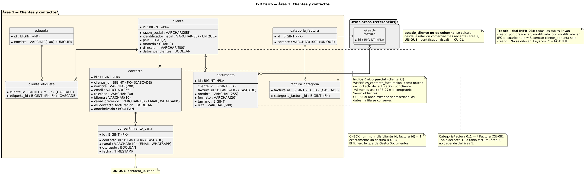

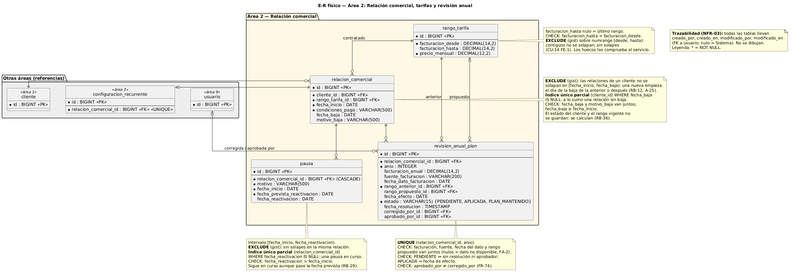

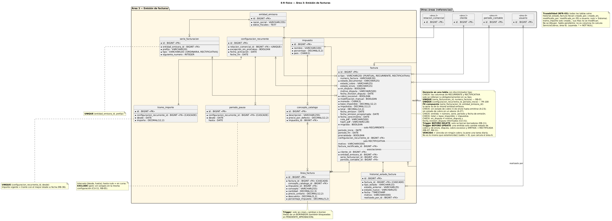

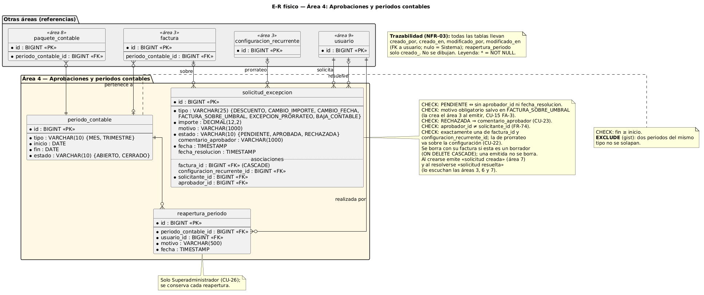

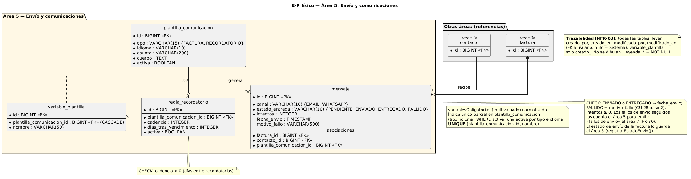

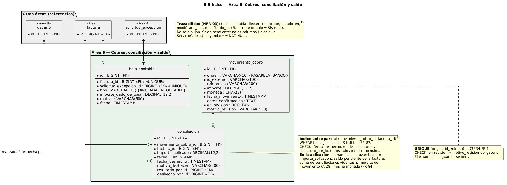

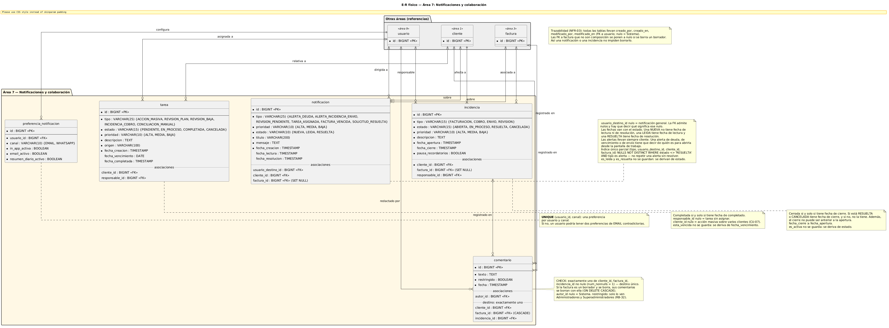

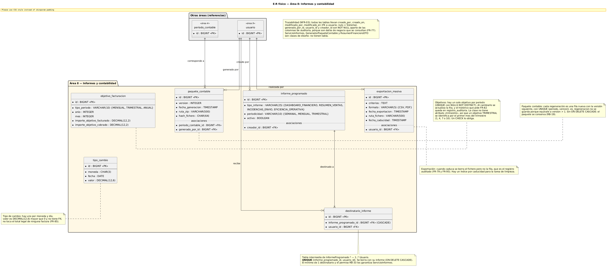

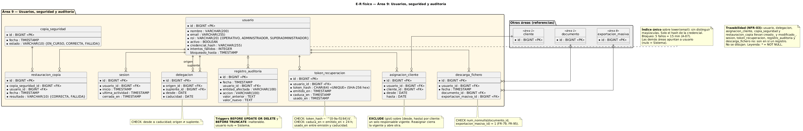

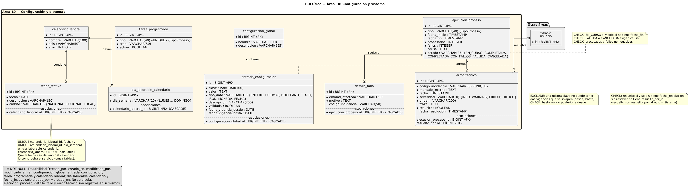

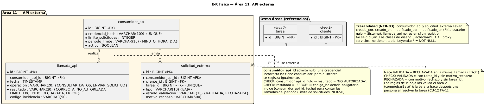

## Justificación del modelo

**Área 1**
- `CLIENTE (1)` — `CONTACTO (1..N)` y `CONTACTO (1)` — `CONSENTIMIENTO_CANAL (0..N)`: composiciones.
- `CLIENTE (0..N)` — `ETIQUETA (0..N)`: tabla intermedia `cliente_etiqueta`.
- `CATEGORIA_FACTURA (0..1)` — `FACTURA (0..N)`: tabla `factura_categoria` del área 1, para que `factura` (área 3) no dependa del área 1.
- `DOCUMENTO`: de un cliente o de una factura, exactamente uno (CU-04).

**Área 2**
- `CLIENTE (1)` — `RELACION_COMERCIAL (0..N)`; `RANGO_TARIFA (1)` — `RELACION_COMERCIAL (0..N)`: rango contratado.
- `RELACION_COMERCIAL (1)` — `PAUSA (0..N)`: composición.
- `RELACION_COMERCIAL (1)` — `REVISION_ANUAL_PLAN (0..N)`, con rango anterior (1), rango propuesto (0..1) y los usuarios que corrigen y aprueban.

**Área 3**
- `ENTIDAD_EMISORA (1)` — `SERIE_FACTURACION (0..N)`: cada serie pertenece a una entidad; una entidad puede tener varias.
- `ENTIDAD_EMISORA (1)` — `FACTURA (0..N)`: toda factura tiene entidad emisora (`NOT NULL`).
- `SERIE_FACTURACION (0..1)` — `FACTURA (0..N)`: un borrador todavía no tiene serie; una factura emitida sí (RB-01).
- `CLIENTE (1)` — `FACTURA (0..N)`.
- `PERIODO_CONTABLE (0..1)` — `FACTURA (0..N)`: se asigna al emitir.
- `FACTURA (1)` — `LINEA_FACTURA (1..N)`: composición; las líneas se borran junto con su borrador.
- `FACTURA (1)` — `HISTORIAL_ESTADO_FACTURA (0..N)`: composición; guarda los cambios de estado documental, de cobro y de envío.
- `FACTURA (0..1)` — `FACTURA (0..N)`, «rectifica»: una factura rectificativa apunta a la factura que rectifica.
- `CONFIGURACION_RECURRENTE (0..1)` — `FACTURA (0..N)`: las facturas recurrentes apuntan a su configuración.
- `RELACION_COMERCIAL (1)` — `CONFIGURACION_RECURRENTE (0..1)`.
- `CONFIGURACION_RECURRENTE (1)` — `TRAMO_IMPORTE (1..N)`: composición; cada cambio de importe añade un tramo con su fecha de inicio y los anteriores se conservan (RB-36).
- `CONFIGURACION_RECURRENTE (1)` — `PERIODO_PAUSA (0..N)`: composición; cada pausa es un intervalo `[desde, hasta)`, con `hasta` nulo mientras sigue en curso (CU-11).
- `IMPUESTO (1)` — `LINEA_FACTURA (0..N)` e `IMPUESTO (1)` — `CONCEPTO_CATALOGO (0..N)`; `CONCEPTO_CATALOGO (0..1)` — `LINEA_FACTURA (0..N)`: una línea puede venir del catálogo o ser libre.
- `USUARIO (0..1)` — `HISTORIAL_ESTADO_FACTURA (0..N)`, «realizado por»: nulo significa acción del Sistema.

**Área 4**
- `FACTURA (0..1)` y `CONFIGURACION_RECURRENTE (0..1)` — `SOLICITUD_EXCEPCION (0..N)`: exactamente una de las dos (la configuración, solo en la excepción de prorrateo); con solicitante (1) y aprobador (0..1).
- `PERIODO_CONTABLE (1)` — `REAPERTURA_PERIODO (0..N)`; `PERIODO_CONTABLE (0..1)` — `FACTURA (0..N)`.

**Área 5**
- `PLANTILLA_COMUNICACION (1)` — `VARIABLE_PLANTILLA (0..N)`: la lista de variables obligatorias, normalizada.
- `PLANTILLA_COMUNICACION (1)` — `REGLA_RECORDATORIO (0..N)` y — `MENSAJE (0..N)`; `FACTURA (1)` y `CONTACTO (1)` — `MENSAJE (0..N)`.

**Área 6**
- `MOVIMIENTO_COBRO (1)` — `CONCILIACION (0..N)` y `FACTURA (1)` — `CONCILIACION (0..N)`: la conciliación es la tabla intermedia entre movimientos y facturas, con atributos propios (importe aplicado, fechas, usuarios).
- `FACTURA (1)` — `BAJA_CONTABLE (0..1)`: una factura tiene como máximo una baja.
- `SOLICITUD_EXCEPCION (1)` — `BAJA_CONTABLE (0..1)`: toda baja está aprobada mediante una solicitud.
- `USUARIO (0..1)` — `CONCILIACION (0..N)`: quién la realizó y quién la deshizo; nulo = conciliación automática.

**Área 7**
- `USUARIO`, `CLIENTE` y `FACTURA (0..1)` — `NOTIFICACION (0..N)`: destinatario (nulo = notificación general) y elemento sobre el que avisa.
- `CLIENTE (1)` — `INCIDENCIA (0..N)` y `CLIENTE (0..1)` — `TAREA (0..N)` (nulo = acción masiva sobre varios clientes, CU-07); `USUARIO (0..1)` como responsable de ambas (nulo = sin asignar).
- `COMENTARIO`: de un cliente, una factura o una incidencia, exactamente uno.
- Las FK a `factura` que no son composición pasan a nulo si se borra un borrador (`ON DELETE SET NULL`); los comentarios de un borrador se borran con él.

**Área 8**
- `PERIODO_CONTABLE (1)` — `PAQUETE_CONTABLE (0..N)`: una fila por versión; no se borra en cascada (RB-19).
- `INFORME_PROGRAMADO (1)` — `DESTINATARIO_INFORME (1..N)`: tabla intermedia con `usuario`.
- `OBJETIVO_FACTURACION` y `TIPO_CAMBIO` no tienen FK.

**Área 9**
- `USUARIO (1)` — `SESION`, `TOKEN_RECUPERACION`, `DELEGACION` (como origen y como suplente), `DESCARGA_FICHERO` y `RESTAURACION_COPIA (0..N)`; `USUARIO (0..1)` — `REGISTRO_AUDITORIA (0..N)` (nulo = Sistema).
- `USUARIO (1)` y `CLIENTE (1)` — `ASIGNACION_CLIENTE (0..N)`: un solo responsable vigente por cliente.
- `DESCARGA_FICHERO`: de un documento (área 1) o de una exportación (área 8), exactamente uno.

**Área 10**
- `CONFIGURACION_GLOBAL (1)` — `ENTRADA_CONFIGURACION (1..N)`, `EJECUCION_PROCESO (1)` — `DETALLE_FALLO (0..N)` y `CALENDARIO_LABORAL (1)` — `DIA_LABORABLE_CALENDARIO (1..N)` y `FECHA_FESTIVA (0..N)`: composiciones.
- `EJECUCION_PROCESO (0..1)` — `ERROR_TECNICO (0..N)`: un error técnico puede no venir de una ejecución (por ejemplo, de la API).
- `USUARIO (0..1)` — `ERROR_TECNICO (0..N)`: quién lo resolvió (`resuelto_por_id`).
- `TAREA_PROGRAMADA` no tiene FK: una fila por tipo de proceso.

**Área 11**
- `CONSUMIDOR_API (0..1)` — `LLAMADA_API (0..N)`: nulo cuando la credencial no es válida.
- `CONSUMIDOR_API (1)` y `CLIENTE (1)` — `SOLICITUD_EXTERNA (0..N)`; `SOLICITUD_EXTERNA (0..1)` — `TAREA (0..1)` (área 7).

**Decisiones de modelado**
- **Pausas guardadas dos veces, a propósito:** en `pausa` (área 2, con motivo y fecha prevista) y en `periodo_pausa` (área 3, solo el intervalo que no se factura). Así el área 3 no lee tablas del área 2. `ServicioRelacionComercial.pausar()` y `reactivar()` llaman a `ServicioFacturacion` en la misma transacción, de modo que las dos quedan siempre iguales.
- **Estado del cliente y rango vigente: no son columnas.** Se calculan desde la relación comercial más reciente y las revisiones aplicadas (área 2), así no hace falta una tarea diaria que los mantenga.
- **Herencia de `Factura` en una sola tabla**, con el discriminador `tipo` (PUNTUAL, RECURRENTE, RECTIFICATIVA). Las columnas propias de cada subtipo admiten nulos y un `CHECK` obliga a rellenarlas según el tipo. Evita uniones entre tablas para consultar facturas.
- **Tres estados independientes** de la factura: `estado_documental`, `estado_cobro` y `estado_envio`. Los dos últimos solo existen una vez emitida (A-23).
- **Importes guardados** (`base_imponible`, `impuestos`, `total`) aunque serían derivables: una factura emitida es inalterable (RB-07, RB-11) y no puede depender de recalcular.
- **Saldo pendiente: no es columna.** Lo calcula `ServicioCobros` como total menos conciliaciones no deshechas, menos baja contable, menos abonos emitidos (RB-10, A-27).
- **Estado del movimiento de cobro: no se guarda.** Se deriva de los importes y de `en_revision`.
- **Deshacer una conciliación no la borra:** se marca con `fecha_deshecho` y conserva su traza (FR-27). Un índice único parcial permite volver a conciliar la misma pareja después de deshacerla.
- **Abono sin estado de cobro:** una rectificativa con total negativo compensa la factura original y no tiene estado de cobro propio (A-27).
- **Cobro excesivo (A-28):** el importe que supera el saldo no se aplica a la factura; queda sin aplicar en el movimiento, que pasa a revisión (`en_revision`), y la factura se marca con `cobro_excesivo`.
- **Estado «vencida» guardado:** `VENCIDA` es un valor de `estado_cobro`; una tarea diaria del planificador marca las facturas sin ningún cobro cuyo vencimiento ha pasado (`ServicioCobros.actualizarVencimientos()`).
- **Importes y fechas:** `DECIMAL(12,2)` en importes y `DECIMAL(5,2)` en porcentajes (NFR-31); instantes en UTC con `TIMESTAMP` y fechas legales con `DATE` (NFR-42, NFR-43).
- **Trazabilidad (NFR-03):** todas las tablas llevan `creado_por`, `creado_en`, `modificado_por` y `modificado_en`, salvo las que son en sí un registro (`historial_estado_factura`, `sesion`, `token_recuperacion`, `registro_auditoria`, `descarga_fichero`, `llamada_api`, `ejecucion_proceso`, `detalle_fallo` y `error_tecnico`), que no las llevan, y las tablas cuyas filas solo se añaden y nunca se modifican (`tramo_importe`, `cliente_etiqueta`, `reapertura_periodo`, `variable_plantilla`, `dia_laborable_calendario`, `fecha_festiva`), que solo llevan `creado_por` y `creado_en`. Las dos FK a `usuario` admiten nulos (nulo = Sistema). No se dibujan en el diagrama.
- **Excepción sobre una configuración recurrente:** la solicitud de excepción va sobre una factura o sobre una configuración recurrente (la de prorrateo, que se propone antes de que exista la factura). `factura_id` admite nulos, hay una columna `configuracion_recurrente_id` y un `CHECK` de «exactamente una» (aplicado el 25/11 y validado el 26/11).
- **Configuración con vigencia:** cada valor de `entrada_configuracion` tiene su intervalo de vigencia, y un cambio crea una fila nueva en lugar de sobrescribir la anterior. Así se sabe qué valor aplicaba en una fecha (Q-07).
- **Nombres:** tablas en singular y `snake_case`, PK `id`, FK `<tabla>_id` o por el rol cuando hay dos (`realizado_por_id`, `deshecho_por_id`).

## Reglas y restricciones

**Las garantiza la base de datos** (`script.sql`):

| Restricción | Tabla | Origen |
|---|---|---|
| `UNIQUE (serie_facturacion_id, numero_factura)` | `factura` | RB-01 |
| `UNIQUE (configuracion_recurrente_id, periodo_inicio)` | `factura` | FR-100, sin duplicar facturas recurrentes |
| `CHECK` de columnas propias por `tipo` (recurrente y rectificativa) | `factura` | Herencia en una tabla |
| `CHECK`: sin estado de cobro ni de envío hasta emitirse; sin estado de cobro en un abono | `factura` | A-23, A-27 |
| `CHECK`: una factura emitida tiene número, serie, periodo, fecha de emisión y estado de envío | `factura` | RB-01 |
| `CHECK (total = base_imponible + impuestos)` | `factura` | NFR-31 |
| Disparador `BEFORE DELETE`: solo se borran borradores | `factura` | RB-03, RB-11, CU-16 |
| Disparador `BEFORE UPDATE`: una factura emitida o rectificada no se modifica; solo pueden cambiar sus estados de cobro y envío, la disputa, el cobro excesivo, los campos de modificación y el paso de emitida a rectificada | `factura` | RB-07, RB-11 |
| Disparador: las líneas solo se crean, modifican o borran mientras la factura es un borrador (también quedan bloqueadas pendiente de aprobación, para que se apruebe lo que vio el aprobador) | `linea_factura` | RB-11, CU-22, CU-23 |
| FK compuesta `(serie_facturacion_id, entidad_emisora_id)` → `serie_facturacion (id, entidad_emisora_id)`: la serie es de la misma entidad emisora que la factura | `factura` | Coherencia serie–entidad |
| Borrado en cascada de líneas e historial | `linea_factura`, `historial_estado_factura` | Composición |
| `UNIQUE (entidad_emisora_id, prefijo)` | `serie_facturacion` | Un prefijo no se repite en la misma entidad |
| `UNIQUE (relacion_comercial_id)` | `configuracion_recurrente` | Una configuración por relación comercial |
| `UNIQUE (configuracion_recurrente_id, desde)` | `tramo_importe` | RB-36: un solo importe por fecha de inicio |
| `EXCLUDE USING gist` sobre `daterange(desde, hasta)` por configuración (extensión `btree_gist`) | `periodo_pausa` | CU-11, RB-05: las pausas no se solapan y solo hay una en curso |
| `UNIQUE (origen, id_externo)` | `movimiento_cobro` | CU-34 FE-1, FR-25: el mismo evento no se cuenta dos veces |
| `CHECK`: `en_revision` exige `motivo_revision` | `movimiento_cobro` | A-28 |
| Índice único parcial `(movimiento_cobro_id, factura_id) WHERE fecha_deshecho IS NULL` | `conciliacion` | FR-87 |
| `CHECK`: `fecha_deshecho`, `motivo_deshacer` y `deshecho_por_id` van juntos | `conciliacion` | FR-27 |
| `UNIQUE (factura_id)` y `UNIQUE (solicitud_excepcion_id)` | `baja_contable` | Una baja por factura y por solicitud |
| `CHECK` de tipo: ANULADA o INCOBRABLE (nunca «pagada») | `baja_contable` | RB-08 |
| `UNIQUE (identificador_fiscal)` | `cliente` | CU-01 |
| Índice único parcial `(cliente_id) WHERE es_contacto_facturacion` | `contacto` | Un contacto de facturación por cliente |
| `UNIQUE (contacto_id, canal)` | `consentimiento_canal` | Un consentimiento por canal |
| `CHECK (num_nonnulls(cliente_id, factura_id) = 1)` | `documento` | CU-04 |
| `EXCLUDE USING gist` sobre `numrange(facturacion_desde, facturacion_hasta)` | `rango_tarifa` | CU-14 FE-1: rangos sin solapes |
| `EXCLUDE USING gist` sobre `daterange(fecha_inicio, fecha_baja)` por cliente e índice único parcial `(cliente_id) WHERE fecha_baja IS NULL` | `relacion_comercial` | RB-12, A-25: una relación nueva empieza el día de la baja de la anterior o después |
| `EXCLUDE USING gist` sobre `daterange(fecha_inicio, fecha_reactivacion)` por relación, índice único parcial `WHERE fecha_reactivacion IS NULL` y `CHECK (fecha_reactivacion > fecha_inicio)` | `pausa` | CU-11: pausas sin solapes y una sola en curso |
| `UNIQUE (relacion_comercial_id, anio)`; `CHECK` de dato, resolución y `aprobado_por_id ≠ corregido_por_id` | `revision_anual_plan` | CU-13, FA-2, FR-74 |
| `CHECK`: rechazada ⇒ comentario; pendiente ⇔ sin aprobador ni fecha de resolución; aprobador ≠ solicitante; motivo obligatorio salvo en FACTURA_SOBRE_UMBRAL; exactamente una de factura y configuración recurrente (esta, solo en la de prorrateo) | `solicitud_excepcion` | CU-22, CU-23, FR-74 |
| `EXCLUDE USING gist` sobre `daterange(inicio, fin)` por tipo | `periodo_contable` | Periodos del mismo tipo sin solapes |
| `UNIQUE (plantilla_comunicacion_id, nombre)` | `variable_plantilla` | Sin variables repetidas |
| Índice único parcial `(tipo, idioma) WHERE activa` | `plantilla_comunicacion` | Una plantilla activa por tipo e idioma (CU-29) |
| `CHECK`: enviado o entregado ⇒ `fecha_envio`; fallido ⇒ `motivo_fallo` | `mensaje` | CU-27, CU-28 |
| `CHECK`: las fechas van con el estado; las alertas llevan cliente | `notificacion` | CU-37 |
| Índice único parcial `NULLS NOT DISTINCT` sobre las alertas sin resolver | `notificacion` | No repetir una alerta abierta |
| `UNIQUE (usuario_id, canal)` | `preferencia_notificacion` | Una preferencia por canal |
| `CHECK`: cerrada ⇔ `fecha_cierre`, y `fecha_cierre ≥ fecha_apertura` | `incidencia` | CU-40 |
| `CHECK (num_nonnulls(cliente_id, factura_id, incidencia_id) = 1)` | `comentario` | CU-41 |
| `CHECK`: completada ⇔ `fecha_completada` | `tarea` | — |
| `UNIQUE NULLS NOT DISTINCT (tipo_periodo, anio, mes)` y `CHECK` del mes según el tipo | `objetivo_facturacion` | FR-82 |
| `UNIQUE (periodo_contable_id, version)` | `paquete_contable` | RB-19 |
| `UNIQUE (moneda, fecha)` y `valor > 0` | `tipo_cambio` | FR-85 |
| `UNIQUE (informe_programado_id, usuario_id)` | `destinatario_informe` | Sin destinatarios repetidos |
| Índice único sobre `lower(email)`; `CHECK` de rol (OPERATIVO, ADMINISTRADOR, SUPERADMINISTRADOR) | `usuario` | Matriz de permisos |
| `CHECK` del formato SHA-256 de `token_hash`, `caduca_en = emitido_en + 24 h` y uso dentro del plazo | `token_recuperacion` | Recuperación de contraseña |
| `EXCLUDE USING gist` sobre `daterange(desde, hasta)` por cliente | `asignacion_cliente` | Un responsable vigente por cliente |
| `CHECK`: `desde ≤ caducidad` y origen ≠ suplente | `delegacion` | — |
| Disparadores `BEFORE UPDATE OR DELETE` y `BEFORE TRUNCATE` | `registro_auditoria` | Auditoría inalterable |
| `CHECK (num_nonnulls(documento_id, exportacion_masiva_id) = 1)` | `descarga_fichero` | FR-79, FR-95 |
| `UNIQUE (credencial_hash)` | `consumidor_api` | Un consumidor por credencial |
| `CHECK`: sin consumidor solo si no autorizada; error ⇒ `codigo_incidencia` | `llamada_api` | FR-61 |
| `CHECK`: validada ⇔ con tarea; rechazada ⇔ con motivo | `solicitud_externa` | CU-58, RB-31 |
| `EXCLUDE USING gist` sobre `daterange(desde, hasta)` por clave | `entrada_configuracion` | Un solo valor vigente por clave y fecha (Q-07) |
| `UNIQUE (tipo)` | `tarea_programada` | Una programación por tipo de proceso |
| `CHECK`: en curso ⇔ sin `fecha_fin`; fallida o cancelada ⇒ `causa` | `ejecucion_proceso` | CU-56 |
| `UNIQUE (codigo_incidencia)`; `CHECK`: resuelto ⇔ `fecha_resolucion`; sin resolver ⇒ sin `resuelto_por_id` | `error_tecnico` | FR-61, FR-62 |
| `UNIQUE (pais, anio)`; `UNIQUE` del día y del festivo por calendario | `calendario_laboral`, `dia_laborable_calendario`, `fecha_festiva` | FR-83, Q-02 |

**Las garantiza la aplicación** (cruzan tablas o dependen de cálculos). **La notación gráfica no las valida:**
- El tipo de la serie corresponde al de la factura: rectificativa para una rectificativa y ordinaria en otro caso. Se comprueba al emitir.
- El importe aplicado de una conciliación no supera el saldo pendiente de la factura, y la moneda del movimiento coincide con la de la factura (FR-84).
- La baja contable es de la misma factura que su solicitud de excepción.
- Un cliente activo tiene al menos un contacto de facturación (RB-27).
- Los rangos de tarifa no dejan huecos (CU-14 FE-1); los solapes sí los impide la base de datos.
- Una regla de recordatorio usa una plantilla de tipo RECORDATORIO.
- Un informe programado tiene al menos un destinatario con permiso para recibirlo (RB-33).
- La fecha de un festivo es del año de su calendario.

## Trazabilidad

| Requisitos/casos | Tablas/columnas | Observación |
|---|---|---|
| CU-15, CU-17, CU-19 (emitir facturas) | `factura`, `linea_factura`, `historial_estado_factura` | Una sola tabla para los tres tipos, con `tipo` como discriminador |
| CU-21 (series y numeración), RB-01 | `serie_facturacion.siguiente_numero`, `factura.numero_factura` | Número único por serie, asignado al emitir |
| CU-17, FR-100 | `configuracion_recurrente`, `factura.periodo_inicio`, `uq_factura_mes` | Evita duplicar la factura de un periodo |
| CU-11, CU-13, FR-100, RB-36 | `tramo_importe`, `periodo_pausa` | Al recuperar cuotas atrasadas, cada periodo sale con su importe y no se facturan los meses en pausa |
| CU-16, RB-03, RB-11, FR-93 | Disparador sobre `factura`; cascada en `linea_factura` e `historial_estado_factura` | Solo se borran borradores |
| CU-31 | `factura.en_disputa`, `motivo_disputa`, `fecha_revision_disputa` | La disputa guarda su motivo y su fecha de revisión; no cambia el estado de cobro |
| CU-22, CU-23, RB-25 | `factura.estado_documental` (PENDIENTE_APROBACION), `factura.modificacion_manual` | La solicitud (`solicitud_excepcion`) pertenece al área 4 |
| RB-06, FR-17 | `linea_factura.porcentaje_impuesto`, `concepto_catalogo`, `impuesto` | La línea copia el porcentaje: cambiar el impuesto del catálogo no altera facturas emitidas |
| RB-07, RB-11 | `factura.base_imponible`, `impuestos`, `total`, `ruta_pdf`, `hash_pdf`; disparadores sobre `factura` y `linea_factura` | Valores guardados, y la base de datos impide modificar una emitida y sus líneas |
| FR-84 | `factura.moneda`, `movimiento_cobro.moneda` | Moneda por factura y por movimiento |
| A-23, A-27 | `factura.estado_cobro`, `estado_envio`, `CHECK` | Sin estado de cobro en borradores ni en abonos |
| CU-34, FR-25, FR-87 | `movimiento_cobro` (`origen`, `id_externo`) | No contabilizar dos veces un mismo evento |
| CU-35, FR-26, FR-27, FR-87 | `conciliacion`, índice único parcial | Conciliar y deshacer conservando la traza |
| A-28 | `movimiento_cobro.en_revision`, `motivo_revision`; `factura.cobro_excesivo` | El sobrante queda sin aplicar en el movimiento |
| CU-36, RB-08 | `baja_contable` | Baja explícita (anulada o incobrable) aprobada mediante una solicitud |
| RB-10, A-27 | Sin columna: lo calcula `ServicioCobros` | Saldo pendiente ≠ facturación total |
| CU-56 | `ejecucion_proceso`, `detalle_fallo`, `error_tecnico` | Cada ejecución del planificador queda registrada con sus fallos |
| FR-83, Q-02 | `calendario_laboral`, `dia_laborable_calendario`, `fecha_festiva` | Traslado de vencimientos y recordatorios al siguiente día laborable |
| NFR-03 | `creado_por`, `creado_en`, `modificado_por`, `modificado_en`; `historial_estado_factura` | Nulo = Sistema |
| NFR-31, NFR-42, NFR-43 | Tipos `DECIMAL` y `TIMESTAMP` en UTC | Sin coma flotante |

## Decisiones abiertas

- **Sumas de conciliaciones:** que las conciliaciones vigentes de un movimiento no superen su importe (A-28) se comprueba en la aplicación; no cabe en un `CHECK`.
- **Mínimo de una línea por factura:** el diagrama indica `1..N`; no se puede expresar con una restricción de columna y se comprueba al emitir.
- **Borrado de un borrador y solicitud de excepción:** el script usa `ON DELETE CASCADE`: si se borra un borrador, se borran sus solicitudes. No afecta a las de prorrateo, que van sobre la configuración.
- **Destino del sobrante cobrado (Q-12):** devolución o saldo a favor. El modelo deja el importe en el movimiento sin aplicar, sea cual sea el destino.

# 4. Diagrama UML de clases

## Alcance

El diagrama de clases cubre las 11 áreas funcionales de la Entrega 1. Un solo diagrama no se leería, así que está **dividido por áreas**: cada una tiene su carpeta en `diagramas/clases/areaNN/`, con su responsable.

Cuando el diagrama de un área no cabe en una página, se parte en tres:

1. **Modelo del área:** sus clases, atributos, métodos y enumerados.
2. **Servicio y patrones:** el servicio que hace de punto de entrada del área y los patrones de diseño que usa.
3. **Relaciones con otras áreas:** las asociaciones con clases de otras áreas.

Cada clase se define completa en un solo diagrama. En los demás aparece solo con su nombre o con los atributos que hacen falta para entender la relación.

| Área | Responsable | Diagramas |
|---|---|---|
| 1. Clientes y contactos | Ana | `area1_1_modelo_clientes`, `area1_2_servicio_clientes` |
| 2. Relación comercial y suscripciones | Ana | `area2_1_relacion_comercial`, `area2_2_servicio_relacion_comercial` |
| 3. Emisión de facturas | Abdelnaybet | `area3_1_modelo_facturacion`, `area3_2_factory_method`, `area3_3_relaciones_otras_areas` |
| 4. Aprobaciones y cierre contable | Loraine | `area4_1_modelo_aprobaciones`, `area4_2_servicio_aprobaciones` |
| 5. Envío y comunicaciones | Loraine | `area5_1_modelo_comunicaciones`, `area5_2_servicios_adapter` |
| 6. Cobros, conciliación y saldo | Abdelnaybet | `area6_1_modelo_cobros`, `area6_2_adapter_servicio`, `area6_3_relaciones_otras_areas` |
| 7. Notificaciones y colaboración | Luca | `area7_1_modelo_notificaciones`, `area7_2_patrones_notificaciones`, `area7_3_relaciones_notificaciones` |
| 8. Informes y contabilidad | Luca | `area8_1_modelo_informes`, `area8_2_patrones_informes`, `area8_3_relaciones_informes` |
| 9. Usuarios, seguridad y auditoría | Imad | `area9_1_modelo_usuarios_y_auditoria`, `area9_2_patron_proxy_permisos`, `area9_3_relaciones_otras_areas`, `area9_4_acceso_y_copias` |
| 10. Configuración y sistema | Cristóbal | `area10_1_configuracion`, `area10_2_planificador`, `area10_3_calendario` |
| 11. API externa | Guillermo | `area11_api_externa` |

## Convenciones comunes

Todas las áreas siguen las mismas reglas de notación:

- Atributos **privados** (`-`) y operaciones públicas (`+`). Derivados con `/` (`/total`, `/importeSinAplicar`), inmutables con `{readOnly}` y opcionales con `[0..1]`.
- Toda asociación lleva **multiplicidad en los dos extremos** y un verbo o nombre de rol.
- Los estados y tipos cerrados son **enumerados**, nunca `String`. Los compartidos (`EstadoCobro`, `Rol`, `Canal`…) tienen un único conjunto de valores para todas las áreas.
- Una clase de otra área se dibuja con el estereotipo **`<<referencia área N>>`**, donde N es el área que la define: solo su nombre o sus atributos clave. Se define completa en su área. Una clase de la misma área que aparece en otro diagrama del área va solo con su nombre, sin estereotipo. El enumerado compartido `Canal` es del área 1 (nace en `Contacto.canalPreferido`); las áreas 5 y 7 lo usan como referencia.
- **`<<infraestructura>>`** marca los componentes técnicos que no son de ningún área funcional, como `GestorDocumentos` (guarda los ficheros: PDF, adjuntos y exportaciones). Se describen en el apartado 6.
- Las restricciones que no se ven en las flechas van en notas: `{único: …}`, invariantes y precondiciones.
- Los campos de trazabilidad (`creadoPor`, `creadoEn`, `modificadoPor`, `modificadoEn`, NFR-03) no se dibujan en cada clase. Se indican una vez en una nota del diagrama.
- **Usuario nulo = Sistema.** Cuando una acción la hace el sistema (una tarea programada o una llamada de la API externa), el usuario que la realiza queda nulo. Los usuarios no se borran, solo se desactivan (FR-37), así que un nulo nunca es un usuario borrado.

## Decisiones de diseño comunes

**Un servicio por área como punto de entrada.** Cada área tiene un servicio (`ServicioFacturacion`, `ServicioCobros`, `ServicioAprobaciones`, `ServicioEnvio`…) con los casos de uso del área como operaciones. Las demás áreas, la interfaz, la API externa y el planificador no tocan las clases internas de un área: llaman a su servicio. La interfaz, la API, la pasarela y el planificador entran por el proxy de permisos; las llamadas entre servicios son internas y no vuelven a pasar por él.

**Lógica entre áreas en un solo sentido.** Las asociaciones entre áreas pueden navegarse en los dos sentidos, pero la lógica no. Una clase solo calcula o decide con datos de su propia área; si necesita algo interno de otra, se lo pide al servicio de esa área. Por ejemplo, `Factura` (área 3) no calcula su saldo pendiente: lo calcula `ServicioCobros` (área 6), porque depende de las conciliaciones. Así no hay ciclos de dependencia entre áreas y cada una se puede cambiar sin tocar las demás.

**Avisos entre áreas como eventos.** Cuando un área necesita reaccionar a algo que pasa en otra, la segunda no la llama: emite un evento y la primera lo escucha. En la Entrega 2 los eventos se declaran en notas. El mecanismo (patrón Observer) se formalizará en la Entrega 3.

| Evento | Lo emite | Lo escucha | Para qué |
|---|---|---|---|
| «abono emitido» | Área 3 (`FacturaRectificativa`) | Área 6 | Recalcular el estado de cobro de la factura original (A-27) |
| «solicitud creada» | Área 4 (`ServicioAprobaciones`) | Área 7 | Avisar a los aprobadores de que hay una solicitud pendiente (CU-22 paso 4) |
| «solicitud resuelta» | Área 4 (`ServicioAprobaciones`) | Áreas 3, 6 y 7 | Emitir o devolver a borrador la factura, registrar la baja contable y notificar al solicitante (CU-23, CU-36, CU-37) |
| «estado de cobro cambiado» | Área 6 (`ServicioCobros`) | Área 5 | Cancelar o reanudar recordatorios (RB-37) |
| «impago sobre el límite» | Área 6 | Área 7 | Avisar al responsable |
| «fallos de envío» | Área 5 | Área 7 | Crear la incidencia (CU-28) |

La excepción documentada es el área 9: el proxy de permisos y la auditoría son infraestructura que usan todas las áreas.

**Sin herencia por rol.** `Usuario` tiene un atributo `rol : Rol` (Usuario operativo, Administrador, Superadministrador) en lugar de una subclase por rol. Un usuario puede cambiar de rol (FR-110), y un objeto no puede cambiar de clase.

**El estado del cliente se calcula, no se guarda**: Las dos transiciones automáticas de la Entrega 1 (pendiente de activación → activo y baja solicitada → baja efectiva) ocurren cuando llega una fecha de la relación comercial. Por eso `Cliente./estadoCliente` es derivado: lo calcula `RelacionComercial.estadoCliente(fecha)` (área 2) sobre la relación comercial más reciente, en este orden: fecha de baja pasada → baja efectiva; fecha de baja futura → baja solicitada (la baja termina una pausa); fecha de inicio futura → pendiente de activación; pausa en curso → pausado; si no, activo. Un cliente sin ninguna relación está pendiente de activación. Con el mismo criterio, el rango de tarifa vigente sale de las revisiones anuales aplicadas y su fecha de efecto. Así no hace falta una tarea diaria, no hay dos datos que puedan contradecirse y la dependencia entre las áreas 1 y 2 va en un solo sentido.

**DTO para los datos que cruzan áreas.** Lo que un servicio devuelve a otra área o a la API se agrupa en clases `<<DTO>>` sin comportamiento (`DatosFactura`, `ResumenSaldo`, `ResumenFactura`…), para no exponer las clases del dominio.

## Patrones de diseño

| Patrón | Dónde | Clases | Motivo |
|---|---|---|---|
| **Factory Method** | Área 3 | `GeneradorFactura` y sus subclases `GeneradorPuntual`, `GeneradorRecurrente` y `GeneradorRectificativa` | Los tres tipos de factura se crean con los mismos pasos (validar, calcular totales, comprobar el umbral) y solo cambia qué clase se crea. Añadir un tipo nuevo no obliga a tocar el servicio |
| **Adapter** | Áreas 5 y 6 | `CanalEnvio` (correo, WhatsApp); `ReceptorNotificacionesPago` y `ProveedorExtractos` (Stripe, banco) | Los proveedores externos tienen su propia interfaz. Cambiar de proveedor es escribir otro adaptador (NFR-27) |
| **Proxy de protección** | Área 9 | Proxy de permisos | Comprueba rol y cartera (RB-15, RB-21, RB-22) y registra en la auditoría antes de llamar al servicio real, en un único sitio para todas las áreas. Hay un proxy por servicio (`ProxyFacturacion`, `ProxyCobros`…) con la misma interfaz que el servicio real; el solicitante lo da `ContextoSeguridad`, así que ninguna operación cambia su firma. El login (`ServicioAcceso`) no pasa por el proxy |
| **Facade** | Área 11 | `FachadaAPI` | Un único punto de entrada para los sistemas externos, con las mismas reglas que la interfaz (RB-31) |

Los patrones de comportamiento (Observer para los eventos, State para los estados de la factura, Command para las tareas del planificador y Strategy para los formatos de exportación) se dejan para la Entrega 3. En la Entrega 2 los estados son enumerados con métodos.

## Área 1: Clientes y contactos

**Diagramas**

| Diagrama | Contenido |
|---|---|
| `area1_1_modelo_clientes` | `Cliente`, `Contacto`, `ConsentimientoCanal`, `Documento`, `Etiqueta`, `CategoriaFactura` y los enumerados `EstadoCliente` y `Canal` |
| `area1_2_servicio_clientes` | `ServicioClientes` y los DTO del área (`DatosCliente`, `FichaCliente`…) |

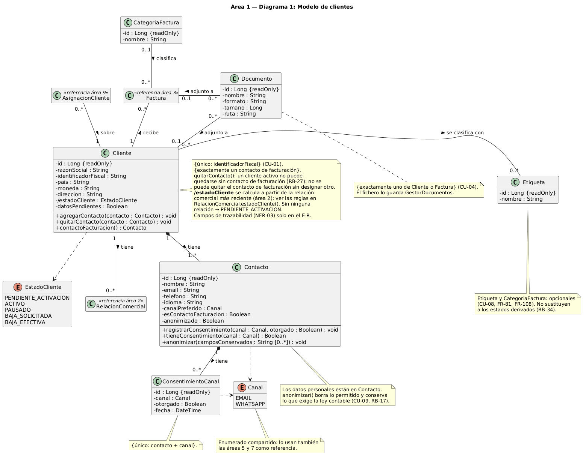

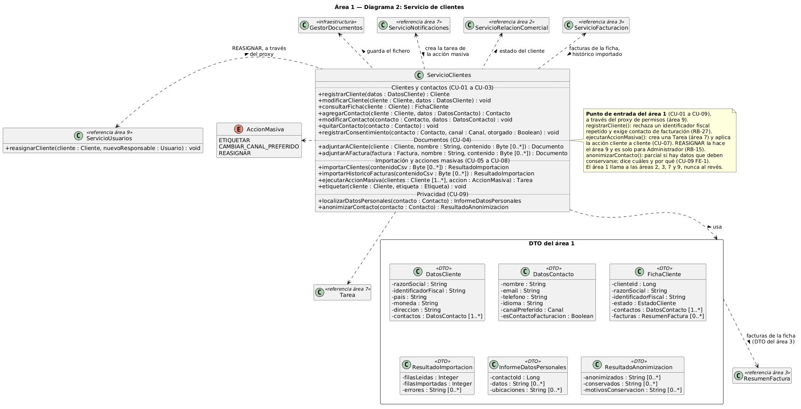

**Decisiones**

- **Los datos personales están en `Contacto`.** Así la privacidad (CU-09) se resuelve en una sola clase: `anonimizar()` borra lo permitido y conserva lo que exige la ley contable (RB-17).
- **Un único contacto de facturación por cliente.** Un cliente activo no puede quedarse sin él (RB-27): `quitarContacto()` no lo permite sin designar otro.
- **El consentimiento es por canal** (`ConsentimientoCanal`). El área 5 lo consulta con `tieneConsentimiento()` antes de enviar (RB-28).
- **`/estadoCliente` es derivado.** Lo calcula el área 2 (ver «Decisiones de diseño comunes»).
- **`Documento` va sobre un cliente o sobre una factura, exactamente uno** (CU-04). El fichero lo guarda `GestorDocumentos`.
- **Las acciones masivas crean una `Tarea`** (área 7) para seguir el progreso. REASIGNAR la hace el área 9 a través del proxy.

**Trazabilidad**

| Requisito / CU | Clases y operaciones | Motivo |
|---|---|---|
| CU-01, CU-02 | `registrarCliente()`, `consultarFicha()`, `FichaCliente`, `{único: identificadorFiscal}` | Alta sin duplicados y ficha con sus facturas |
| CU-03, RB-28 | `Contacto`, `ConsentimientoCanal`, `registrarConsentimiento()` | Contactos y consentimiento por canal |
| CU-04 | `Documento`, `adjuntarACliente()`, `adjuntarAFactura()` | Adjuntos |
| CU-05 a CU-08 | `importarClientes()`, `importarHistoricoFacturas()`, `ejecutarAccionMasiva()`, `Etiqueta` | Importación, acciones masivas y etiquetas |
| CU-09, RB-17 | `localizarDatosPersonales()`, `anonimizarContacto()`, `Contacto.anonimizar()` | Privacidad |
| RB-27 | `Cliente.contactoFacturacion()`, `quitarContacto()` | Siempre un contacto de facturación |

## Área 2: Relación comercial y suscripciones

**Diagramas**

| Diagrama | Contenido |
|---|---|
| `area2_1_relacion_comercial` | `RelacionComercial`, `Pausa`, `RangoTarifa`, `RevisionAnualPlan` y `EstadoRevision` |
| `area2_2_servicio_relacion_comercial` | `ServicioRelacionComercial` y las operaciones del área 3 que usa |

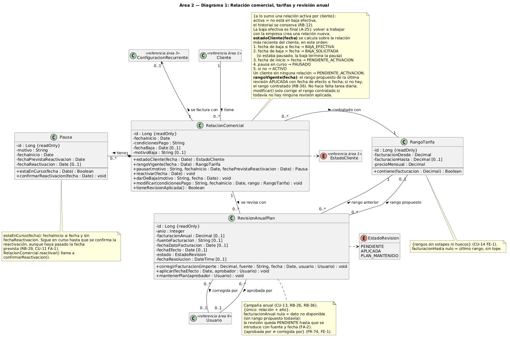

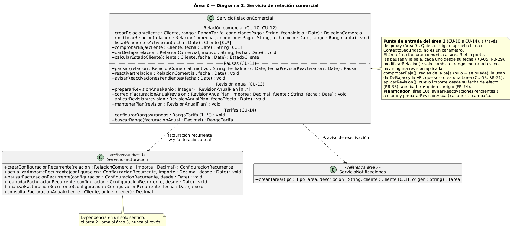

**Decisiones**

- **Estado del cliente y rango vigente calculados** con `estadoCliente(fecha)` y `rangoVigente(fecha)`, sin tarea diaria (ver «Decisiones de diseño comunes»).
- **La baja es definitiva** (A-25). Volver a trabajar con la empresa crea una relación nueva, y el historial se conserva (RB-12). Como mucho hay una relación activa por cliente.
- **Una pausa sigue en curso hasta que se confirma la reactivación**, aunque haya pasado la fecha prevista (RB-29, CU-11 FA-1). El aviso de reactivación lo lanza el planificador.
- **El área 2 no factura.** Comunica al área 3 el importe, las pausas y la baja, cada uno con su fecha. La dependencia va del área 2 al área 3, nunca al revés.
- **Revisión anual con doble control.** Quien corrige la facturación no puede aprobar la revisión (FR-74). El nuevo importe se aplica desde su fecha de efecto y las facturas anteriores no cambian (RB-36).
- **`comprobarBaja()` la usa también la API** (CU-58, RB-31): una baja pedida desde fuera sigue las mismas reglas.

**Trazabilidad**

| Requisito / CU | Clases y operaciones | Motivo |
|---|---|---|
| CU-10 | `crearRelacion()`, `modificarRelacion()` | Alta y modificación de la relación |
| CU-11, RB-05, RB-29 | `pausar()`, `reactivar()`, `Pausa`, `avisarReactivacionesPendientes()` | Pausas |
| CU-12, RB-13 | `darDeBaja()`, `comprobarBaja()` | Baja, con el recobro pendiente |
| CU-13, RB-26, RB-36, FR-74 | `prepararRevisionAnual()`, `RevisionAnualPlan`, `aplicarRevision()`, `mantenerPlan()` | Revisión anual |
| CU-14 | `configurarRangos()`, `RangoTarifa`, `{sin solapes ni huecos}` | Rangos de tarifa |

## Área 3: Emisión de facturas

**Diagramas**

| Diagrama | Contenido |
|---|---|
| `area3_1_modelo_facturacion` | `Factura` (abstracta) y sus subclases, líneas, impuestos, series, entidad emisora, configuración recurrente, historial de estados y enumerados |
| `area3_2_factory_method` | `ServicioFacturacion`, los generadores (Factory Method) y `DatosFactura` |
| `area3_3_relaciones_otras_areas` | `Cliente`, `RelacionComercial`, `PeriodoContable`, `SolicitudExcepcion`, `Conciliacion` y `Usuario` como referencias |

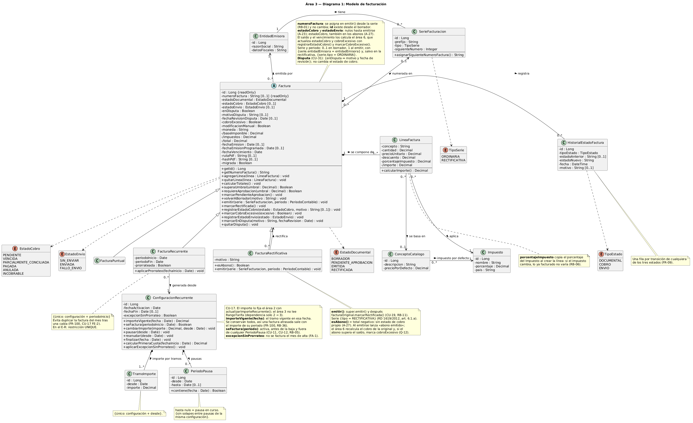

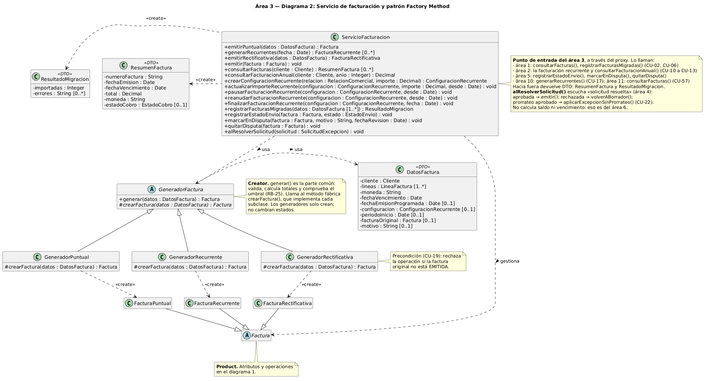

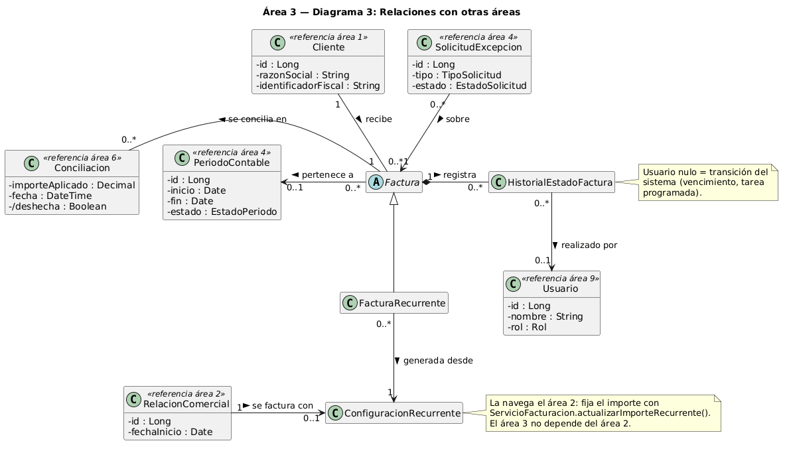

**Decisiones**

- **Herencia por tipo de factura.** `Factura` es abstracta, con `FacturaPuntual`, `FacturaRecurrente` y `FacturaRectificativa`. Cada subclase añade lo suyo: el periodo y el prorrateo en la recurrente, y el motivo y `esAbono()` en la rectificativa.
- **Tres estados independientes.** `estadoDocumental` (borrador, pendiente de aprobación, emitida, rectificada), `estadoCobro` y `estadoEnvio`. Los dos últimos son nulos hasta que la factura se emite (A-23). Cada cambio de cualquiera de los tres queda en `HistorialEstadoFactura` (FR-09).
- **Identificador y número legal separados.** `id` existe desde el borrador. `numeroFactura` se asigna en `emitir()` desde la serie y no cambia (RB-01).
- **Los estados de cobro y envío los cambian otras áreas con métodos propios de `Factura`.** El área 6 usa `registrarEstadoCobro()` y `marcarCobroExcesivo()`; el área 5 usa `registrarEstadoEnvio()`, `marcarEnDisputa()` y `quitarDisputa()`. `Factura` no sabe nada de esas áreas.
- **La rectificativa no modifica la original.** `FacturaRectificativa.emitir()` emite y después marca la original como rectificada (RB-11). Si es un abono (total negativo), emite el evento «abono emitido» y el área 6 recalcula el cobro de la original (A-27).
- **El impuesto se copia en la línea.** `LineaFactura.porcentajeImpuesto` guarda el porcentaje vigente al crear la línea, para que un cambio de impuesto no altere lo ya facturado (RB-06).
- **`ServicioFacturacion` pide la serie y el periodo, no `Factura`.** Así el área 3 no depende del área 4.

**Trazabilidad**

| Requisito / CU | Clases y operaciones | Motivo |
|---|---|---|
| CU-15 | `ServicioFacturacion.emitirPuntual()`, `GeneradorPuntual`, `Factura.emitir()` | Emitir una factura puntual |
| CU-15 FA-3, RB-25 | `Factura.requiereAprobacion()`, `marcarPendienteAprobacion()` | Facturas por encima del umbral |
| CU-16 | `Factura.agregarLinea()`, `quitarLinea()`, `volverABorrador()` | Gestionar borradores |
| CU-17, FR-100 | `ServicioFacturacion.generarRecurrentes()`, `GeneradorRecurrente`, `{único: configuración + periodoInicio}` | Facturación recurrente sin duplicados |
| CU-19, RB-11, A-27 | `ServicioFacturacion.emitirRectificativa()`, `FacturaRectificativa.emitir()`, `esAbono()`, `Factura.marcarRectificada()` | Rectificar sin modificar la original |
| RB-01 | `SerieFacturacion.asignarSiguienteNumeroFactura()` | Número correlativo por serie al emitir |
| RB-06 | `LineaFactura.porcentajeImpuesto` | Lo facturado no cambia si cambia el impuesto |
| FR-09 | `HistorialEstadoFactura` | Historial de los tres estados |
| CU-23 | `ServicioFacturacion.alResolverSolicitud()` | Emitir o devolver a borrador al resolverse la aprobación |

## Área 4: Aprobaciones y cierre contable

**Diagramas**

| Diagrama | Contenido |
|---|---|
| `area4_1_modelo_aprobaciones` | `SolicitudExcepcion`, `PeriodoContable`, `ReaperturaPeriodo` y sus enumerados |
| `area4_2_servicio_aprobaciones` | `ServicioAprobaciones` |

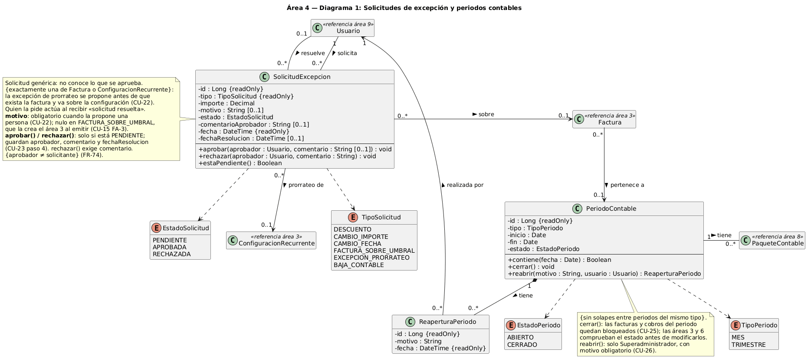

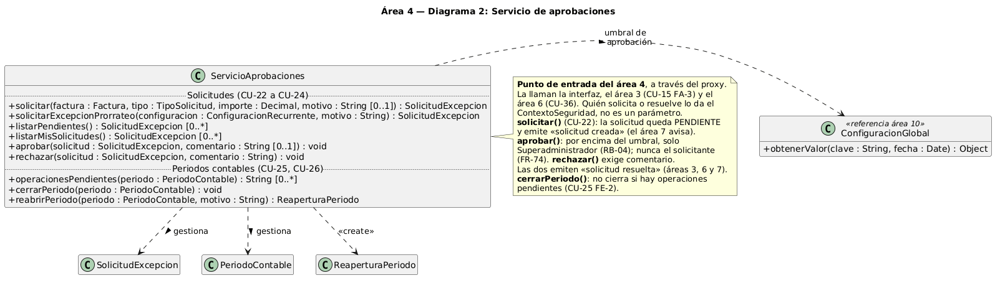

**Decisiones**

- **Solicitud genérica.** `SolicitudExcepcion` no sabe qué se aprueba (descuento, factura sobre el umbral, prorrateo o baja contable). Quien la pide actúa al recibir «solicitud resuelta», así que el área 4 no depende de las áreas 3 y 6.
- **Sobre una factura o sobre una configuración recurrente, exactamente una.** La excepción de prorrateo se pide antes de que exista la factura (CU-22).
- **Quién aprueba depende del importe.** Por encima del umbral de `ConfiguracionGlobal`, solo un Superadministrador (RB-04), y nadie aprueba su propia solicitud (FR-74). Rechazar exige comentario.
- **Dos avisos:** «solicitud creada» (el área 7 avisa a los aprobadores) y «solicitud resuelta» (la escuchan las áreas 3, 6 y 7).
- **Cierre de periodo.** No se cierra con operaciones pendientes (CU-25 FE-2). Solo un Superadministrador lo reabre, con motivo, y queda una `ReaperturaPeriodo` (CU-26).

**Trazabilidad**

| Requisito / CU | Clases y operaciones | Motivo |
|---|---|---|
| CU-22, RB-25 | `solicitar()`, `solicitarExcepcionProrrateo()` | Proponer sin emitir |
| CU-23, RB-04, FR-74 | `listarPendientes()`, `aprobar()`, `rechazar()`, `SolicitudExcepcion.aprobar()` | Resolver según el umbral |
| CU-24 | `listarMisSolicitudes()` | Bandeja del solicitante |
| CU-25 | `cerrarPeriodo()`, `operacionesPendientes()` | Cierre contable |
| CU-26 | `reabrirPeriodo()`, `ReaperturaPeriodo` | Reapertura con motivo |

## Área 5: Envío y comunicaciones

**Diagramas**

| Diagrama | Contenido |
|---|---|
| `area5_1_modelo_comunicaciones` | `PlantillaComunicacion`, `ReglaRecordatorio`, `Mensaje` y sus enumerados |
| `area5_2_servicios_adapter` | `ServicioEnvio`, `ServicioRecordatorios` y el patrón Adapter de los canales |

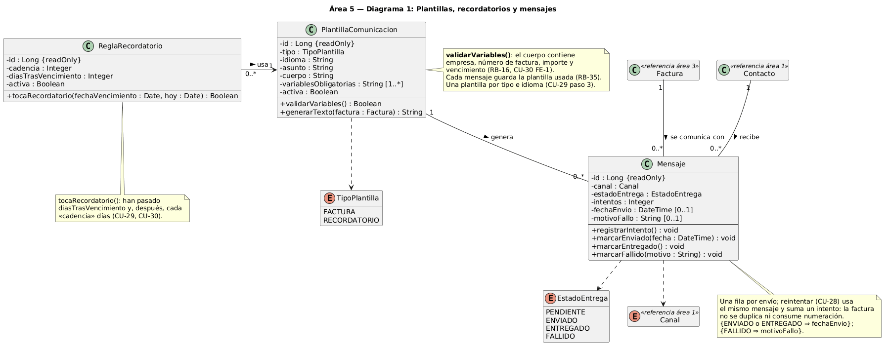

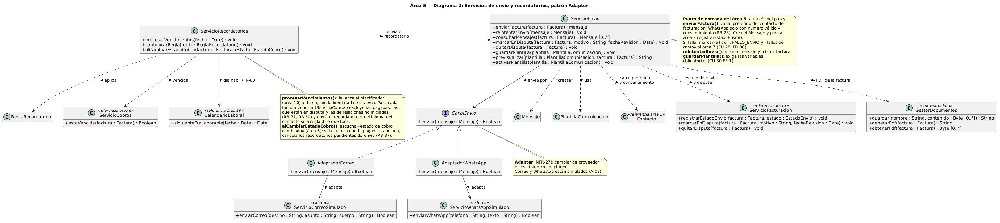

**Decisiones**

- **Dos servicios.** `ServicioEnvio` es el punto de entrada (envío, plantillas y disputa). `ServicioRecordatorios` lo lanza el planificador y escucha «estado de cobro cambiado».
- **Adapter para los canales.** `CanalEnvio`, con `AdaptadorCorreo` y `AdaptadorWhatsApp`, que llaman a servicios simulados (A-03, NFR-27).
- **Un `Mensaje` por envío,** con la plantilla usada (RB-35). Reintentar suma un intento al mismo mensaje: la factura no se duplica.
- **El área 5 no toca la factura.** Pide al área 3 el cambio de estado de envío y la disputa.
- **Plantillas validadas:** deben llevar las variables obligatorias (RB-16), y hay una activa por tipo e idioma.
- **Recordatorios:** no se envían a facturas pagadas, en disputa o de relaciones no iniciadas (RB-37, RB-30). Una fecha que cae en festivo pasa al siguiente día laborable (FR-83).

**Trazabilidad**

| Requisito / CU | Clases y operaciones | Motivo |
|---|---|---|
| CU-27, RB-28 | `enviarFactura()`, `CanalEnvio`, `Mensaje` | Envío por el canal preferido |
| CU-28, FR-80 | `consultarMensajes()`, `reintentarEnvio()`, evento «fallos de envío» | Gestionar el fallo |
| CU-29, CU-30, RB-16 | `ReglaRecordatorio`, `procesarVencimientos()`, `PlantillaComunicacion.validarVariables()` | Recordatorios y plantillas |
| CU-31 | `marcarEnDisputa()`, `quitarDisputa()` | Factura en disputa |
| RB-37 | `alCambiarEstadoCobro()` | Cancelar recordatorios de lo pagado |

## Área 6: Cobros, conciliación y saldo

**Diagramas**

| Diagrama | Contenido |
|---|---|
| `area6_1_modelo_cobros` | `MovimientoCobro`, `Conciliacion`, `BajaContable`, `ResumenSaldo` y enumerados |
| `area6_2_adapter_servicio` | `ServicioCobros` y los adaptadores de la pasarela (Stripe) y del banco |
| `area6_3_relaciones_otras_areas` | `Factura`, `FacturaRectificativa`, `Cliente`, `Usuario` y `SolicitudExcepcion` como referencias |

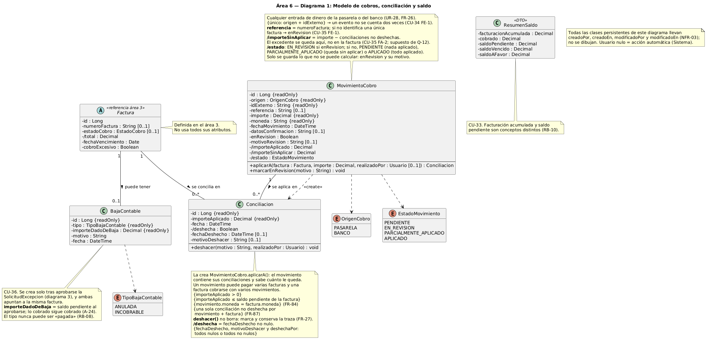

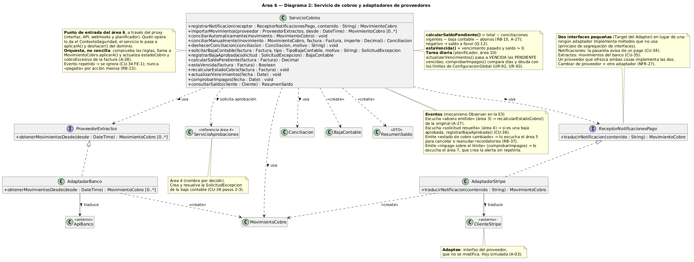

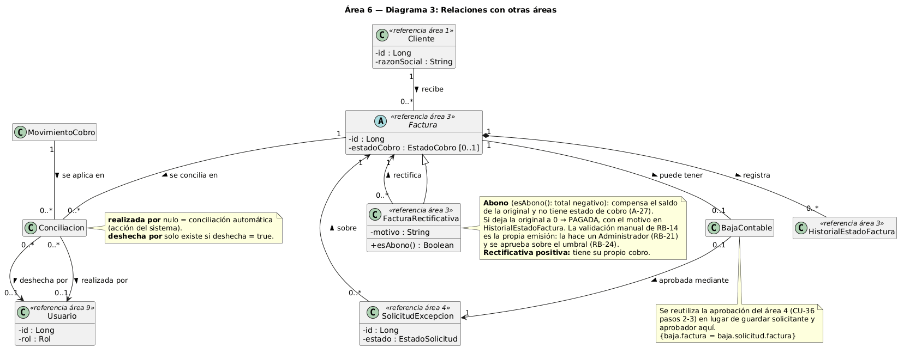

**Decisiones**

- **Un movimiento de cobro, varias conciliaciones.** Un `MovimientoCobro` (entrada de dinero de la pasarela o del banco) puede pagar varias facturas, y una factura puede cobrarse con varios movimientos. Cada aplicación es una `Conciliacion`, que crea el propio movimiento con `aplicarA()`.
- **Deshacer no borra.** `Conciliacion.deshacer()` marca la conciliación con fecha, motivo y usuario, y conserva la traza (FR-27).
- **El sobrante se queda en el movimiento.** Si se cobra más de lo que se debe, el exceso no se aplica a la factura: queda en `/importeSinAplicar` y la factura se marca con cobro excesivo (A-28).
- **El saldo y el vencimiento los calcula el servicio.** `ServicioCobros.calcularSaldoPendiente()` resta del total las conciliaciones vigentes, la baja contable y los abonos (RB-10, A-27). `estaVencida()` indica si hay saldo con el vencimiento pasado. Ninguno de los dos se guarda.
- **El estado `VENCIDA` sí se guarda.** Lo pone una tarea diaria del planificador (`actualizarVencimientos()`) en las facturas pendientes sin ningún cobro, siguiendo la tabla de transiciones de la Entrega 1.
- **«Vencida» responde a dos preguntas distintas.** `VENCIDA` es la transición de la Entrega 1 para facturas sin ningún cobro; una factura cobrada en parte sigue `PARCIALMENTE_CONCILIADA` aunque pase el plazo. `estaVencida()` responde otra cosa: si queda saldo con el vencimiento pasado, y es lo que usan las alertas de impago. El estado de cobro se guarda, a diferencia del estado del cliente, porque cada cambio deja historial y avisa a otras áreas («estado de cobro cambiado»).
- **Dos interfaces pequeñas para los proveedores.** `ReceptorNotificacionesPago` para la pasarela y `ProveedorExtractos` para el banco, en lugar de una sola. Cada adaptador implementa solo lo que usa (segregación de interfaces).
- **La baja contable reutiliza la aprobación del área 4.** `BajaContable` solo se crea al aprobarse su `SolicitudExcepcion`, y no guarda solicitante ni aprobador (CU-36).

**Trazabilidad**

| Requisito / CU | Clases y operaciones | Motivo |
|---|---|---|
| CU-33, RB-10 | `ServicioCobros.consultarSaldo()`, `ResumenSaldo` | Saldo del cliente, distinto de la facturación acumulada |
| CU-34, FR-25 | `ServicioCobros.registrarNotificacion()`, `AdaptadorStripe`, `{único: origen + idExterno}` | Registrar pagos de la pasarela sin duplicados |
| CU-35, FR-84, FR-87 | `consultarBandejaConciliacion()`, `importarMovimientos()`, `conciliarAutomaticamente()`, `conciliarManualmente()`, `deshacerConciliacion()`, `MovimientoCobro.aplicarA()` | Conciliar con la misma moneda y sin duplicar |
| FR-27 | `Conciliacion.deshacer()` | Deshacer conservando la traza |
| CU-36, RB-08, A-24 | `solicitarBajaContable()`, `registrarBajaAprobada()`, `BajaContable` | Baja contable aprobada, nunca como «pagada» |
| A-27 | `recalcularEstadoCobro()` (escucha «abono emitido») | El abono compensa el saldo de la original |
| A-28 | `MovimientoCobro./importeSinAplicar`, `enRevision`, `Factura.cobroExcesivo` | Cobros por encima del saldo |
| RB-37 | Evento «estado de cobro cambiado» | Cancelar o reanudar recordatorios |

## Área 7: Notificaciones y colaboración

**Diagramas**

| Diagrama | Contenido |
|---|---|
| `area7_1_modelo_notificaciones` | `Notificacion`, `PreferenciaNotificacion`, `Incidencia`, `Comentario`, `Tarea` y sus enumerados |
| `area7_2_patrones_notificaciones` | `ServicioNotificaciones` y los manejadores de eventos |
| `area7_3_relaciones_notificaciones` | `Usuario`, `Cliente` y `Factura` como referencias |

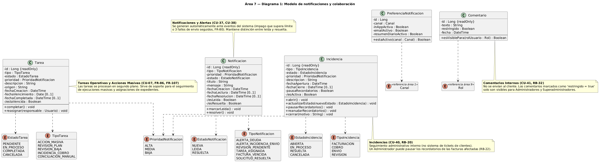

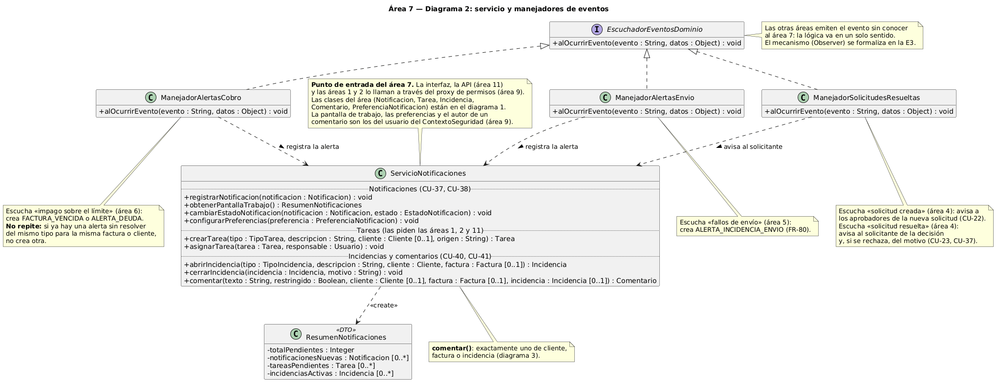

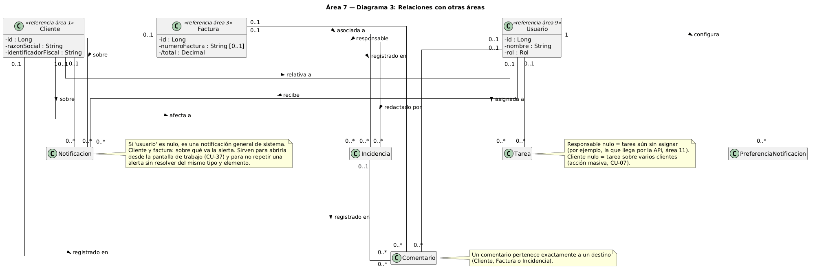

**Decisiones**

- **El área 7 escucha, no decide.** `ManejadorAlertasCobro`, `ManejadorAlertasEnvio` y `ManejadorSolicitudesResueltas` implementan `EscuchadorEventosDominio` y crean la notificación. Es la base del Observer de la Entrega 3.
- **Las alertas no se repiten.** No se crea otra si ya hay una sin resolver del mismo tipo para la misma factura o cliente.
- **Leída y resuelta son estados distintos** (CU-37).
- **Comentarios internos.** No se envían al cliente, y los restringidos solo los ven Administrador y Superadministrador (RB-32). Cada uno va sobre un cliente, una factura o una incidencia, exactamente uno.
- **Tareas** para las acciones masivas y las solicitudes de la API. Responsable nulo = sin asignar; cliente nulo = varios clientes.

**Trazabilidad**

| Requisito / CU | Clases y operaciones | Motivo |
|---|---|---|
| CU-37, CU-38 | `Notificacion`, `obtenerPantallaTrabajo()`, `PreferenciaNotificacion` | Pantalla de trabajo y preferencias |
| CU-40, RB-20, RB-22 | `Incidencia`, `abrirIncidencia()`, `cerrarIncidencia()` | Incidencias internas |
| CU-41, RB-32 | `Comentario`, `comentar()`, `esVisiblePara()` | Comentarios internos |
| CU-07, CU-58 | `Tarea`, `crearTarea()`, `asignarTarea()` | Tareas de seguimiento |
| UR-92, UR-93, FR-80 | `ManejadorAlertasCobro`, `ManejadorAlertasEnvio` | Alertas de impago y de envío |

## Área 8: Informes y contabilidad

**Diagramas**

| Diagrama | Contenido |
|---|---|
| `area8_1_modelo_informes` | `ObjetivoFacturacion`, `PaqueteContable`, `TipoCambio`, `ExportacionMasiva`, `InformeProgramado` y sus enumerados |
| `area8_2_patrones_informes` | `ServicioInformes`, `GeneradorPaqueteContable` y `ResumenFinancieroDTO` |
| `area8_3_relaciones_informes` | `PeriodoContable` y `Usuario` como referencias |

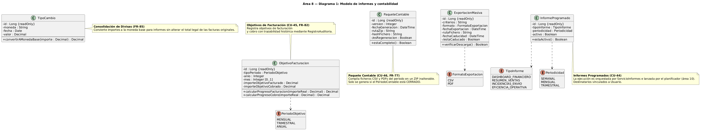

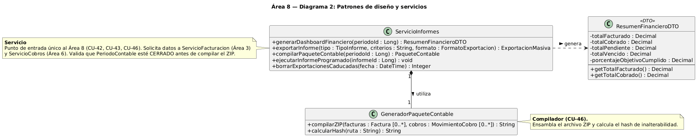

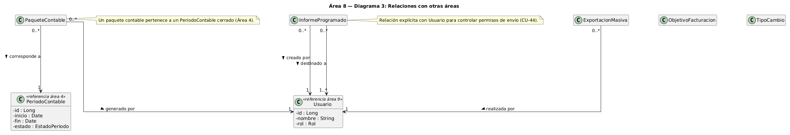

**Decisiones**

- **El área 8 solo lee.** Pide las cifras a `ServicioFacturacion` y `ServicioCobros` y no consulta las tablas de otras áreas.
- **Paquete contable inalterable.** Solo se genera con el periodo cerrado, es un ZIP con su hash y cada versión se conserva (RB-19).
- **Tipo de cambio solo para informes.** Convierte a la moneda base sin alterar el total legal de las facturas (FR-85).
- **Exportaciones temporales.** Caducan, y las borra el planificador con `borrarExportacionesCaducadas()` (FR-95).

**Trazabilidad**

| Requisito / CU | Clases y operaciones | Motivo |
|---|---|---|
| CU-42 | `generarDashboardFinanciero()`, `ResumenFinancieroDTO` | Dashboard |
| CU-43, FR-95 | `exportarInforme()`, `ExportacionMasiva`, `borrarExportacionesCaducadas()` | Exportaciones que caducan |
| CU-44 | `InformeProgramado`, `ejecutarInformeProgramado()` | Informes programados |
| CU-45, FR-82 | `ObjetivoFacturacion` | Objetivos de facturación y cobro |
| CU-46, RB-19 | `compilarPaqueteContable()`, `GeneradorPaqueteContable` | Paquete contable |
| FR-85 | `TipoCambio` | Consolidación de divisas |

## Área 9: Usuarios, seguridad y auditoría

**Diagramas**

| Diagrama | Contenido |
|---|---|
| `area9_1_modelo_usuarios_y_auditoria` | `Usuario`, `Sesion`, `TokenRecuperacion`, `AsignacionCliente`, `Delegacion`, `RegistroAuditoria`, `DescargaFichero`, copias y enumerados |
| `area9_2_patron_proxy_permisos` | Proxy de permisos, `ContextoSeguridad`, `Solicitante`, `IdentidadSistema` y `ControlAcceso` |
| `area9_3_relaciones_otras_areas` | `Cliente`, `Documento` y `ExportacionMasiva` como referencias |
| `area9_4_acceso_y_copias` | `ServicioAcceso` y `ServicioCopias` |

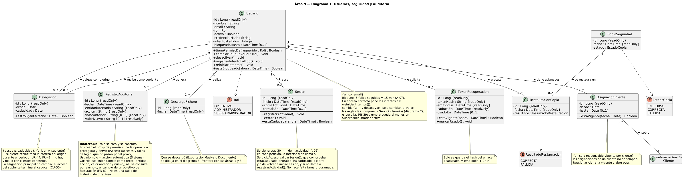

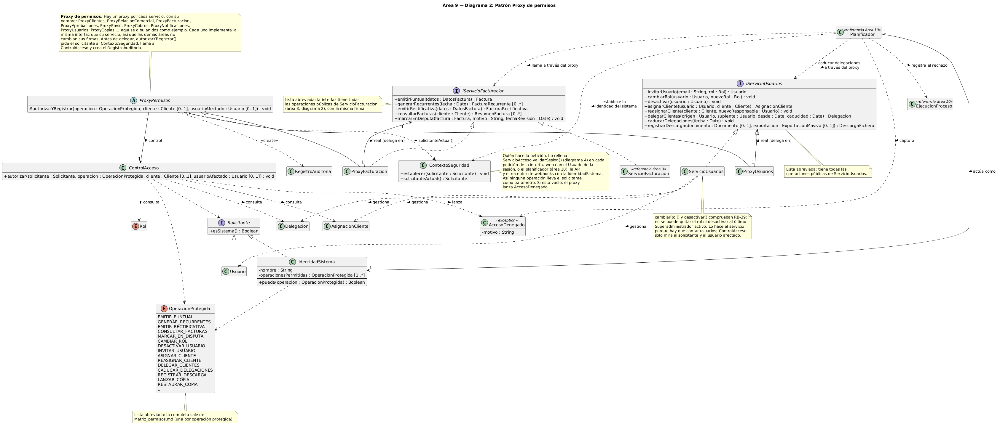

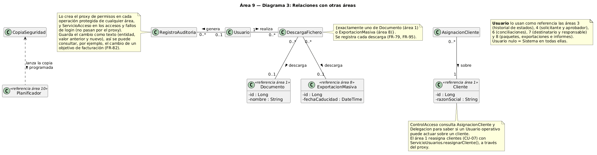

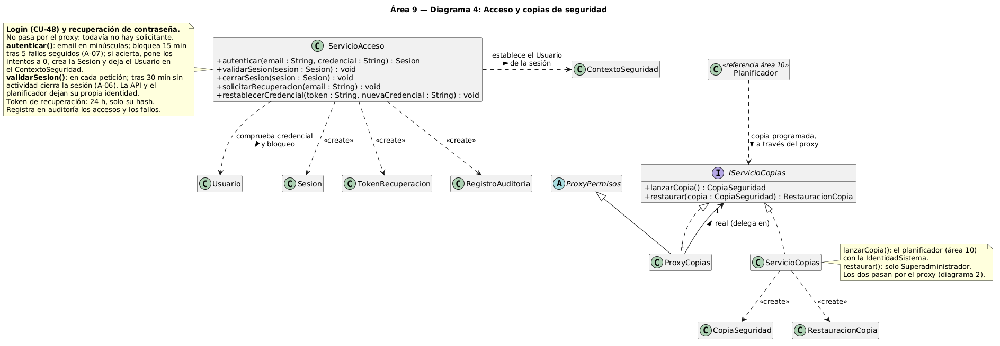

**Decisiones**

- **Un proxy por servicio** (Proxy de protección), con la misma interfaz que el servicio real. `ControlAcceso` decide y el proxy deja el `RegistroAuditoria`.
- **`ContextoSeguridad` da el solicitante.** Es un `Usuario` o la `IdentidadSistema` del planificador, de la API y de los webhooks (interfaz `Solicitante`), así que ninguna operación lleva el solicitante como parámetro.
- **El inicio de sesión no pasa por el proxy.** `ServicioAcceso` bloquea la cuenta 15 minutos tras 5 fallos seguidos (A-07), cierra la sesión tras 30 minutos sin actividad (A-06) y guarda solo el hash del enlace de recuperación.
- **Cartera.** Cada cliente tiene un solo responsable vigente (`AsignacionCliente`). Una `Delegacion` cede toda la cartera durante un periodo (FR-41).
- **Auditoría inalterable.** Solo se crea y se consulta; usuario nulo = Sistema.
- **Siempre queda un Superadministrador activo** (RB-39). Lo comprueba `ServicioUsuarios`, porque hay que contar usuarios.

**Trazabilidad**

| Requisito / CU | Clases y operaciones | Motivo |
|---|---|---|
| CU-48, A-06, A-07 | `ServicioAcceso.autenticar()`, `validarSesion()`, `Usuario.estaBloqueado()`, `Sesion` | Acceso y sesión |
| CU-49, FR-110, RB-38, RB-39 | `invitarUsuario()`, `cambiarRol()`, `desactivar()` | Gestión de usuarios |
| CU-50, RB-15, FR-39, FR-41 | `asignarCliente()`, `reasignarCliente()`, `delegarClientes()`, `AsignacionCliente`, `Delegacion` | Cartera y delegación |
| NFR-03 | `RegistroAuditoria`, `ProxyPermisos.autorizarYRegistrar()` | Auditoría |
| FR-79, FR-95 | `DescargaFichero`, `registrarDescarga()` | Registro de descargas |
| CU-53, CU-59, NFR-11 | `ServicioCopias.lanzarCopia()`, `restaurar()` | Copias de seguridad |

## Área 10: Configuración y sistema

**Diagramas**

| Diagrama | Contenido |
|---|---|
| `area10_1_configuracion` | `ConfiguracionGlobal` y `EntradaConfiguracion` |
| `area10_2_planificador` | `Planificador`, `TareaAutomatica`, `TareaProgramada`, `EjecucionProceso`, `DetalleFallo` y `ErrorTecnico` |
| `area10_3_calendario` | `CalendarioLaboral` y `FechaFestiva` |

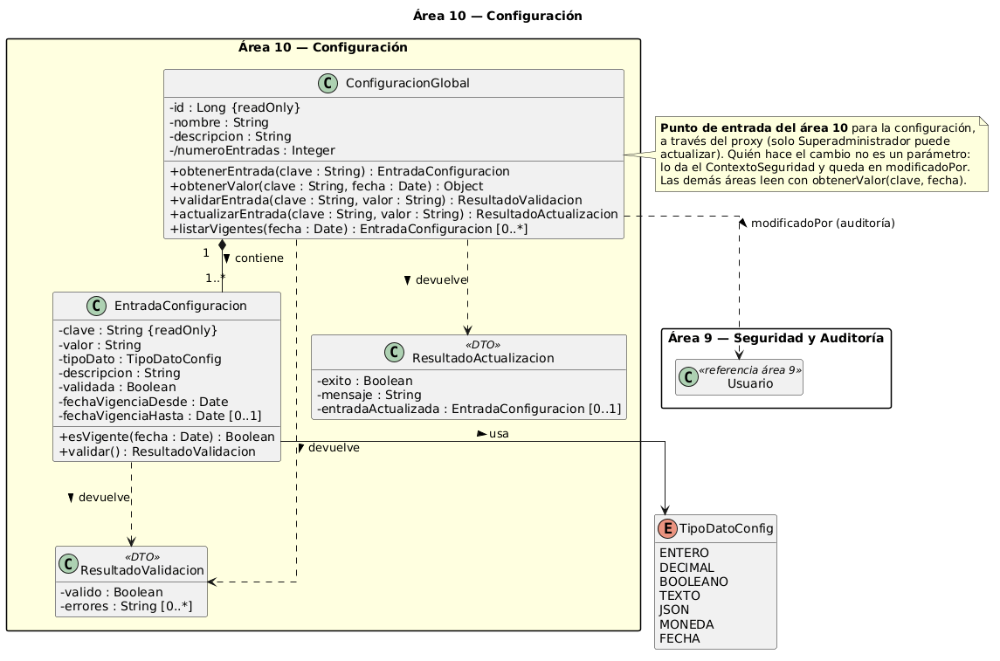

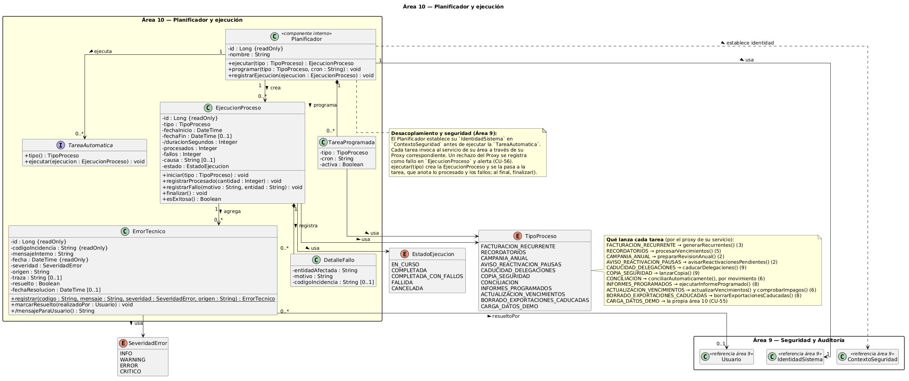

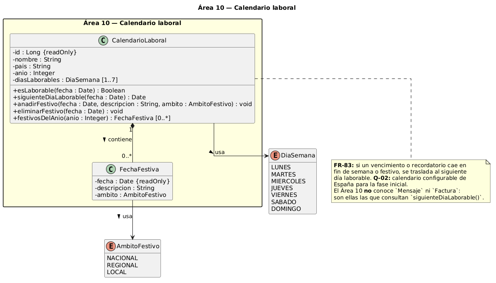

**Decisiones**

- **Configuración con vigencia.** Cada valor tiene sus fechas, y las demás áreas leen con `obtenerValor(clave, fecha)`. Así se sabe qué valor aplicaba en una fecha (Q-07).
- **Una tarea por tipo de proceso.** `Planificador.ejecutar(tipo)` crea la `EjecucionProceso` y se la pasa a la `TareaAutomatica` de ese tipo, que llama a su servicio por el proxy con la `IdentidadSistema`. Una nota del diagrama dice qué operación lanza cada tipo.
- **Cada ejecución queda registrada** con sus fallos (CU-56). Tras una caída se puede repetir sin duplicar (FR-100).
- **Errores técnicos.** El mensaje interno nunca se muestra al usuario, que ve un texto con el código de incidencia (FR-61, FR-62).
- **El calendario laboral lo consultan las demás áreas** (FR-83). El área 10 no conoce `Factura` ni `Mensaje`.

**Trazabilidad**

| Requisito / CU | Clases y operaciones | Motivo |
|---|---|---|
| Q-07, RB-04 | `ConfiguracionGlobal.obtenerValor()`, `EntradaConfiguracion` | Parámetros con vigencia (umbral, límites…) |
| FR-86, FR-100 | `Planificador.ejecutar()`, `TareaAutomatica`, `TipoProceso` | Tareas en segundo plano |
| CU-56 | `EjecucionProceso`, `DetalleFallo` | Estado de las ejecuciones |
| FR-61, FR-62 | `ErrorTecnico`, `/mensajeParaUsuario()` | Errores sin detalles internos |
| FR-83, Q-02 | `CalendarioLaboral.siguienteDiaLaborable()`, `FechaFestiva` | Días laborables |
| CU-55 | `TipoProceso.CARGA_DATOS_DEMO` | Datos de demostración |

## Área 11: API externa

**Diagramas**

| Diagrama | Contenido |
|---|---|
| `area11_api_externa` | `FachadaAPI`, `ConsumidorAPI`, `LlamadaAPI`, `SolicitudExterna`, `DatosConsultaCliente` y sus enumerados |

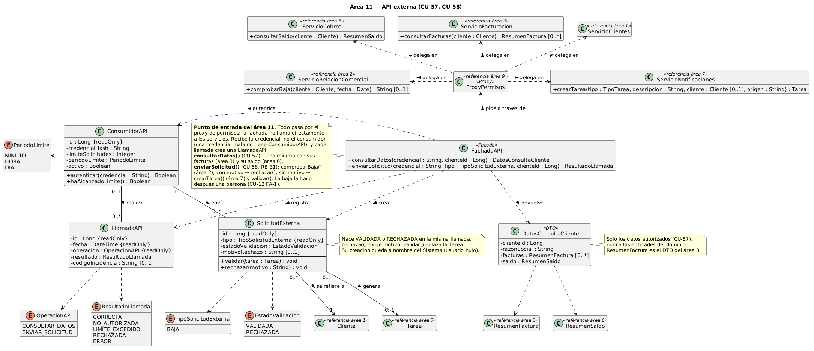

**Decisiones**

- **Facade.** `FachadaAPI` es el único punto de entrada de los sistemas externos y pasa por el proxy con las mismas reglas que la interfaz (RB-31).
- **Recibe la credencial, no el consumidor.** Una credencial mala no tiene `ConsumidorAPI`. Cada llamada deja una `LlamadaAPI`, también las no autorizadas.
- **Límite de solicitudes** por consumidor y periodo.
- **La API no modifica datos.** Una baja pedida por la API se comprueba con las mismas reglas (`comprobarBaja()`) y solo crea una tarea; la baja la hace una persona (CU-58, CU-12 FA-1).
- **Solo DTO hacia fuera** (`DatosConsultaCliente`), nunca entidades del dominio.

**Trazabilidad**

| Requisito / CU | Clases y operaciones | Motivo |
|---|---|---|
| CU-57 | `consultarDatos()`, `DatosConsultaCliente` | Consulta de datos autorizados |
| CU-58, RB-31 | `enviarSolicitud()`, `SolicitudExterna`, `comprobarBaja()`, `crearTarea()` | Solicitudes con las mismas reglas |
| NFR-50 | `ConsumidorAPI.credencialHash` | Credenciales separadas |
| FR-61 | `LlamadaAPI.codigoIncidencia` | Errores con código |

## Consistencia con otros modelos

**Con el modelo de datos.** No toda clase tiene tabla:

- Los servicios, los generadores, los adaptadores, el proxy y los DTO son clases de diseño y no se guardan.
- Las herencias se guardan en una sola tabla con una columna `tipo`. Por ejemplo, las tres subclases de `Factura` van en la tabla `factura`.
- Los atributos derivados (`/total`, `/importeSinAplicar`, el saldo pendiente) no son columnas, salvo los que se guardan para que una factura emitida no cambie (RB-07, RB-11).
- Los enumerados son columnas de texto con su `CHECK`.
- Los campos de trazabilidad sí son columnas.

El detalle está en el apartado 3.

**Con las secuencias y la arquitectura.** Las clases que aparecen en los diagramas de secuencia existen en algún diagrama de clases, con los mismos nombres de operación. Por ejemplo, las secuencias de CU-19 usan `ServicioFacturacion.emitirRectificativa()`, `FacturaRectificativa.emitir()`, `Factura.marcarRectificada()` y `Factura.registrarEstadoCobro()`. Los servicios de cada área son los componentes de la capa de servicios de la arquitectura (el apartado 6).

## Alternativas descartadas

| Alternativa | Por qué se descartó |
|---|---|
| Una subclase de `Usuario` por rol | Un usuario puede cambiar de rol y un objeto no puede cambiar de clase |
| Saldo pendiente como atributo derivado de `Factura` | Obligaba al área 3 a conocer las conciliaciones del área 6 (lógica en los dos sentidos) |
| Una sola interfaz `PasarelaPagos` para la pasarela y el banco | Un banco no es una pasarela, y cada adaptador habría implementado métodos que no usa |
| Que `ServicioAprobaciones` emita la factura o registre la baja al aprobar | El área 4 tendría que conocer las áreas 3 y 6. Es genérico y avisa con «solicitud resuelta» |
| Patrón State para los estados de la factura en esta entrega | Es un patrón de comportamiento que corresponde a la Entrega 3, y habría tres jerarquías, una por estado |

# 5. Diagramas UML de secuencia

## Selección de escenarios

Se han elegido escenarios sobre todo de los casos de uso del **núcleo** de la primera versión (apartado 1.4 de los requisitos). CU-57/58 son complementarios, pero se incluyen porque son la única entrada por la API externa. Entre ellos se han elegido los que pasan por las piezas más importantes de la arquitectura:

- el proxy de permisos;
- la fachada de la API externa;
- el planificador;
- los adaptadores de proveedores externos;
- los avisos (eventos) entre áreas.

Entre todos, los eventos entre áreas aparecen al menos en una secuencia. «Impago sobre el límite» no lo dispara ningún caso de uso, sino una tarea diaria del planificador, así que tiene su propio escenario automático. Las variantes de un mismo caso de uso (un flujo alternativo o de excepción relevante) van en un diagrama aparte.

| Diagrama | Caso de uso y escenario | Responsable |
|---|---|---|
| `cu15_1_emitir_factura` | CU-15, flujo principal: emisión directa | Abdelnaybet |
| `cu15_2_emitir_requiere_aprobacion` | CU-15, FA-3: supera el umbral y pasa a aprobación | Abdelnaybet |
| `cu19_1_emitir_rectificativa` | CU-19 (1), flujo principal: emisión de la rectificativa | Abdelnaybet |
| `cu19_2_abono_recalculo_cobro` | CU-19 (2): el área 6 recibe el abono y recalcula el cobro de la original (A-27) | Abdelnaybet |
| `tarea_1_vencimientos` | Tarea diaria del planificador (1): facturas que pasan a vencidas | Abdelnaybet |
| `tarea_2_impagos` | Tarea diaria del planificador (2): alertas de impago (UR-92, UR-93; la alerta se ve en CU-37) | Abdelnaybet |
| `cu17_1_generar_recurrentes` | CU-17 (1), flujo principal: generación mensual por el planificador | Luca |
| `cu17_2_recuperacion_tras_caida` | CU-17 (2): recuperación tras una caída a mitad de la generación | Luca |
| `cu27_enviar_factura` | CU-27, flujo principal: envío por correo; el fallo emite «fallos de envío» | Ana |
| `cu28_gestionar_fallo_envio` | CU-28: consultar el fallo, corregir el contacto y reintentar | Ana |
| `cu48_1_acceso_correcto` | CU-48 (1), flujo principal: acceso correcto | Guillermo |
| `cu48_2_credencial_incorrecta` | CU-48 (2): credencial incorrecta | Guillermo |
| `cu48_3_cuenta_bloqueada` | CU-48 (3): cuenta bloqueada | Guillermo |
| `cu22_proponer_excepcion_prorrateo` | CU-22: proponer una excepción de prorrateo (la propuesta de una factura sigue CU-15, diagrama 2) | Cristóbal |
| `cu23_1_aprobar_solicitud` | CU-23 (1), flujo principal: aprobar (FE-1 y FA-1 como alternativas) | Cristóbal |
| `cu23_2_rechazar_solicitud` | CU-23 (2), FA-2: rechazar con comentario | Cristóbal |
| `cu34_registrar_cobro_pasarela` | CU-34, flujo principal: la pasarela notifica un pago y se concilia solo (FE-1, evento repetido) | Loraine |
| `cu35_1_conciliar_manualmente` | CU-35 (1), flujo principal: bandeja y conciliación manual (FA-2 en nota) | Loraine |
| `cu35_2_deshacer_conciliacion` | CU-35 (2), FA-1: deshacer una conciliación | Loraine |
| `cu57_consultar_datos_api` | CU-57: un sistema externo consulta los datos de un cliente (FE-1 y FE-2 como alternativas) | Imad |
| `cu58_enviar_solicitud_api` | CU-58: un sistema externo pide la baja de un cliente (FE-1 como alternativa) | Imad |

## Notación

Todos los diagramas siguen las mismas reglas:

- **Participantes:** instancias con el nombre subrayado (`: ServicioFacturacion`, `r : FacturaRectificativa`).
- **Llamadas:** solo se numeran las llamadas. Las respuestas son flechas discontinuas sin número.
- **Creación:** los objetos se crean con una flecha discontinua hacia la caja del participante, que aparece a esa altura.
- **Base de datos:** el acceso a la base de datos se dibuja como un mensaje hacia un punto en el borde derecho («buscar… en BD», «guardar… en BD»). La persistencia no es una clase del dominio.
- **Avisos entre áreas (eventos):** flecha verde. Indica que el área que emite no llama a la que escucha (ver «Lógica entre áreas en un solo sentido» en el apartado 4).
- **Comprobación de permisos:** toda petición de un usuario, de la API, de la pasarela o del planificador entra por el proxy de permisos, que la autoriza y la registra en la auditoría antes de llamar al servicio. La única excepción es el inicio de sesión (CU-48), que ocurre antes de que haya un solicitante.

## CU-15: Emitir factura puntual

**Diagrama 1. Emisión directa.** El Usuario operativo pide emitir una factura y el proxy comprueba su rol y que el cliente esté en su cartera (RB-15). `ServicioFacturacion` usa el `GeneradorPuntual` (Factory Method), que crea la factura y sus líneas, calcula los totales y comprueba el umbral. Como no lo supera, el servicio busca el periodo contable abierto y la serie ordinaria, y llama a `factura.emitir()`. La factura toma el siguiente número de la serie (RB-01) y deja la transición en el historial. Al final, `GestorDocumentos` genera el PDF y se guarda todo.

**Diagrama 2. Supera el umbral (FA-3).** Igual hasta la comprobación del umbral. Como lo supera, la factura pasa a pendiente de aprobación y `ServicioFacturacion` crea la solicitud en `ServicioAprobaciones` (área 4). La factura no se emite todavía. Cuando se resuelve la solicitud, el área 4 emite «solicitud resuelta» y `ServicioFacturacion.alResolverSolicitud()` emite la factura (diagrama 1, desde el paso de emitir) o la devuelve a borrador (CU-23).

**Decisiones**

- La serie y el periodo los pide el servicio, no `Factura`, para que el área 3 no dependa del área 4.
- FE-1 (doble clic): la petición repetida se detecta y solo se emite una factura (FR-87). Se indica en una nota en lugar de en un diagrama aparte.

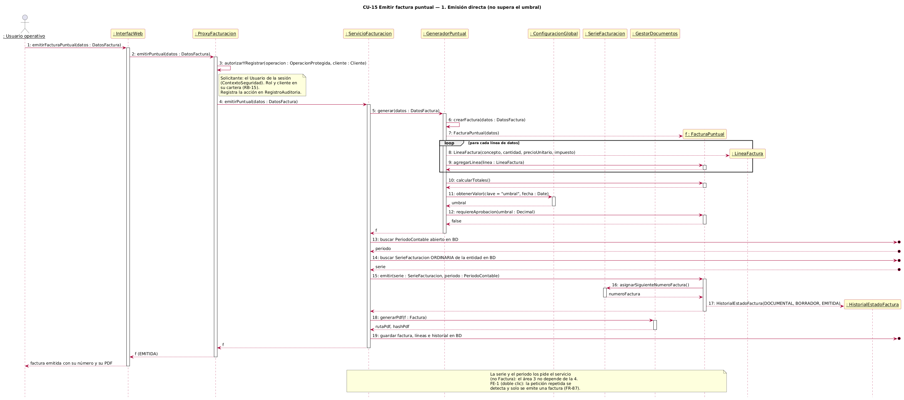

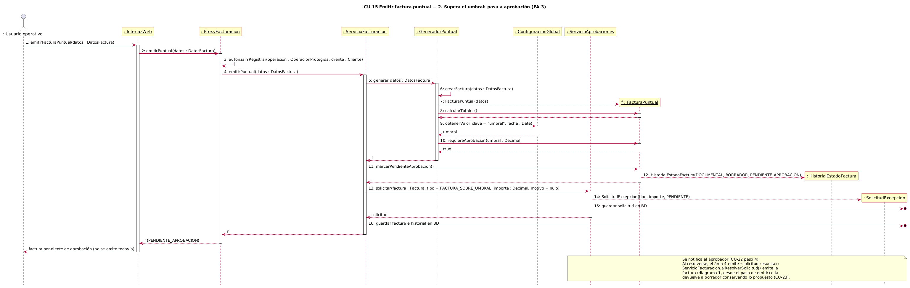

## CU-19: Emitir factura rectificativa

El caso se divide en dos diagramas para que se lean bien. El corte está en el evento «abono emitido»: el primero acaba cuando el área 3 lo emite y el segundo empieza cuando el área 6 lo recibe.

**Diagrama 1. Emisión de la rectificativa.** El Administrador pide rectificar una factura emitida. El proxy solo deja pasar a Administrador y Superadministrador (RB-21); un Usuario operativo recibe la denegación (FE-1). El `GeneradorRectificativa` comprueba que la original esté emitida (PRE-2), crea la rectificativa con las líneas corregidas y comprueba el umbral. `ServicioFacturacion` busca la serie de tipo rectificativa y llama a `emitir()`. La rectificativa numera y deja su historial, y después marca la original como rectificada sin modificarla (POST-1, RB-11).

Si la rectificativa es un **abono** (total negativo, `esAbono()`), emite el evento «abono emitido».

**Diagrama 2. El área 6 recalcula el cobro.** `ServicioCobros` (área 6) recibe «abono emitido» y recalcula el saldo de la original:

- **Saldo 0 o negativo:** si la original no estaba pagada, pasa a pagada con `registrarEstadoCobro()`. El área 6 emite «estado de cobro cambiado» y `ServicioRecordatorios.alCambiarEstadoCobro()` (área 5) cancela los recordatorios pendientes de esa factura (A-27, RB-37).
- **Saldo negativo:** el abono supera el saldo pendiente. Lo habitual es que se corrija una factura ya cobrada, pero también pasa si se abona más de lo que se debía. La diferencia queda a favor del cliente y la original se marca con `marcarCobroExcesivo()`. Qué se hace con ese dinero (devolución o saldo a favor) depende de Q-12, que sigue abierta.

**Decisiones**

- El abono va en un fragmento `opt` al final del diagrama 1: la única diferencia con una rectificativa positiva es el aviso al área 6. Una rectificativa positiva tiene su propio estado de cobro y no lanza el aviso, así que el diagrama 2 solo ocurre con abonos.
- El aviso se entrega cuando la emisión ya está guardada, para que el área 6 calcule el saldo con el abono incluido.
- FA-1 (sobre el umbral) sigue el mismo camino que el diagrama 2 de CU-15 y no se repite.
- POST-2 (el saldo del cliente refleja la corrección) no necesita ningún paso: el saldo del cliente no se guarda, se calcula al consultarlo (CU-33) y ya incluye el abono.

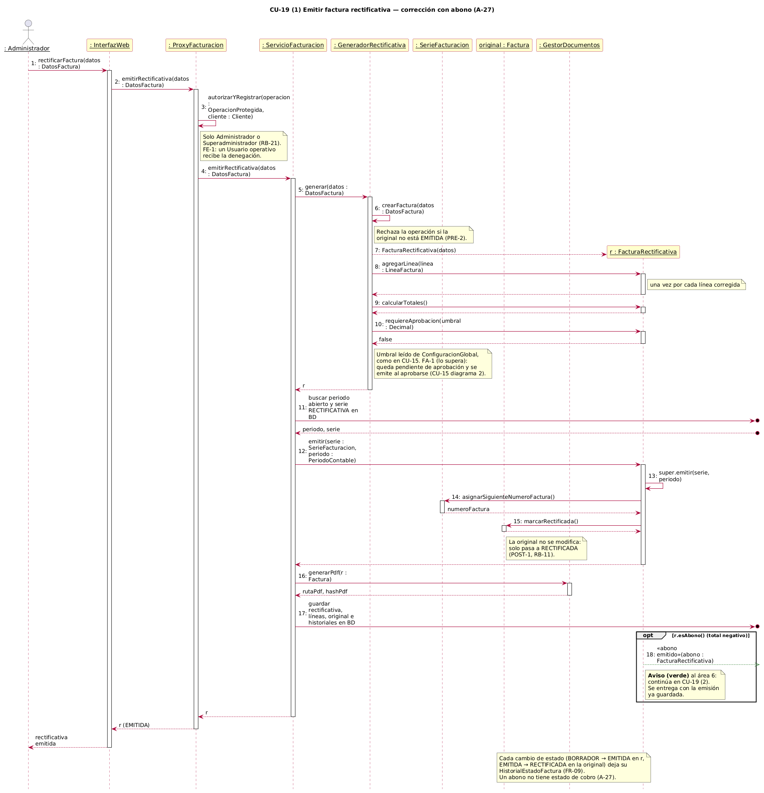

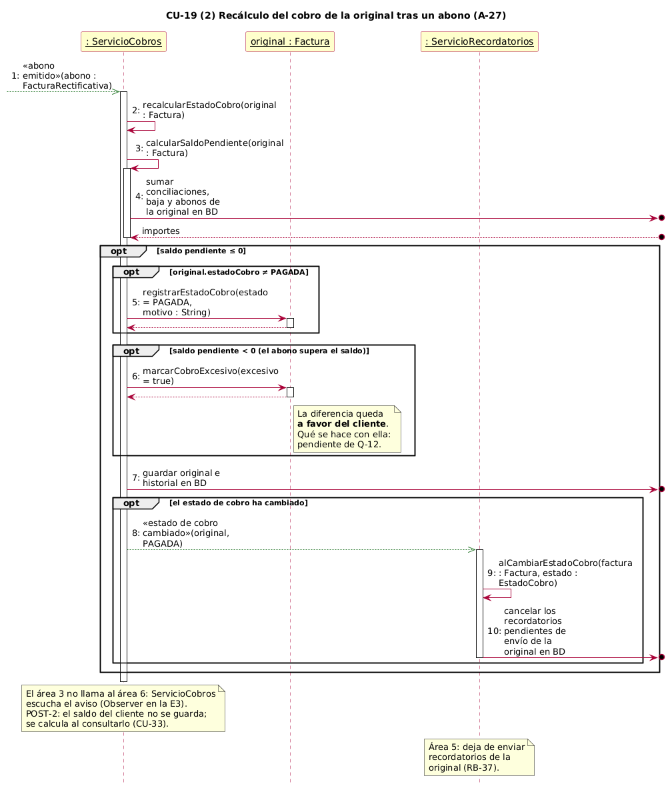

## Tarea diaria: vencimientos y alertas de impago

**Escenario automático, sin actor.** El planificador (área 10) entra por el proxy de permisos con la identidad de sistema: no es un rol de usuario, solo puede lanzar las tareas programadas y en la auditoría queda como «Sistema». Si el proxy la rechaza, se registra como fallo en `EjecucionProceso` y salta una alerta (CU-56).

El planificador lanza `ejecutar(ACTUALIZACION_VENCIMIENTOS)`: crea la `EjecucionProceso` y se la pasa a la `TareaAutomatica` de ese tipo, que llama al servicio del área 6 por su proxy y anota lo procesado. La tarea se divide en dos diagramas, uno por paso, dentro de la misma ejecución: el diagrama 1 la crea y el diagrama 2 la finaliza.

1. **Vencimientos (diagrama 1).** `ServicioCobros.actualizarVencimientos()` pasa a VENCIDA las facturas pendientes sin ningún cobro cuyo vencimiento ha pasado, con `registrarEstadoCobro()`. Es la transición «Pendiente → Vencida (Sistema)» de la Entrega 1.
2. **Límites de impago (diagrama 2).** `ServicioCobros.comprobarImpagos()` lee los dos límites de `ConfiguracionGlobal`:
   - Revisa **todas** las facturas con saldo y el vencimiento pasado (`estaVencida()`), no solo las que acaban de vencer. Las que vencieron hace días siguen envejeciendo, y son ellas las que cruzan el límite de días (UR-92).
   - Comprueba la deuda de cada cliente afectado con `consultarSaldo()` (UR-93).
   - Si se supera un límite, emite «impago sobre el límite». El área 7 lo escucha (`ManejadorAlertasCobro`) y crea la alerta (`FACTURA_VENCIDA` o `ALERTA_DEUDA`), que el usuario ve en su pantalla de trabajo (CU-37).

**Decisiones**

- **La alerta no se repite.** El área 6 avisa cada día mientras siga el impago, y el área 7 no crea otra alerta si ya hay una sin resolver del mismo tipo y para la misma factura o cliente. Así el área 6 no guarda si ya avisó, y si la tarea falla un día, al siguiente avisa igual. Para comprobarlo, `Notificacion` guarda la factura o el cliente de la alerta.
- **UR-93 puede llegar con hasta un día de retraso.** La deuda también crece al emitir una factura (área 3), pero solo se comprueba en esta tarea. Comprobarlo también al emitir obligaría al área 3 a conocer los límites de cobro. Se acepta para la primera versión.
- **Detecta el área 6 y avisa el área 7.** El área 6 es la que conoce el saldo y el vencimiento; el área 7 solo crea la alerta.

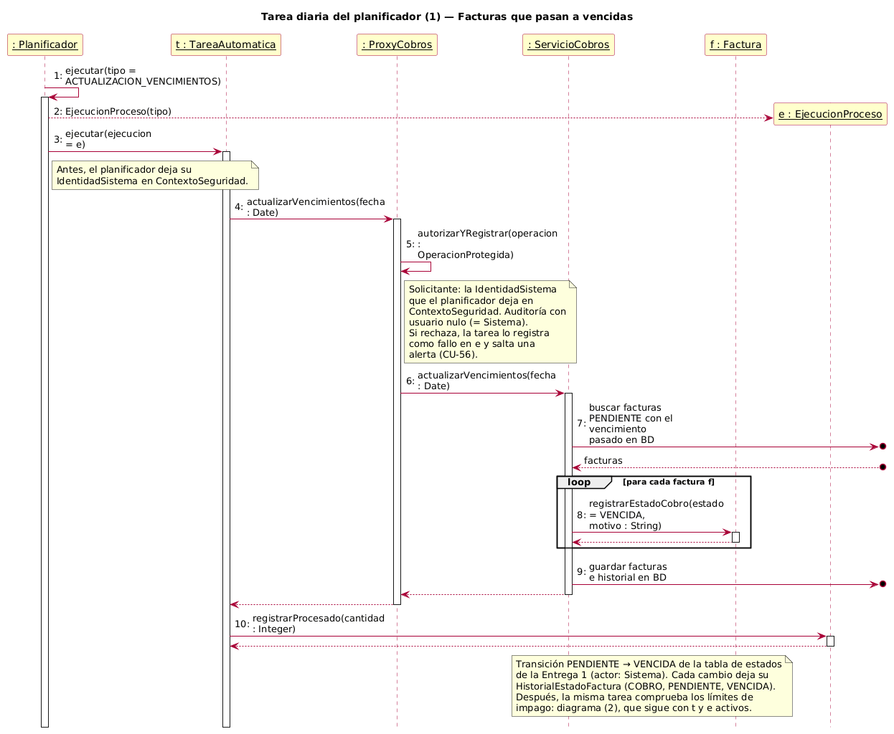

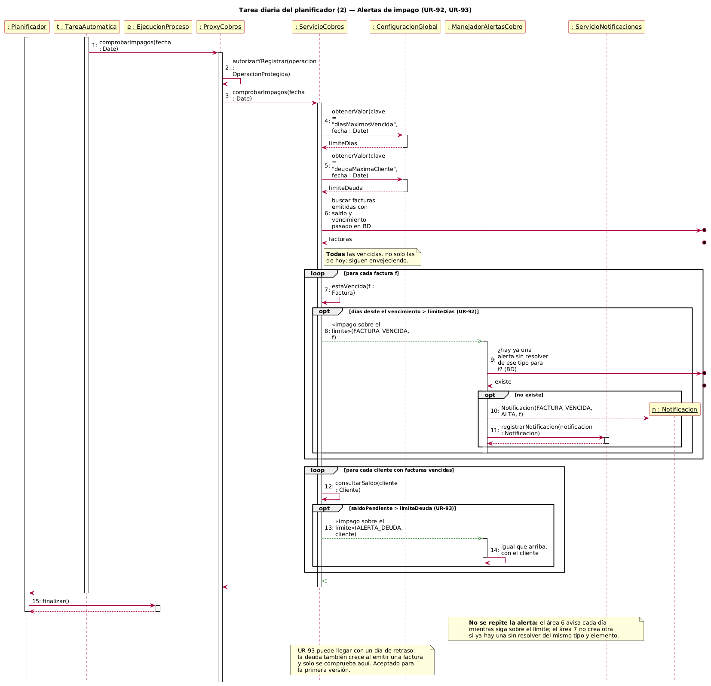

## CU-17: Generar facturas recurrentes

**Diagrama 1. Generación mensual.** El día 1 de cada mes el planificador lanza `ejecutar(FACTURACION_RECURRENTE)`: crea la `EjecucionProceso` y se la pasa a la `TareaAutomatica`, que entra por `ProxyFacturacion` con la identidad de sistema. `ServicioFacturacion.generarRecurrentes()` busca las configuraciones activas que aún no tienen factura ese mes y, para cada una:

- comprueba con `seFactura()` que no está en pausa ni dada de baja;
- toma el importe del tramo vigente (`importeVigente()`);
- crea la factura con el `GeneradorRecurrente` (Factory Method), que aplica el prorrateo el primer mes si el alta fue después del día 1;
- la emite como en CU-15 (serie, número y PDF) y la guarda.

Al final, la tarea anota en la ejecución las facturas generadas y el planificador la finaliza.

**Diagrama 2. Recuperación tras una caída.** Si el sistema se cae a mitad de la generación, al volver a arrancar el planificador encuentra la ejecución que quedó en curso, le registra el fallo y la finaliza. Después lanza una ejecución nueva, y `generarRecurrentes()` solo encuentra las configuraciones que se quedaron sin factura.

**Decisiones**

- **Sin duplicados.** La búsqueda excluye las configuraciones que ya tienen factura del mes, y además la base de datos impide guardar dos facturas del mismo mes para la misma configuración (FR-100). Repetir la generación es seguro.
- **Excepción sin prorrateo (FA-1).** Si se aprobó la excepción de CU-22, la configuración ya tiene aplicado `aplicarExcepcionSinProrrateo()` y el generador no prorratea. Se indica en una nota.
- El resultado de cada ejecución lo ve el Administrador en el estado del sistema (CU-56).

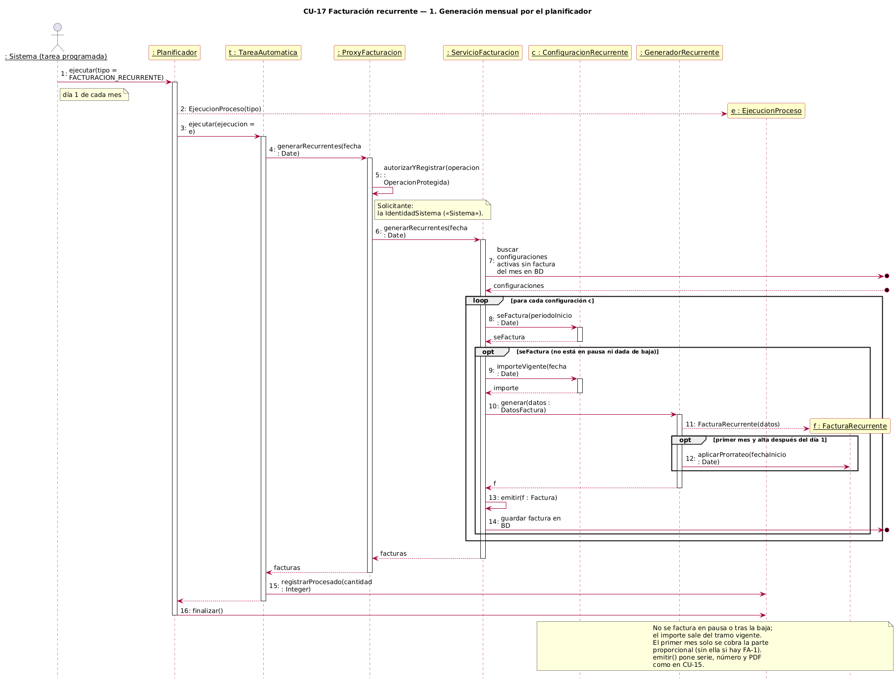

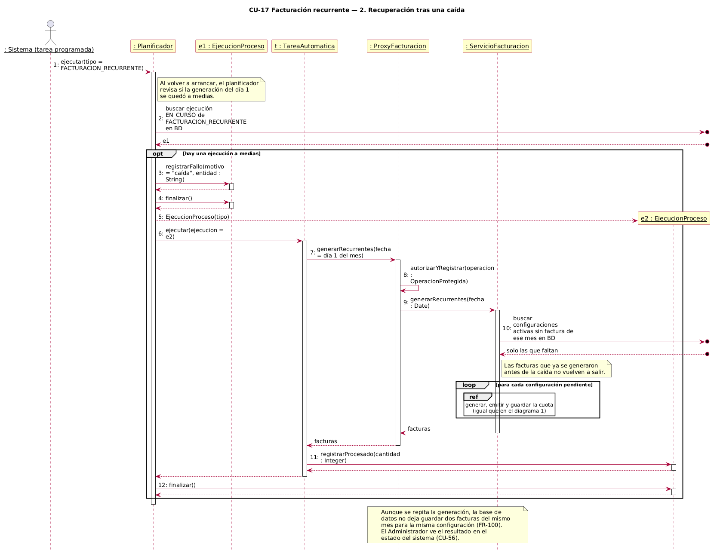

## CU-27 y CU-28: Enviar factura y gestionar el fallo

**CU-27. Enviar la factura.** El Usuario operativo pide enviar una factura emitida y `ProxyEnvio` comprueba que el cliente está en su cartera. `ServicioEnvio.enviarFactura()`:

1. Obtiene el contacto de facturación del cliente y comprueba el consentimiento para su canal preferido. WhatsApp solo con un número válido y consentimiento (RB-28).
2. Compone el texto con la plantilla (`generarTexto()`) y obtiene el PDF de `GestorDocumentos`.
3. Crea el `Mensaje`, registra el intento y lo envía por `CanalEnvio` (patrón Adapter). En el diagrama, `AdaptadorCorreo` llama al servicio de correo simulado.
4. Según el resultado:
   - **Aceptado:** marca el mensaje como enviado y pide al área 3 que pase la factura a `ENVIADA`.
   - **Rechazado:** marca el mensaje como fallido con el motivo, pide al área 3 `FALLO_ENVIO` y emite «fallos de envío». El área 7 (`ManejadorAlertasEnvio`) crea la alerta de la pantalla de trabajo (CU-37).

**CU-28. Gestionar el fallo.** Desde la alerta, el usuario consulta los mensajes de la factura (`consultarMensajes()`) y ve el motivo del fallo. Si es un dato de contacto erróneo, lo corrige (CU-03). Después reintenta con `reintentarEnvio()`. Si vuelve a fallar se emite de nuevo «fallos de envío», y con tres fallos seguidos el área 7 abre una incidencia (FE-1, FR-80).

**Decisiones**

- **El área 5 no toca la factura.** Pide el cambio de estado de envío al área 3 (`registrarEstadoEnvio()`), y cada cambio deja su historial (tipo ENVIO, FR-09).
- **El reintento usa el mismo mensaje y la misma factura.** Solo suma un intento: la factura no se duplica ni consume numeración.
- **Detecta el área 5 y avisa el área 7.** El área 5 no sabe nada de alertas ni de incidencias; solo emite el evento.
- Corregir el contacto es otro caso de uso (CU-03) y aparece como referencia.

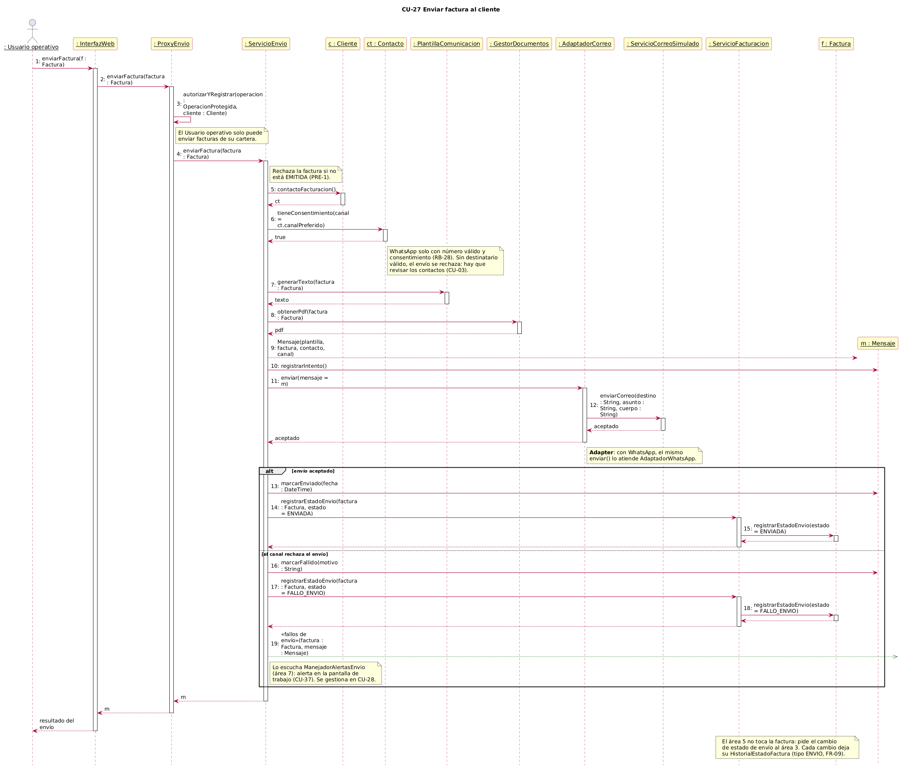

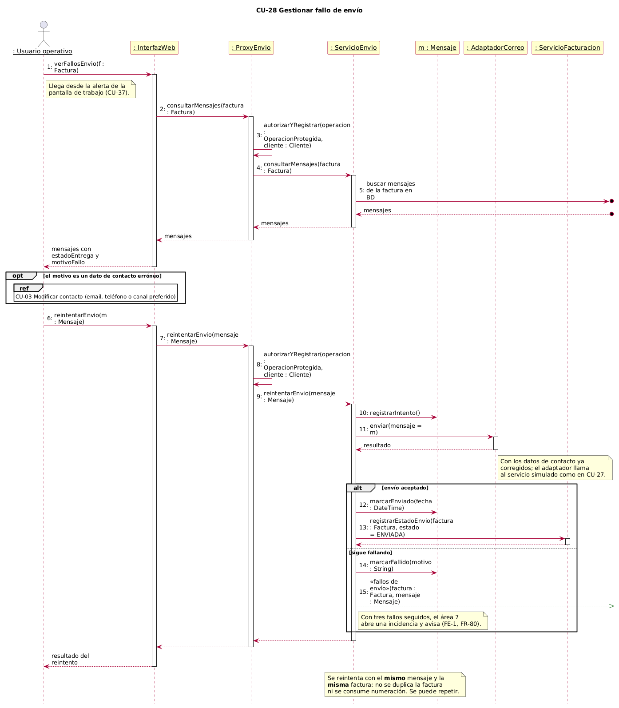

## CU-48: Acceder al sistema

La persona escribe su email y su credencial, y la interfaz llama a `ServicioAcceso.autenticar()`. No pasa por el proxy, porque todavía no hay solicitante. El email se pasa a minúsculas antes de buscarlo. Hay un diagrama por cada resultado:

- **Diagrama 1. Acceso correcto.** Comprueba que la cuenta no está bloqueada (`estaBloqueado()`) y la credencial. Pone los intentos fallidos a 0 (`reiniciarIntentos()`), crea la `Sesion`, deja el usuario en el `ContextoSeguridad` (`establecer()`) y registra el acceso en la auditoría.
- **Diagrama 2. Credencial incorrecta.** Si el email no existe, solo registra el fallo. Si existe, suma un intento fallido (`registrarIntentoFallido()`); al quinto seguido, la cuenta queda bloqueada 15 minutos (A-07).
- **Diagrama 3. Cuenta bloqueada.** No comprueba la credencial ni suma intentos. Registra el intento y responde hasta cuándo dura el bloqueo.

**Decisiones**

- **El mismo error si el email no existe y si la credencial no coincide,** para no revelar qué emails están dados de alta.
- **`ServicioAcceso` registra él mismo en la auditoría,** porque el inicio de sesión no pasa por el proxy.
- **La caducidad de la sesión** (30 minutos sin actividad, A-06) la comprueba `validarSesion()` en cada petición. No hace falta una tarea programada.

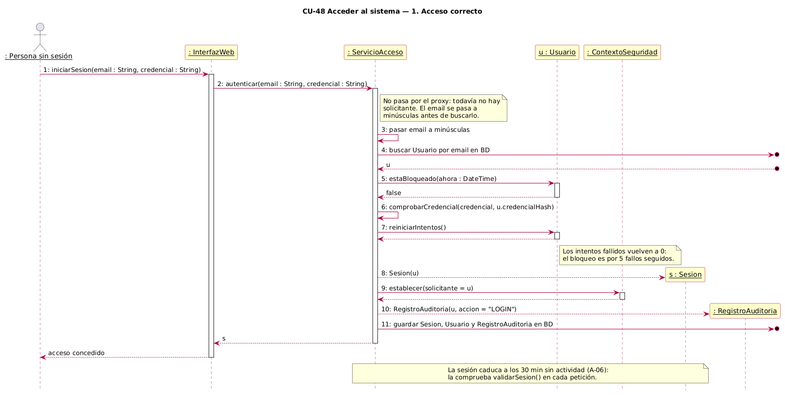

## CU-22 y CU-23: Proponer una excepción y resolverla

**CU-22. Proponer una excepción de prorrateo.** El Usuario operativo propone no cobrar el prorrateo del primer mes de una facturación recurrente. La factura todavía no existe, así que la propuesta va sobre la `ConfiguracionRecurrente`. `ProxyAprobaciones` comprueba que el cliente está en su cartera (FE-1, RB-15). `ServicioAprobaciones.solicitarExcepcionProrrateo()` toma el solicitante del `ContextoSeguridad`, lee de la configuración el importe que se dejaría de facturar (`calcularPrimeraCuota()`) y crea la `SolicitudExcepcion` PENDIENTE. Al guardarla emite «solicitud creada», y el área 7 (`ManejadorSolicitudesResueltas`) avisa a cada aprobador (paso 4).

La **propuesta de una factura** (descuento, importe o fecha manual) no se repite: es el diagrama 2 de CU-15, con el tipo de la modificación y el motivo de `DatosFactura`. La factura queda pendiente de aprobación sin número (RB-25).

**CU-23 (1). Aprobar.** El Administrador abre la bandeja con `listarPendientes()` y aprueba una solicitud. `ServicioAprobaciones.aprobar()` toma el aprobador del `ContextoSeguridad`, lee el umbral de `ConfiguracionGlobal` y comprueba dos casos, que son las alternativas del diagrama:

- **FE-1, autoaprobación:** el aprobador es quien la pidió (FR-74).
- **FA-1, supera el umbral:** el importe supera el umbral y el aprobador no es Superadministrador (RB-04). La solicitud sigue pendiente hasta que la resuelva un Superadministrador.

Si puede aprobar, `s.aprobar()` guarda el aprobador, el comentario y la fecha (paso 4), y el servicio emite «solicitud resuelta». El área 3 (`alResolverSolicitud()`) aplica lo aprobado (paso 5): en una excepción de prorrateo llama a `aplicarExcepcionSinProrrateo()`; en una factura, la emite como en el diagrama 1 de CU-15. El área 7 avisa al solicitante.

**CU-23 (2). Rechazar (FA-2).** El comentario es obligatorio. `s.rechazar()` deja la solicitud rechazada y se emite «solicitud resuelta». Si era una factura, el área 3 la devuelve a borrador con `volverABorrador()`, conservando lo propuesto y dejando el historial, para que el solicitante la corrija y la reenvíe (POST-2). Si era una excepción de prorrateo, no se aplica. El área 7 avisa al solicitante con el motivo (CU-37).

**Decisiones**

- **El área 4 no toca la factura ni la configuración.** Solo resuelve la solicitud y emite el evento; quien la pidió (área 3, o área 6 en una baja contable) actúa al recibirlo. Así la dependencia va del área 3 a la 4 y no al revés.
- **El umbral lo lee el servicio, no la interfaz.** La interfaz no accede a `ConfiguracionGlobal`: todo pasa por el proxy.
- **Las comprobaciones de FE-1 y FA-1 se repiten al rechazar.** Se indica en una nota del diagrama 2 en lugar de dibujarlas otra vez.

## CU-34 y CU-35: Registrar el cobro de la pasarela y conciliar

**CU-34. Cobro notificado por la pasarela.** No hay usuario ni sesión. El receptor de webhooks (vista 1 de la arquitectura) recibe el aviso de la pasarela, deja la `IdentidadSistema` en el `ContextoSeguridad` y entra por `ProxyCobros`, igual que el planificador. `ServicioCobros.registrarNotificacion()` solo conoce la interfaz `ReceptorNotificacionesPago`. `AdaptadorStripe` traduce el aviso de Stripe a un `MovimientoCobro` (patrón Adapter). El servicio busca en la base de datos un movimiento con el mismo origen e identificador externo:

- **Ya existe (FE-1):** el evento se ignora y no se contabiliza dos veces. La base de datos lo garantiza con `{único: origen + idExterno}`.
- **Es nuevo:** se guarda (POST-1) y se intenta `conciliarAutomaticamente()`. Si la referencia identifica una sola factura, `m.aplicarA()` crea la `Conciliacion` por el importe que cabe en el saldo; si el cobro lo supera, la factura se marca con `marcarCobroExcesivo()` y el excedente queda en el movimiento (A-28, Q-12). Si la referencia falta o es ambigua, el movimiento queda en revisión para CU-35.

**CU-35 (1). Conciliación manual.** El Administrador (PRE-3) abre la bandeja con `consultarBandejaConciliacion()`: movimientos pendientes, parciales o en revisión. Asocia un movimiento con una factura y un importe; `conciliarManualmente()` toma el usuario del `ContextoSeguridad`, comprueba el importe y la moneda, y `m.aplicarA()` crea la `Conciliacion` con quien la hizo. Si el importe es menor que el saldo, el pago queda parcial (FA-2).

**CU-35 (2). Deshacer (FA-1).** `c.deshacer()` guarda la fecha y el motivo; la fila no se borra, así queda la traza. El importe vuelve a estar sin aplicar y el movimiento reaparece en la bandeja.

En los tres casos, si el estado de cobro de la factura cambia, `recalcularEstadoCobro()` lo registra con su historial y emite «estado de cobro cambiado». `ServicioRecordatorios` (área 5) cancela los recordatorios si la factura queda pagada, o los mantiene sobre el saldo (RB-37).

**Decisiones**

- **La pasarela también pasa por el proxy,** con la `IdentidadSistema` como solicitante: así la notificación queda en la auditoría como «Sistema» y la única entrada sin proxy sigue siendo el inicio de sesión (CU-48). La conciliación automática queda sin `realizadoPor`.
- **Conciliar solo crea la `Conciliacion`.** Lo aplicado y lo sin aplicar del movimiento, y el saldo de la factura, son derivados: deshacer no tiene que recalcular nada guardado.
- **Una conciliación por movimiento y factura** mientras no se deshaga (FR-87).

## CU-57 y CU-58: La API externa

El sistema externo solo conoce `FachadaAPI` (patrón Facade). Las dos operaciones empiezan igual: la fachada busca el `ConsumidorAPI` por el hash de la credencial, comprueba con `autenticar()` y `haAlcanzadoLimite()`, y decide:

- **Credencial inválida o consumidor inexistente:** responde `NO_AUTORIZADA` (FE-2 de CU-57).
- **Límite alcanzado:** responde `LIMITE_EXCEDIDO` (FE-1 de CU-57).
- **Correcta:** deja la `IdentidadSistema` de la API en el `ContextoSeguridad` y llama a los servicios **a través de sus proxies**, como cualquier otra entrada.

En todos los casos guarda una `LlamadaAPI` con el resultado (POST-1).

**CU-57. Consultar datos.** La fachada pide las facturas del cliente (`consultarFacturas()`, área 3) y su saldo (`consultarSaldo()`, área 6), y devuelve un `DatosConsultaCliente`: solo los datos autorizados, en DTO, nunca las entidades del dominio.

**CU-58. Solicitar la baja de un cliente.** La fachada comprueba la baja con `comprobarBaja()` del área 2, la misma regla que aplica la interfaz en CU-12 (RB-31), y crea la `SolicitudExterna`:

- **Hay motivo (FE-1):** `s.rechazar(motivo)` y responde `RECHAZADA`.
- **No hay motivo:** el área 7 crea una tarea de revisión (`crearTarea()`), `s.validar(t)` la enlaza y responde `CORRECTA`. La baja la hace después una persona (CU-12 FA-1).

**Decisiones**

- **La fachada recibe la credencial, no el consumidor.** Una credencial mala no tiene `ConsumidorAPI`, y aun así la llamada queda registrada.
- **La API no da de baja a nadie.** Solo valida la petición y deja una tarea; la decisión sigue siendo de una persona.
- **Las mismas reglas que la interfaz.** La API no duplica validaciones: llama a las operaciones de cada área por su proxy.

## Trazabilidad

| Diagrama | Caso de uso | Participantes / responsabilidades |
|---|---|---|
| `cu15_1_emitir_factura` | CU-15 (flujo principal, FE-1 en nota) | `InterfazWeb`; `ProxyFacturacion` (RB-15, auditoría); `ServicioFacturacion` (orquesta); `GeneradorPuntual` (crea); `FacturaPuntual`, `LineaFactura`, `HistorialEstadoFactura`; `ConfiguracionGlobal` (umbral); `SerieFacturacion` (número, RB-01); `GestorDocumentos` (PDF) |
| `cu15_2_emitir_requiere_aprobacion` | CU-15 FA-3, CU-22 | Los anteriores y `ServicioAprobaciones` (área 4), que crea la `SolicitudExcepcion` |
| `cu19_1_emitir_rectificativa` | CU-19 (flujo principal, FE-1 y FA-1 en nota) | `ProxyFacturacion` (RB-21); `ServicioFacturacion`; `GeneradorRectificativa`; `FacturaRectificativa`; la factura original (`marcarRectificada()`); `GestorDocumentos` (PDF) |
| `cu19_2_abono_recalculo_cobro` | CU-19 (abono), A-27, RB-37 | `ServicioCobros` (área 6: escucha el abono, `calcularSaldoPendiente()`); la factura original (`registrarEstadoCobro()`, `marcarCobroExcesivo()`); `ServicioRecordatorios` (área 5, `alCambiarEstadoCobro()`) |
| `cu17_1_generar_recurrentes` | CU-17 (flujo principal; FA-1 en nota) | `Planificador`, `TareaAutomatica` y `EjecucionProceso` (área 10); `ProxyFacturacion` (identidad de sistema); `ServicioFacturacion` (`generarRecurrentes()`, `emitir()`); `ConfiguracionRecurrente` (`seFactura()`, `importeVigente()`); `GeneradorRecurrente`; `FacturaRecurrente` (`aplicarProrrateo()`) |
| `cu17_2_recuperacion_tras_caida` | CU-17 (recuperación), FR-100, CU-56 | `Planificador` y `EjecucionProceso` (`registrarFallo()`, `finalizar()`); `TareaAutomatica`; `ProxyFacturacion`; `ServicioFacturacion` |
| `cu27_enviar_factura` | CU-27, RB-28, FR-09 | `ProxyEnvio`; `ServicioEnvio` (`enviarFactura()`); `Cliente` (`contactoFacturacion()`) y `Contacto` (`tieneConsentimiento()`) (área 1); `PlantillaComunicacion` (`generarTexto()`); `GestorDocumentos` (PDF); `Mensaje`; `AdaptadorCorreo` y `ServicioCorreoSimulado` (Adapter); `ServicioFacturacion` y `Factura` (`registrarEstadoEnvio()`) |
| `cu28_gestionar_fallo_envio` | CU-28 (FE-1 en nota), CU-03 (referencia), FR-80 | `ProxyEnvio`; `ServicioEnvio` (`consultarMensajes()`, `reintentarEnvio()`); `Mensaje` (`registrarIntento()`, `marcarEnviado()`, `marcarFallido()`); `AdaptadorCorreo`; `ServicioFacturacion` |
| `cu48_1_acceso_correcto` | CU-48 (flujo principal), A-06 | `ServicioAcceso` (`autenticar()`); `Usuario` (`estaBloqueado()`, `reiniciarIntentos()`); `Sesion`; `ContextoSeguridad` (`establecer()`); `RegistroAuditoria` |
| `cu48_2_credencial_incorrecta` | CU-48 (credencial incorrecta), A-07 | `ServicioAcceso`; `Usuario` (`estaBloqueado()`, `registrarIntentoFallido()`); `RegistroAuditoria` |
| `cu48_3_cuenta_bloqueada` | CU-48 (cuenta bloqueada), A-07 | `ServicioAcceso`; `Usuario` (`estaBloqueado()`); `RegistroAuditoria` |
| `cu22_proponer_excepcion_prorrateo` | CU-22 (flujo principal; FE-1 en nota), RB-25 | `ProxyAprobaciones` (RB-15); `ServicioAprobaciones` (`solicitarExcepcionProrrateo()`); `ContextoSeguridad` (`solicitanteActual()`); `ConfiguracionRecurrente` (`calcularPrimeraCuota()`); `SolicitudExcepcion`; `ManejadorSolicitudesResueltas` y `ServicioNotificaciones` (área 7) |
| `cu23_1_aprobar_solicitud` | CU-23 (flujo principal, FE-1, FA-1), FR-74, RB-04 | `ProxyAprobaciones`; `ServicioAprobaciones` (`listarPendientes()`, `aprobar()`); `ContextoSeguridad`; `ConfiguracionGlobal` (umbral); `SolicitudExcepcion` (`aprobar()`); `ServicioFacturacion` (`alResolverSolicitud()`); `ConfiguracionRecurrente` (`aplicarExcepcionSinProrrateo()`); `ManejadorSolicitudesResueltas` |
| `cu23_2_rechazar_solicitud` | CU-23 FA-2, POST-2, CU-37 | `ProxyAprobaciones`; `ServicioAprobaciones` (`rechazar()`); `SolicitudExcepcion` (`rechazar()`); `ServicioFacturacion` (`alResolverSolicitud()`); `Factura` (`volverABorrador()`); `HistorialEstadoFactura`; `ManejadorSolicitudesResueltas` y `ServicioNotificaciones` (área 7) |
| `cu34_registrar_cobro_pasarela` | CU-34 (flujo principal, FE-1), A-28, NFR-27 | Receptor de webhooks; `ProxyCobros` (identidad de sistema); `ServicioCobros` (`registrarNotificacion()`, `conciliarAutomaticamente()`, `calcularSaldoPendiente()`, `recalcularEstadoCobro()`); `AdaptadorStripe` (`traducirNotificacion()`, Adapter); `MovimientoCobro` (`aplicarA()`, `marcarEnRevision()`); `Conciliacion`; `Factura` (`marcarCobroExcesivo()`, `registrarEstadoCobro()`); `ServicioRecordatorios` (área 5) |
| `cu35_1_conciliar_manualmente` | CU-35 (flujo principal, FE-1, FA-2), FR-87, RB-37 | `ProxyCobros`; `ServicioCobros` (`consultarBandejaConciliacion()`, `conciliarManualmente()`, `recalcularEstadoCobro()`); `ContextoSeguridad`; `MovimientoCobro` (`aplicarA()`); `Conciliacion`; `Factura` (`registrarEstadoCobro()`); `ServicioRecordatorios` (área 5) |
| `cu35_2_deshacer_conciliacion` | CU-35 FA-1, RB-37 | `ProxyCobros`; `ServicioCobros` (`deshacerConciliacion()`, `recalcularEstadoCobro()`); `ContextoSeguridad`; `Conciliacion` (`deshacer()`); `Factura` (`registrarEstadoCobro()`); `ServicioRecordatorios` (área 5) |
| `cu57_consultar_datos_api` | CU-57 (flujo principal, FE-1, FE-2), POST-1, NFR-50 | `FachadaAPI` (Facade, `consultarDatos()`); `ConsumidorAPI` (`autenticar()`, `haAlcanzadoLimite()`); `LlamadaAPI`; `ContextoSeguridad` (`IdentidadSistema`); `ProxyFacturacion` y `ServicioFacturacion` (`consultarFacturas()`); `ProxyCobros` y `ServicioCobros` (`consultarSaldo()`); `DatosConsultaCliente` |
| `cu58_enviar_solicitud_api` | CU-58 (flujo principal, FE-1), CU-12 FA-1, RB-31 | `FachadaAPI` (`enviarSolicitud()`); `ConsumidorAPI`; `LlamadaAPI`; `ContextoSeguridad`; `ProxyRelacionComercial` y `ServicioRelacionComercial` (`comprobarBaja()`); `SolicitudExterna` (`rechazar()`, `validar()`); `ProxyNotificaciones` y `ServicioNotificaciones` (`crearTarea()`); `Tarea` |
| `tarea_1_vencimientos` | Transición «Pendiente → Vencida», CU-56 (fallo de la tarea) | `Planificador`, `TareaAutomatica` y `EjecucionProceso` (área 10); `ProxyCobros` (identidad de sistema); `ServicioCobros` (`actualizarVencimientos()`); `Factura` (`registrarEstadoCobro()`) |
| `tarea_2_impagos` | UR-92, UR-93, CU-37 (alerta) | `Planificador`, `TareaAutomatica` y `EjecucionProceso` (área 10); `ProxyCobros`; `ServicioCobros` (`comprobarImpagos()`, `estaVencida()`, `consultarSaldo()`); `ConfiguracionGlobal` (límites); `ManejadorAlertasCobro` y `ServicioNotificaciones` (área 7) |

## Consistencia

- **Con el diagrama de clases.** Los participantes y operaciones del dominio y de los servicios existen en los diagramas de clases con el mismo nombre y los mismos parámetros. `InterfazWeb` es un componente de la arquitectura, no una clase. Cada servicio tiene su proxy (`ProxyFacturacion`, `ProxyAprobaciones`, `ProxyEnvio`, `ProxyCobros`…), que implementa la misma interfaz que el servicio; el diagrama de clases del área 9 dibuja dos como ejemplo y nombra el resto. `GestorDocumentos` es infraestructura, con sus operaciones (`guardar()`, `generarPdf()`, `obtenerPdf()`) declaradas en los diagramas de las áreas 1 y 5. `comprobarCredencial()` (CU-48) es una operación privada de `ServicioAcceso`.
- **Con la arquitectura.** Los participantes siguen las capas de la vista 1: la interfaz y la API entran por el proxy de permisos, el proxy llama al servicio del área, y el servicio usa el dominio, la configuración, el gestor de documentos y la persistencia. Los avisos en verde son los mismos que las flechas verdes de la vista 2.
- **Diferencia de nivel de abstracción.** Las secuencias no muestran el mecanismo de los eventos (Observer, Entrega 3) ni las clases de persistencia: el acceso a la base de datos se resume en un mensaje.

# 6. Arquitectura y componentes

## Vista representada

La arquitectura se describe con tres diagramas complementarios, en `diagramas/arquitectura/`:

| Diagrama | Vista | Qué muestra |
|---|---|---|
| `arquitectura_1_general` | **Arquitectura lógica en capas** (vista principal) | Capas, componentes, proxy de permisos, adaptadores de integración y servicios externos |
| `arquitectura_2_servicios` | Detalle de los servicios | Dependencias de lógica entre los servicios de las áreas (flechas continuas) y avisos entre áreas (flechas verdes discontinuas, eventos) |
| `arquitectura_3_despliegue` | Despliegue (complementaria) | Nodos físicos: puesto del usuario, servidor de aplicación en un contenedor, base de datos, almacenamiento de ficheros y de copias |

La vista 1 es la estructura **lógica**; la 3 es la **física** y solo la complementa. 

Estilo general: arquitectura en capas (presentación, seguridad, servicios de aplicación, persistencia) con un dominio compartido; en lo físico, cliente-servidor con la aplicación en un único contenedor.

Cada servicio corresponde a un área funcional de nuestro sistema (áreas 1 a la 8). Las áreas 9, 10 y 11 son transversales.

## Responsabilidades

| Componente | Responsabilidad | Relaciones principales |
|---|---|---|
| Interfaz web | Entrada y presentación de datos de los usuarios internos (Usuario operativo, Administrador, Superadministrador) | ProxyPermisos; ServicioAcceso (inicio de sesión) |
| FachadaAPI (área 11) | Punto de entrada de los sistemas externos (CU-57, CU-58). Sus credenciales son distintas de las de la interfaz (NFR-50) | ProxyPermisos |
| Receptor de webhooks | Recibe la notificación de pago de la pasarela | ProxyPermisos (con identidad de sistema) |
| ServicioAcceso (área 9) | Inicio de sesión, sesiones y recuperación de contraseña (CU-48). No pasa por el proxy, porque todavía no hay solicitante. En cada petición valida la sesión y deja el usuario en el `ContextoSeguridad` | Interfaz web; Auditoría |
| ProxyPermisos (área 9) | Único punto de entrada a los servicios: comprueba rol y cartera asignada (RB-15) y registra la acción. Hay un proxy por servicio, con la misma interfaz que el servicio real | Auditoría; servicios de aplicación |
| Auditoría (`RegistroAuditoria`) | Conserva quién hizo qué y cuándo (NFR-03); nulo = acción del Sistema | ProxyPermisos |
| ServicioClientes (área 1) | Clientes, contactos, preferencias de comunicación, documentos y privacidad | ServicioRelacionComercial (estado del cliente); ServicioFacturacion (facturas de la ficha, histórico importado); ServicioNotificaciones (tarea de la acción masiva); GestorDocumentos. Leído por ServicioEnvio |
| ServicioRelacionComercial (área 2) | Relación comercial, suscripciones, tarifas y revisión anual. Calcula el estado del cliente | ServicioFacturacion (importe, pausa y baja de la facturación recurrente; facturación anual, CU-13); ServicioNotificaciones (aviso de reactivación) |
| ServicioFacturacion (área 3) | Emisión de facturas puntuales, recurrentes y rectificativas; series y borradores | ServicioAprobaciones (solicita aprobación); GestorDocumentos (PDF); ConfiguracionGlobal (umbral) |
| ServicioAprobaciones (área 4) | Solicitudes de excepción y su resolución. Es genérico: no conoce facturas ni bajas | Avisa de «solicitud creada» a ServicioNotificaciones y de «solicitud resuelta» a ServicioFacturacion, ServicioCobros y ServicioNotificaciones; ConfiguracionGlobal (umbral, RB-04) |
| ServicioEnvio / Recordatorios (área 5) | Envío de facturas y recordatorios de pago | ServicioFacturacion, ServicioClientes, ServicioCobros (¿vencida?); GestorDocumentos; adaptadores de correo y WhatsApp; ConfiguracionGlobal (calendario) |
| ServicioCobros (área 6) | Registro de cobros, conciliación, saldo pendiente y bajas contables | ServicioFacturacion (estado de cobro); ServicioAprobaciones (bajas); adaptadores de Stripe y banco; avisa a ServicioEnvio y ServicioNotificaciones |
| ServicioNotificaciones (área 7) | Notificaciones, alertas, tareas e incidencias | Recibe avisos de las áreas 4, 5 y 6 |
| ServicioInformes (área 8) | Dashboard, informes y exportaciones | Lee cifras de ServicioFacturacion y ServicioCobros; GestorDocumentos (exportaciones) |
| Dominio (compartido) | Entidades del modelo (diagramas de clases) | Usado por los servicios y por el acceso a datos |
| Acceso a datos | Lectura y escritura de las entidades en la base de datos | PostgreSQL; Dominio |
| PostgreSQL | Persistencia (esquema del E-R) | Acceso a datos |
| Planificador (área 10) | Tareas automáticas en segundo plano (FR-86, FR-100). `ejecutar(tipo)` lanza la `TareaAutomatica` de cada tipo de proceso: facturas recurrentes, recordatorios, vencimientos e impagos, aviso de reactivación de pausas, campaña de revisión anual, caducidad de delegaciones, copias de seguridad, conciliación automática, informes programados y borrado de exportaciones caducadas. Cada ejecución queda registrada (CU-56) | ProxyPermisos, con identidad de sistema |
| ConfiguracionGlobal / CalendarioLaboral (área 10) | Umbral de aprobación, calendario y demás parámetros | Leído por los servicios de las áreas 3, 4 y 5 |
| GestorDocumentos | Genera y guarda los PDF de las facturas, adjuntos y exportaciones temporales | Almacén de ficheros |
| Almacén de ficheros | PDF inalterables (con su hash), exportaciones que caducan (FR-95) y adjuntos | GestorDocumentos |
| Adaptadores de integración (Stripe, banco, correo, WhatsApp) | Aíslan al sistema de cada proveedor externo | Servicios de las áreas 5 y 6; servicios externos simulados |

## Justificación y alternativas

**Arquitectura en capas.** Separa la interfaz, la seguridad, la lógica y la persistencia, de modo que cambiar una capa no obliga a tocar las demás (mantenibilidad). Los servicios se organizan **uno por área**.

**Proxy de permisos como entrada única.** Todo lo que entra al sistema pasa por él: interfaz, API, webhooks y planificador. La única excepción es el inicio de sesión (`ServicioAcceso`), que ocurre antes de que haya un solicitante y registra él mismo en la auditoría. Así se aplican en un solo sitio los permisos y la cartera asignada (RB-15, FR-39) y se registra la auditoría (NFR-03). Las solicitudes de sistemas externos pasan por las mismas reglas que la interfaz (RB-31), y sus credenciales están separadas de las de los usuarios (NFR-50).
- *Alternativa descartada:* comprobar los permisos dentro de cada servicio. Repite la lógica en cada área y facilita olvidar una comprobación.
- *Planificador:* no tiene usuario, así que llama a los servicios a través del proxy con una **identidad de sistema** propia, que no es un valor de `Rol`, con permisos limitados a lo que hacen sus tareas. En la auditoría queda como «Sistema» (usuario nulo).

**Dependencias de lógica en un solo sentido y avisos como eventos.** Entre áreas, la lógica va en un sentido y la respuesta se da con un aviso (evento). Por ejemplo, el área 3 solicita la aprobación al área 4, y esta avisa cuando la solicitud se resuelve. Evita ciclos entre áreas, que complican el mantenimiento. La vista 2 los muestra: ningún conjunto de flechas continuas forma un ciclo.
- *Alternativa descartada:* llamadas en los dos sentidos. Es más directa, pero crea dependencias circulares entre áreas.
- *Excepción documentada:* el área 9 (seguridad) es infraestructura transversal y las áreas dependen de ella.
- Los avisos se formalizarán como patrón **Observer** en la Entrega 3.

**Adaptadores para los proveedores externos.** Stripe, el banco, el correo y WhatsApp se usan solo a través de adaptadores, y son simulados (A-03). Cambiar de proveedor equivale a escribir otro adaptador y no obliga a modificar las facturas existentes (NFR-27).
- *Alternativa descartada:* llamar al proveedor directamente desde el servicio, que acopla la lógica de negocio a un proveedor concreto.
- Stripe solo envía notificaciones: no hay llamadas salientes hacia él.

**Dominio compartido y datos de otra área.** Cada servicio lee sus propios datos por el repositorio; los de otra área los pide a su servicio. El informe de cifras (área 8) lo hace igual y no consulta la base de datos de otras áreas.

**GestorDocumentos.** Centraliza los ficheros. El PDF de una factura emitida es inalterable (RB-07) y se guarda con su hash; las exportaciones son temporales y se borran al caducar (FR-95).

**Planificador.** Ejecuta las tareas largas en segundo plano (FR-86) y recupera, tras una caída, las facturas recurrentes pendientes sin duplicar las ya generadas (FR-100). Por eso se despliega **una sola instancia**: con varias, las tareas se ejecutarían por duplicado. Si en el futuro hubiera que escalar, haría falta un bloqueo en la base de datos para que solo una instancia ejecute las tareas.

**Despliegue.** La aplicación va en un único contenedor, con la interfaz y la API, el proxy, los servicios y el dominio, y el planificador. Es un monolito modular: sencillo de desplegar y suficiente para un sistema interno.
- *Alternativa descartada:* un servicio desplegable por área (microservicios). Añade infraestructura y comunicación que este tamaño no justifica.
- Las copias de seguridad van en una ubicación separada de los datos y se prueban restaurándolas (NFR-11, CU-53, CU-59): una copia en el mismo sitio no protege si ese sitio falla.
- Los datos de demostración (CU-55) viven en un esquema separado de la misma base de datos, no en una segunda base de producción.

**Restricciones de calidad que atraviesan todas las capas.** Importes con precisión decimal exacta (NFR-31) e instantes guardados en UTC y mostrados en la zona horaria de España (NFR-42).

| Atributo de calidad | Cómo se logra |
|---|---|
| Seguridad | Proxy único; credenciales de API separadas de las de usuario (NFR-50) |
| Mantenibilidad | Capas, adaptadores y dependencias de lógica en un solo sentido (NFR-27) |
| Disponibilidad | Recuperación tras una caída sin duplicar tareas (FR-100); copias probadas (NFR-11) |
| Rendimiento | Tareas largas en segundo plano (FR-86); tareas habituales en menos de un minuto (NFR-40) |

## Trazabilidad

| Requisito / caso de uso | Componentes que lo realizan |
|---|---|
| CU-01 a CU-04, CU-09 Clientes, contactos, documentos y privacidad | Interfaz web → ProxyPermisos → ServicioClientes; los adjuntos se guardan en GestorDocumentos (CU-04) |
| CU-02 Ficha del cliente | ServicioClientes → ServicioRelacionComercial (estado del cliente) y ServicioFacturacion (facturas) |
| CU-07 Acción masiva | ServicioClientes → ServicioNotificaciones (tarea en segundo plano, FR-107); REASIGNAR pasa por el área 9 |
| CU-10, CU-12 Relación comercial y baja | ServicioRelacionComercial → ServicioFacturacion (alta, importe y fin de la facturación recurrente) |
| CU-11 Pausar y reactivar | ServicioRelacionComercial → ServicioFacturacion (pausa desde su fecha de inicio); el aviso de reactivación lo lanza el Planificador y llega a ServicioNotificaciones (RB-29) |
| CU-13 Revisión anual | Planificador abre la campaña → ServicioRelacionComercial → ServicioFacturacion (facturación anual; nuevo importe con fecha de efecto, RB-36) |
| CU-15 Emitir factura puntual | Interfaz web → ProxyPermisos → ServicioFacturacion (con ConfiguracionGlobal para el umbral y GestorDocumentos para el PDF) → Acceso a datos → PostgreSQL |
| CU-15 FA-3, CU-22, CU-23 Aprobaciones | ServicioFacturacion solicita a ServicioAprobaciones, que avisa con «solicitud creada» a ServicioNotificaciones (los aprobadores); al resolverse, «solicitud resuelta» llega a ServicioFacturacion y ServicioNotificaciones (CU-37) |
| CU-17 Facturación recurrente, CU-29 Recordatorios | Planificador → ProxyPermisos (identidad de sistema) → ServicioFacturacion / ServicioEnvio |
| CU-27, CU-28 Envío de factura y fallo de envío | ServicioEnvio → ServicioFacturacion y ServicioClientes → adaptadores de correo y WhatsApp; el fallo se avisa a ServicioNotificaciones |
| CU-34 Cobro notificado por la pasarela | Stripe → Receptor de webhooks → ProxyPermisos → ServicioCobros → AdaptadorStripe → Acceso a datos (FR-25, FR-87) |
| CU-35, CU-36 Conciliación y baja contable | ServicioCobros → ServicioFacturacion (estado de cobro); la baja pide su aprobación a ServicioAprobaciones |
| CU-43 Exportar informes | ServicioInformes → ServicioFacturacion / ServicioCobros → GestorDocumentos (FR-95) |
| CU-48 Acceso al sistema | Interfaz web → ServicioAcceso (sin proxy) → Sesion, ContextoSeguridad y Auditoría |
| CU-49, CU-50 Usuarios y cartera | ProxyPermisos (rol y cartera, RB-15, FR-39) → ServicioUsuarios; Auditoría |
| CU-53, CU-59 Copias de seguridad | Almacenamiento de copias, separado de los datos (NFR-11) |
| CU-55 Datos de demostración | Esquema de demostración en el servidor de base de datos |
| CU-57, CU-58 API externa | Sistema externo → FachadaAPI → ProxyPermisos (RB-31, NFR-50) |
| NFR-27 | Adaptadores de integración |
| NFR-31, NFR-42 | Restricción transversal: decimal exacto y UTC |
| FR-86, FR-100 | Planificador, una sola instancia |

# 7. Informe Scrum

## Identificación del equipo

| Nombre y apellidos | Rol en esta entrega |
|---|---|
| Abdelnaybet Aomar Hamed | Scrum Master |
| Imad El Founti Chaib | Miembro del equipo |
| Luca Fernández Cordeiro | Miembro del equipo |
| Ana Guerrero Martín | Miembro del equipo |
| Guillermo Herrera Lozano | Miembro del equipo |
| Loraine Meijer Arboleda | Miembro del equipo |
| Cristóbal Jesús Subires Macías | Miembro del equipo |

## Organización del trabajo

La Entrega 2 se ha trabajado en dos sprints, el tercero y el cuarto del proyecto:

- **Sprint 3: diagrama de clases.** Cada miembro diseña las clases de las áreas funcionales que le corresponden. El reparto es el de las 11 áreas de los diagramas de casos de uso de la Entrega 1.
- **Sprint 4: el resto del diseño.** Modelo de datos (E-R y script.sql), diagramas de secuencia y de arquitectura, redacción y corrección de los informes.

Para que las áreas encajen entre sí, se preparó un **catálogo interno de clases** con los nombres, enumerados y relaciones compartidas, y una **propuesta de entidades**. Sobre esa base se fijaron unas **convenciones comunes**: un servicio por área como punto de entrada, lógica entre áreas en un solo sentido, avisos entre áreas como eventos, clases de otras áreas marcadas con `<<referencia área N>>` y DTO para los datos que cruzan áreas.

Herramientas utilizadas: repositorio Git con la estructura de la plantilla del profesor, tablero Trello, PlantUML y VS Code para el diseño de todos los diagramas, PostgreSQL para probar el script del modelo ER, además de Discord y WhatsApp para las dudas del día a día.

## Reuniones del periodo

| Fecha | Inicio | Duración | Participantes | Temas y acuerdos |
|---|---|---|---|---|
| 27/10 | 10:45 | 105 minutos | Todo el grupo | Planificación del sprint 3: reparto de áreas, catálogo de clases y propuesta de entidades y convenciones comunes |
| 11/11 | 10:45 | 105 minutos | Todo el grupo | Revisión cruzada de los diagramas de clase; dependencias entre áreas en un solo sentido; planificación del sprint 4 (E-R, secuencias, arquitectura) |
| 24/11 | 10:45 | 105 minutos | Todos; Imad y Guillermo, en remoto |Revisión de coherencia de todos los diagramas subidos al repositorio, limpieza de erratas y pequeño debate sobre la presentación del día 1/12  |

## Estado del product backlog y Sprint backlog

**Tablero:** https://trello.com/b/kKiiBTri/proyecto-ayda-bebes

### Sprint 3: diagrama de clases

- **Fechas:** del 27/10 al 11/11.
- **Objetivo:** Preparar el diagrama de clases de las 11 áreas, asegurándonos de que fueran coherentes entre ellas, además de aplicar las correcciones pendientes de la Entrega 1.
- **Completado:**
  - catálogo de clases;
  - propuesta de entidades;
  - ajustes de la Entrega 1;
  - diagramas de clase de las áreas 1 a 9 y 11;
  - revisión cruzada de los diagramas de clase.
- **Pasa al sprint 4:**
  - diagramas de clase del área 10;
  - diagramas E-R.

### Sprint 4: datos, secuencias, arquitectura e informes

- **Fechas:** del 11/11 al 27/11.
- **Objetivo:** el modelo físico de datos, los diagramas de secuencia de los casos de uso del núcleo, la arquitectura y los informes de la entrega.
- **Completado**:
  - diagramas de arquitectura;
  - diagramas de clase del área 10;
  - secuencias de CU-15, CU-17, CU-19, CU-22/23, CU-27/28, CU-34/35, CU-48 y CU-57/58, y de la tarea diaria del planificador;
  - E-R y script de las 11 áreas (64 tablas), construido y probado área por área sobre PostgreSQL;
  - informe de la entrega y este informe Scrum.

## Información de tareas

| Tarea | Responsable | Milestone | Prioridad | Etiqueta | Descripción / estado |
|---|---|---|---|---|---|
| Catálogo de clases y propuesta de entidades | Abdelnaybet | Entrega 2 | Alta | clases | Nombres, enumerados y relaciones comunes a todas las áreas. Completado |
| Ajustes de la Entrega 1 | Abdelnaybet | Entrega 2 | Muy Alta | entrega 1 | Cambios recogidos en el apartado 2. Completado |
| Diagramas de clase, áreas 1 y 2 | Ana | Entrega 2 | Muy Alta | clases | Completado |
| Diagramas de clase, áreas 3 y 6 | Abdelnaybet | Entrega 2 | Muy Alta | clases | Completado |
| Diagramas de clase, áreas 4 y 5 | Loraine | Entrega 2 | Muy Alta | clases | Completado |
| Diagramas de clase, áreas 7 y 8 | Luca | Entrega 2 | Muy Alta | clases | Completado |
| Diagramas de clase, área 9 | Imad | Entrega 2 | Muy Alta | clases | Completado |
| Diagramas de clase, área 10 | Cristóbal | Entrega 2 | Muy Alta | clases | Completado |
| Diagrama de clase, área 11 | Guillermo | Entrega 2 | Muy Alta | clases | Completado |
| Revisión cruzada de los diagramas de clase | Todos | Entrega 2 | Alta | revisión | Completado |
| Diagramas E-R (cada uno el de su área) | Todos | Entrega 2 | Muy Alta | datos | Completado; script de las 11 áreas probado sobre PostgreSQL. |
| Diagramas de arquitectura | Abdelnaybet | Entrega 2 | Muy Alta | arquitectura | Completado |
| Secuencias CU-15 y CU-19 | Abdelnaybet | Entrega 2 | Alta | secuencias | Completado |
| Secuencias CU-27 y CU-28 | Ana | Entrega 2 | Alta | secuencias | Completado |
| Secuencias CU-57 y CU-58 | Imad | Entrega 2 | Alta | secuencias | Completado |
| Secuencias CU-34 y CU-35 | Loraine | Entrega 2 | Alta | secuencias | Completado |
| Secuencia CU-17 | Luca | Entrega 2 | Alta | secuencias | Completado |
| Secuencias CU-22 y CU-23 | Cristóbal | Entrega 2 | Alta | secuencias | Completado |
| Secuencia CU-48 | Guillermo | Entrega 2 | Alta | secuencias | Completado |
| Terminar informes | Abdelnaybet | Entrega 2 | Alta | informe | Completado |
| Terminar informe Scrum | Abdelnaybet | Entrega 2 | Alta | informe | Completado |

## Problemas y riesgos

| Sprint | Problema/riesgo | Impacto | Medida aplicada | Estado |
|---|---|---|---|---|
| 3 | Cada área usaba nombres distintos para lo mismo (servicios, DTO, firmas de operaciones) | Diagramas que no encajan entre sí | Catálogo común de clases y revisión de coherencia entre áreas | Resuelto |
| 3 | Dependencias en los dos sentidos entre áreas (1↔2, 2↔3) | Ciclos: un cambio en un área obliga a tocar otra | Regla de lógica en un solo sentido, eventos entre áreas y datos derivados (estado del cliente, rango vigente) | Resuelto |
| 3 | El nombre del rol «Lector» volvía a causar confusión, como en la revisión de la Entrega 1 | Malentendidos sobre los permisos | Se renombra a «Usuario operativo» (`OPERATIVO`) en todos los documentos | Resuelto |
| 4 | Los E-R llegaron con formatos distintos (algunos conceptuales, otros físicos) | Modelo de datos incoherente | Convenciones comunes de traducción y un único script probado sobre PostgreSQL | Resuelto |
| 4 | Revisiones hechas sobre copias antiguas del repositorio | Correcciones repetidas sobre cosas ya resueltas | Subir los cambios al repositorio con más frecuencia y descargar la última versión antes de revisar | Resuelto |
| 4 | Área 10 pendiente de su versión nueva | El planificador debe recoger las tareas programadas de las áreas 2, 3, 6 y 9 | Lista de tareas programadas enviada a Cristóbal; versión nueva del área 10 integrada | Resuelto |
| 4 | Varias secuencias se hicieron siguiendo solo el flujo del caso de uso, sin las clases del diseño | Secuencias que no se corresponden con el diagrama de clases | Revisar cada secuencia contra los diagramas de clase y adaptarla a sus clases y operaciones | Resuelto |

## Revisión y retrospectiva

 **Logros**
- Hemos conseguido hacer un diagrama de clases con 11 áreas que encajan entre sí y no generan ciclos de dependencia.
- El modelo físico de datos cuenta con 64 tablas y se puede crear completo en PostgreSQL.
- También hemos definido una arquitectura por capas con un único punto desde el que se controlan los permisos.

**Aspectos positivos**
- Tener desde el principio un catálogo común y unas convenciones claras nos ayudó a evitar muchos de los problemas de coherencia que tuvimos en la Entrega 1. Esto era precisamente una de las mejoras que nos habíamos propuesto en la retrospectiva anterior.
- La revisión entre compañeros fue útil para detectar a tiempo algunos descuadres entre las distintas áreas y poder corregirlos antes de avanzar más.

**Mejoras**
- Deberíamos subir los cambios al repositorio con más frecuencia. Así todos podremos trabajar siempre sobre la versión más reciente y revisar los cambios de los demás.
- También creemos que habría sido mejor pasar antes del diagrama de clases al modelo E-R, ya que al construir el modelo de datos aparecieron algunos detalles que no estaban del todo claros en las clases.
- El script se fue construyendo y probando poco a poco, área por área. Durante este proceso aparecieron algunos errores, como restricciones con el mismo nombre, comprobaciones que estaban incompletas o detalles que faltaban en algunas clases. Estos problemas se fueron corrigiendo durante el propio sprint.
- Al repartir una tarea, explicar cómo se relaciona con lo ya hecho. Por ejemplo, que los diagramas de secuencia usan las clases y operaciones del diagrama de clases, y no solo el flujo del caso de uso.

**Acciones siguientes**
- Empezar a preparar la Entrega 3, donde se formalizarán los patrones que vamos a utilizar, entre ellos el patrón Observer para gestionar los eventos entre las diferentes áreas.
- Confirmar con el cliente qué hacer con el importe sobrante de un abono mayor que lo facturado o de un cobro excesivo (Q-12); el diseño asume por ahora que queda como saldo a favor del cliente.

# 8. Conclusiones y cuestiones pendientes

**Decisiones principales**

- **Diseño dividido por áreas**, con un servicio como punto de entrada en cada una y la lógica entre áreas en un solo sentido. Cada área se puede cambiar sin tocar las demás y no hay ciclos de dependencia.
- **Eventos entre áreas** en lugar de llamadas cruzadas. Se declaran ahora y el mecanismo (Observer) se formaliza en la Entrega 3.
- **Proxy de permisos** con un `ContextoSeguridad`. Ninguna operación de ningún servicio lleva el solicitante como parámetro, y el planificador, la API y la pasarela pasan por el mismo control con su propia identidad.
- **Datos derivados sin guardar**, que se calculan cuando se consultan:
  - el estado del cliente;
  - el rango de tarifa vigente;
  - el saldo pendiente;
  - el importe vigente de la facturación recurrente, calculado a partir de sus tramos.

  Las excepciones son el estado de cobro, que se guarda porque deja historial y avisa a otras áreas, y las pausas, guardadas en las áreas 2 y 3 para que la dependencia vaya en un solo sentido.
- **Restricciones en la base de datos** siempre que se pueden expresar:
  - sin solapes de pausas, tarifas, periodos, asignaciones y relaciones comerciales (`EXCLUDE`);
  - auditoría inalterable (disparadores);
  - numeración única por serie.

  Las que necesitan contar o consultar otras tablas (por ejemplo, RB-39) las comprueba el servicio y quedan anotadas en el apartado 3.

**Cuestiones pendientes**

- **Q-12:** qué hacer con el importe sobrante de un abono mayor que lo facturado o de un cobro excesivo. El diseño asume por ahora que queda como saldo a favor del cliente.
- **Q-07:** a qué afecta un cambio de configuración (facturas nuevas, condiciones nuevas o ambas).
- **Q-13:** qué pasa con la cartera y las solicitudes pendientes cuando un usuario cambia de rol.
- **Q-10:** si la reasignación de clientes necesita la aprobación de otro administrador.
- **Primera versión:** si CU-12 (baja de cliente) o CU-53 (copias) suben al núcleo.
